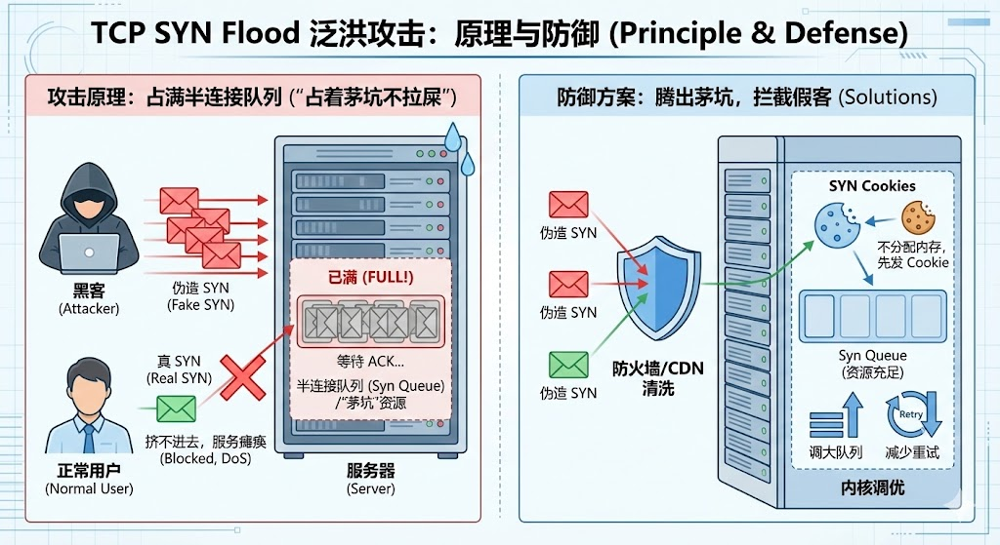

TCP 泛洪攻击，说白了就是“占着茅坑不拉屎”的一种网络攻击。

它是利用 TCP 协议的设计缺陷，伪造大量的“假连接请求”，让服务器把内存和资源都拿去接待这些假请求，导致真正的用户反而挤不进来。

具体的过程和解决思路可以从以下几个维度来拆解：

1. **攻击原理**
- **利用三次握手漏洞：** 正常握手是“SYN -> SYN+ACK -> ACK”。
- **攻击步骤：**
    - 黑客疯狂发送第一次握手的 **SYN** 包（通常配合 **IP** **欺骗**，伪造源 IP，让服务器找不到人）。
    - 服务器收到后，乖乖分配内存（开启半连接队列），回复 **SYN****+****ACK**，然后傻傻地等待第三次握手的 ACK。
    - 因为源 IP 是假的，或者黑客故意不回 ACK，服务器就一直处于 **SYN_RECV** 状态。
- **后果：** 服务器的半连接队列（Syn Queue）瞬间被塞满。正常的请求发过来，服务器一看队列满了，直接丢弃，导致服务瘫痪（DoS）。
1. **解决思路**
- **操作系统****调优：**
    - **调大队列：** 把半连接队列（`tcp_max_syn_backlog`）搞大点。
    - **减少重试：** 服务器等不到 ACK 会重传 SYN+ACK。把重传次数（`tcp_synack_retries`）调小，比如从默认的 5 次改成 1 次，让它死心快一点，赶紧释放资源。
- **SYN Cookies：**
    - 这是防范 SYN Flood 的神技。开启后，服务器收到 SYN **不再分配内存**，而是根据源 IP、端口等信息算出一个 Hash 值（Cookie），放在序列号里发回去。等收到对方的 ACK 时，再检验这个 Hash 值。如果对上了，才真正分配内存建立连接。
- **防火墙清洗：**
    - 直接上硬件防火墙或 CDN 高防。它们会挡在服务器前面，替服务器完成第一次握手，确认是真人才放行给源站。

### 面试标准回答

TCP 泛洪攻击通常指的是 **SYN Flood** 攻击，这是一种典型的 DoS（拒绝服务）攻击。

它的核心原理是利用了 TCP 三次握手的机制缺陷：

攻击者在短时间内伪造大量不存在的源 IP，向服务器发送 SYN 报文。

服务器收到后，会回复 SYN+ACK，并将这些连接加入到**半连接队列（Syn Queue）**中，等待客户端的最终确认（ACK）。

由于源 IP 是伪造的，服务器永远等不到 ACK，但它会维持这些半连接并不断重试。这导致服务器的半连接队列被耗尽，正常的连接请求因为无法进入队列而被丢弃。

**解决和防御方案主要有三层**：

**第一，操作系统内核参数调优**：

- 启用 **SYN Cookies** (`net.ipv4.tcp_syncookies = 1`)。这是最有效的软件防御手段。它允许服务器在收到 SYN 时不立即分配存储空间，而是通过算法将状态编码在 Sequence Number 中返回，等到收到 ACK 验证通过后才真正分配资源。
- 减小 **SYN+ACK 的重传次数** (`tcp_synack_retries`)，加快回收半连接资源。
- 增大 **半连接队列的长度** (`tcp_max_syn_backlog`)。

第二，使用防火墙或高防设备：

在网络入口处部署防火墙，启用源探测功能。防火墙拦截 SYN 包并代理三次握手，只有完成握手的合法连接才会被转发给后端服务器。
