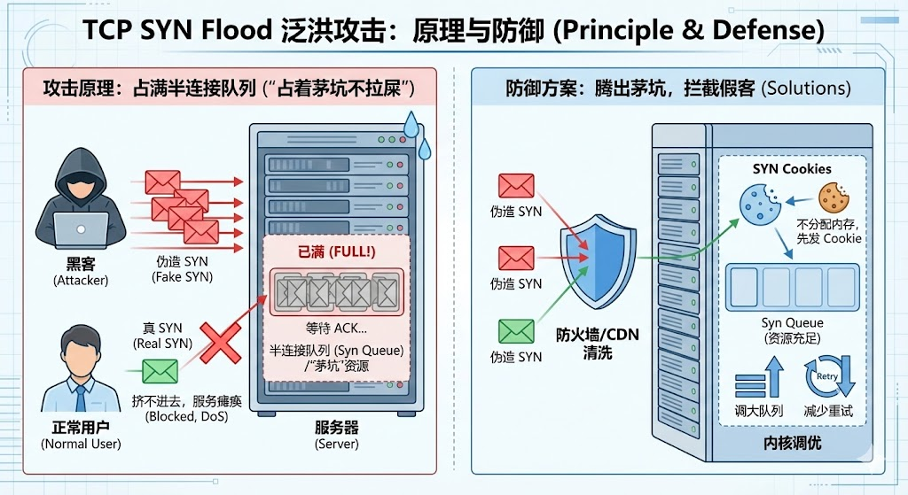

SYN Cookie 说白了就是服务器用来对抗 SYN Flood 攻击的一张“防伪通行证”。

它的核心思想是：**“在我不确定你是好人之前，我绝不给你分配内存，但我会给你发个特殊的号码牌，你如果能拿着这个号码牌回来，我再认你。”**

这个机制打破了传统 TCP 三次握手的资源分配规则，具体的原理逻辑如下：

1. 传统握手的痛点

正常情况下，服务器收到一个 SYN（连接请求），就会立马在内存里建个档案（半连接队列），等着对方回话。

攻击者就是利用这一点，发几万个假 SYN，把服务器的内存（队列）占满，却永远不回话。服务器就像被一堆占座又不吃饭的人挤爆了。

1. SYN Cookie 的方案

启用 SYN Cookie 后，当服务器收到 SYN 包且半连接队列满了时，它不会分配任何内存，也不会建立档案。

- **生成 Cookie：** 服务器根据客户端的 IP、端口、时间戳等信息，用一套加密算法算出一个 Hash 值。
- **藏在序列号里：** 服务器把这个 Hash 值当作 **ISN（初始序列号）**，填在回复给客户端的 SYN+ACK 包里发回去。这个序列号就是所谓的 "Cookie"。
- **结果：** 服务器发完就忘，根本不记得刚才理过谁，内存完全零消耗。
1. 验证归还
- **客户端回信：** 如果客户端是正常的，它收到 SYN+ACK 后，会按照 TCP 规矩，把序列号加 1（Cookie + 1）作为 ACK 发回来。
- **服务器验票：** 服务器收到 ACK，把里面的确认号减去 1，还原出 Cookie。然后用同样的算法算一遍，看看能不能对得上。
- **建连：** 如果对上了，说明刚才确实给这个人发过通行证，这时候服务器才真正分配内存，建立连接。

### 面试标准回答

SYN Cookie 是 Linux 内核为了防御 **SYN Flood 攻击**而引入的一种机制。

它的核心原理是**推迟资源分配**，将三次握手中的服务器状态**‘无状态化’**。具体流程如下：

第一，生成 Cookie：

当服务器的半连接队列（Syn Queue）被填满时，服务器在收到新的 SYN 请求后，不再分配内存空间存储连接状态。而是根据源 IP、端口、目标 IP、端口以及时间戳等信息，计算出一个 Hash 值。

第二，携带 Cookie：

服务器将这个 Hash 值作为 TCP 初始序列号（ISN），放在 SYN+ACK 报文中发给客户端。之后服务器立即释放相关资源，不保存任何状态。

第三，验证 Cookie：

当客户端回复第三次握手的 ACK 报文时，会带上 seq = ISN + 1。服务器收到后，将确认号减 1 还原出 Hash 值，并进行校验。如果校验通过，说明这是一个合法的连接请求，此时服务器才真正分配内存，完成连接建立。
