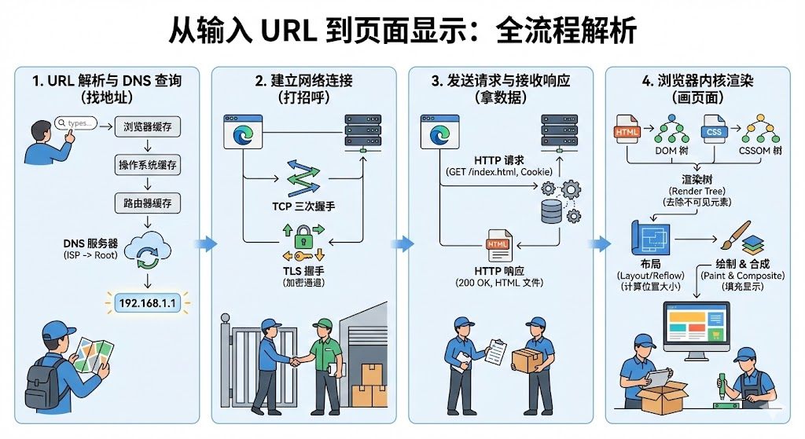

简单来说，这个过程可以概括为：**“找地址 -> 建连接 -> 拿数据 -> 画页面”**。

如果把浏览器比作一个去取快递的人，那流程就是：先查快递点在哪（DNS），跑过去跟老板打招呼（TCP/TLS），填单子拿包裹（HTTP），最后回家拆开包裹把东西摆好（渲染）。

具体的细节是按照以下**四个核心步骤**推进的：

1. **URL 解析与 DNS 查询（找地址）**
- 浏览器先看你输的是啥，是不是合法的 URL。
- 如果是域名（比如 `baidu.com`），机器是不认识的，必须翻译成 IP 地址。
- **查找顺序（层层缓存）：** 浏览器缓存 -> 操作系统缓存（hosts） -> 路由器缓存 -> ISP DNS 服务器 -> 根域名服务器（递归查询）。
- 最终拿到服务器的 IP 地址。
1. **建立网络连接（打招呼）**
- **TCP 三次握手：** 拿到 IP 后，浏览器和服务器通过三次握手建立可靠连接。
- **TLS 握手（如果是 HTTPS）：** 现在基本都是 HTTPS，所以在 TCP 建好后，还得再进行四次 TLS 握手，交换密钥，确保后面的通信加密。
1. **发送请求与接收响应（拿数据）**
- **发请求：** 浏览器构建一个 HTTP 请求报文（GET /index.html），顺便带上 Cookie 等信息，发给服务器。
- **回响应：** 服务器处理请求（查库、读文件），返回一个 HTTP 响应报文。只要状态码是 200，就说明拿到了 HTML 文件。
1. 浏览器内核渲染

这是前端最关注的部分。拿到 HTML 后，浏览器开始干活：

- **解析 HTML** 生成 **DOM 树**。
- **解析 CSS** 生成 **CSSOM 树**（样式规则）。
- **合并** DOM 和 CSSOM，生成 **渲染树（Render Tree）**。注意：`display: none` 的节点不会出现在这里。
- **布局（Layout/Reflow）：** 根据渲染树，计算每个节点在屏幕上的具体位置和大小（回流）。
- **绘制（Paint）：** 把每个节点填充颜色、图片、文字。
- **合成（Composite）：** 如果有图层（比如用了 `z-index` 或 `transform`），最后把各个图层叠在一起，显示在屏幕上。

---

### 面试标准回答

从输入 URL 到页面显示，整个过程可以大致分为**网络通信**和**页面渲染**两个阶段。

**第一阶段：网络通信**

1. **DNS 解析**：浏览器首先检查本地缓存，若没有，则递归查询 DNS 服务器，将域名解析为 IP 地址。
2. **建立连接**：拿到 IP 后，通过 **TCP 三次握手**与服务器建立连接。如果是 HTTPS，还需要进行 **SSL/TLS 握手**以确保加密传输。
3. **发送请求与接收响应**：浏览器发送 HTTP 请求，服务器处理后返回 HTML 文件及状态码（如 200）。

**第二阶段：页面渲染（浏览器内核处理）**

1. **构建树结构**：浏览器解析 HTML 生成 **DOM 树**，解析 CSS 生成 **CSSOM 树**。
2. **生成渲染树**：将 DOM 树和 CSSOM 树合并，生成 **Render Tree**（这一步会去除不可见元素）。
3. **布局（Layout）**：计算渲染树中每个节点在屏幕上的确切位置和大小（也叫回流）。
4. **绘制（Paint）**：将节点的几何信息转换为像素，填充颜色和内容。
5. **合成（Composite）**：将多个图层合并，最终显示在屏幕上。
