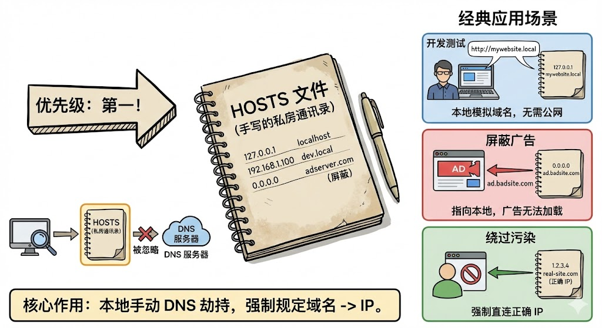

HOSTS 文件，说白了就是你电脑操作系统里一本**“手写的私房通讯录”**。

它的核心作用非常霸道：**强制规定某个域名对应哪个** **IP** **地址**。

不管外面的 DNS 服务器怎么说，你的电脑都会**优先**听 HOSTS 文件的。它相当于在本地做了一个手动的 DNS 劫持。

具体来看，它主要有这么三个关键点：

1. 最高的优先级

当你输入一个网址（比如 www.baidu.com）时，电脑查找 IP 的顺序是：

HOSTS 文件 -> 本地 DNS 缓存 -> DNS 服务器。

也就是说，哪怕 DNS 服务器全是正常的，只要你在 HOSTS 里把百度指向了 127.0.0.1，你就死活上不去百度。

1. 静态映射

它是一个纯文本文件，里面每一行就是一条规则，格式非常简单：IP地址 域名。

比如：127.0.0.1 test.com。这意味着你访问 test.com 时，电脑就不去问 DNS 了，直接去连 127.0.0.1。

1. **经典的应用场景**
- **开发测试（最常用）：** 你在本地写了个网站，还没买域名，但想用域名访问测试一下。就可以在 HOSTS 里加一条 `127.0.0.1 mywebsite.local`，这样浏览器就能假装访问真实域名了。
- **屏蔽广告或恶意网站：** 把广告域名的 IP 指向 `0.0.0.0` 或 `127.0.0.1`（也就是指向你自己），这样广告就加载不出来了。
- **绕过 DNS 污染：** 有时候 DNS 坏了或者被干扰了，你知道正确的 IP，可以直接写进 HOSTS 强制直连。

---

### 面试标准回答

HOSTS 文件是操作系统中用于将主机名（域名）映射到 IP 地址的一个文本文件。

它可以被理解为**本地的 DNS 数据库**，其核心特点和作用主要体现在以下两点：

第一，优先级最高（Override DNS）：

在进行域名解析时，操作系统会优先检查 HOSTS 文件。只有当 HOSTS 文件中没有找到对应的映射关系时，才会去请求 DNS 服务器。这赋予了我们‘覆盖’或‘劫持’特定域名解析结果的能力。

**第二，实际应用场景**：

1. **开发与测试**：这是最常用的场景。在开发阶段（尚未拥有公网域名时），我们可以通过修改 HOSTS，将虚拟域名指向内网开发机或本地（127.0.0.1），模拟线上环境。
2. **屏蔽网站**：将恶意网站或广告联盟的域名映射到本地回环地址（如 127.0.0.1），从而达到屏蔽访问的效果。
3. **快速访问**：对于某些 DNS 解析缓慢或不稳定的服务，可以直接将已知的 IP 写入 HOSTS 以实现直连。
