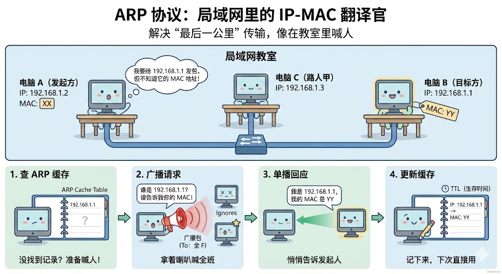

ARP 协议，用一句话通俗解释就是：**“在局域网里，把 IP 地址翻译成 MAC 地址的翻译官”。**

它的核心目的就是解决“最后一公里”的传输问题。因为在数据链路层（网线、交换机这一层），设备是不认识 IP 地址的，它们只认 MAC 地址（物理地址）。只要是在同一个局域网内通信，不管是发给邻居还是发给路由器，最终都得知道对方的 MAC 地址才能发包。

ARP 的工作流程，就像是在教室里“喊人”：

1. 查 ARP 缓存

电脑每次要发包前，先看一眼自己的缓存（ARP Cache Table）。

- 如果里面记着：“192.168.1.1 的 MAC 是 AA:BB:CC...”，那就直接用。
1. 广播找人，发送 ARP Request）

如果本地里没有，电脑就得站起来，拿着大喇叭向全班喊一声：

- **动作：** 发送一个广播包（目标 MAC 是全 F）。
- **内容：** “我是 192.168.1.2（源 IP），我的 MAC 是 XX（源 MAC）。谁是 192.168.1.1？请把你的 MAC 地址告诉我！”
- **范围：** 局域网里的**所有**设备都能听到这一声喊。
1. **单播回应（发送 ARP Reply）**
- **其他人：** 听到后看看 IP 不对，直接无视。
- **目标（192.168.1.1）：** 听到后，发现是在找自己，于是悄悄走过去告诉刚才喊话的人（单播）：
    - **内容：** “嘿，我就是 192.168.1.1，我的 MAC 地址是 YY。”
1. **记录结果（更新缓存）**
- 发起方收到了回复，赶紧把“192.168.1.1 对应 YY”这条记录写进记事本，下次就不用再喊了。

---

### 面试标准回答（建议背诵）

ARP（地址解析协议）的主要目的是**实现从 IP 地址到 MAC 地址的映射**。

在网络层我们使用 IP 地址寻址，但在数据链路层（以太网）传输数据帧时，必须知道接收方的物理地址（MAC 地址）。ARP 就是这两层之间的桥梁。

它的工作流程主要分为四步：

第一，检查本地缓存（ARP Cache）：

主机在发送数据前，先检查本地 ARP 缓存表中是否有目标 IP 对应的 MAC 地址。如果有，直接使用。

第二，广播请求（Broadcasting）：

如果缓存中没有，主机会向局域网内发送一个 ARP Request 报文。该报文的目标 MAC 地址是全 F（ff:ff:ff:ff:ff:ff），这意味着局域网内的所有设备都会收到这个请求。请求的内容是：‘谁是 IP xxx？请告诉我你的 MAC。’

第三，单播响应（Unicasting）：

局域网内的设备收到广播后，会比对目标 IP。非目标设备直接丢弃，只有目标设备会回复一个 ARP Reply 报文。注意，回复是单播的，直接发给发起方，告知自己的 MAC 地址。

第四，更新缓存：

发起方收到回复后，将目标 IP 和 MAC 的映射关系存入本地 ARP 缓存表，并设置 TTL（生存时间），以便后续直接通信。
