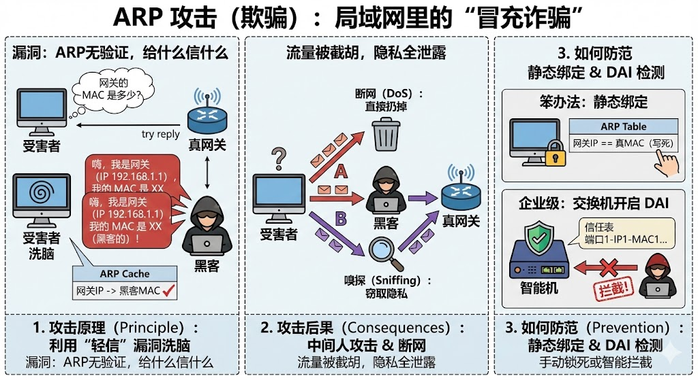

ARP 攻击（也叫 ARP 欺骗），说白了就是**局域网里的“冒充诈骗”**。

它的核心利用了 ARP 协议的一个巨大漏洞：**“轻信”**。ARP 协议是没有验证机制的，任何人只要喊一声“我是 192.168.1.1”，别人的电脑就会无条件相信，并更新自己的记录。

具体可以从原理、后果和防范这三个维度来拆解：

1. **攻击原理**
- **正常情况：** 你要把数据发给网关（路由器），你会先问“网关的 MAC 是多少？”网关回答你，你记下来。
- **攻击情况：** 黑客（也在同一个局域网里）不断地给你发洗脑包（ARP 应答），不管你问没问，他都一直告诉你：“嗨，我是网关（IP 192.168.1.1），我的 MAC 地址是 XX（其实是黑客的 MAC）”。
- **结果：** 你的电脑信以为真，把ARP缓存里的网关 MAC 换成了黑客的 MAC。
1. 攻击后果（中间人攻击 & 断网）

一旦你被骗了，你所有想发到互联网的数据，都会先发到黑客的电脑上。

- **断网（DoS）：** 黑客拿到你的包直接扔掉，你就上不了网了。
- **嗅探（Sniffing）：** 黑客把你的包存下来分析（看你的账号密码），然后再转发给真的网关。你根本感觉不到异常，但你的隐私已经泄露了。这叫**中间人攻击（MITM）**。
1. **如何防范**
- **最笨但最有效的方法：静态绑定（Static ARP）。**
    - 在电脑或服务器上，手动写死网关的 MAC 地址（`arp -s IP MAC`）。不管黑客怎么喊，我只认我本地写死的这条记录。但这个维护起来太累，不适合大规模用。
- **企业级的方法：交换机开启 DAI（动态 ARP 检测）。**
    - 这是最彻底的解决办法。在交换机上开启 **DHCP Snooping** 功能，交换机会记录每个端口插的是哪台电脑（IP 和 MAC 的对应关系）。
    - 如果某个端口突然发来一个 ARP 包，说自己是网关，交换机一查记录表：“不对啊，网关不在这个端口”，直接把包拦截扔掉。

### 面试标准回答

ARP 攻击本质上是**利用了 ARP 协议‘无状态、无验证’的安全漏洞**来实现的局域网欺骗。

关于攻击原理：

ARP 协议规定，只要主机收到 ARP 应答（Reply），无论它之前是否发出过请求，都会强制更新本地的 ARP 缓存表。

攻击者利用这一点，向受害者发送伪造的 ARP 应答报文，将合法的 IP 地址（通常是网关 IP）映射到攻击者自己的 MAC 地址上。

造成的后果：

这会导致受害者的流量全部流向攻击者。攻击者可以拦截流量导致受害者断网（DoS），或者转发流量进行中间人攻击（MITM），从而窃取敏感数据。

**关于防范措施，主要有两种**：

1. **主机侧（小规模）**：采用**静态 ARP 绑定**。在主机和网关上双向绑定 IP 和 MAC 的映射关系，让系统忽略伪造的 ARP 报文。
2. **网络设备侧（企业级/大规模）**：在接入层交换机上开启 **DAI（Dynamic ARP Inspection，动态 ARP 检测）**功能。配合 DHCP Snooping 技术，交换机会建立一张受信任的绑定表，自动丢弃那些 IP/MAC 映射关系不合法的 ARP 数据包。”
