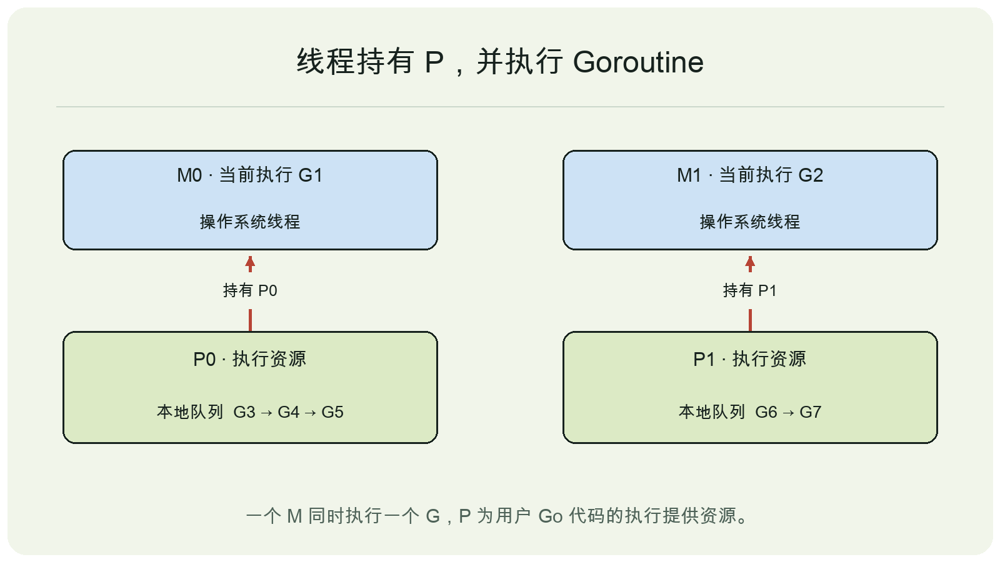
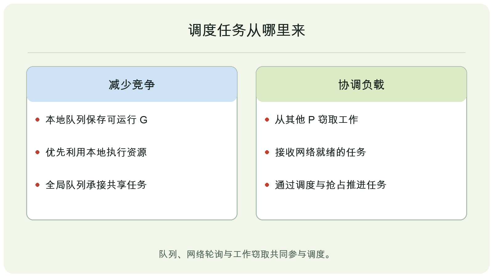
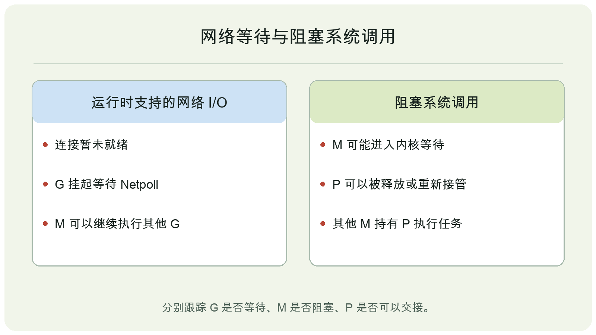

**GMP 是 Go 运行时把大量 Goroutine 调度到操作系统线程上执行的模型。G 表示 Goroutine，M 表示操作系统线程，P 保存执行 Go 代码需要的调度与分配资源。**

理解它，可以先看一个实际场景。服务同时接到一万个请求，每个请求都在等待数据库。如果给每个请求单独创建一个操作系统线程，线程栈和调度会产生较大开销。Go 通过运行时调度，把大量任务复用到一组线程上。

### 一、G、M、P 分别负责什么



- **G 保存任务状态**。包括栈、程序计数器、调度状态等。Goroutine 的栈可以按需要增长，创建成本和初始栈开销通常较低。
- **M 真正执行指令**。M 由操作系统调度，通常需要持有 P 才能执行用户 Go 代码。
- **P 保存执行资源**。包括本地可运行队列等。`GOMAXPROCS` 决定 P 的数量，从而限制同一时刻执行用户 Go 代码的并行度。

一万个 G 可以处于运行、等待网络、等待锁等不同状态。P 的数量与 G 的总数之间没有固定比例。运行时也可能为了系统调用等工作保留更多 M。

### 二、Goroutine 如何拿到执行机会

运行时会综合使用当前 P 的本地队列、全局队列、网络就绪任务，以及其他 P 上可窃取的工作。这样既能减少所有线程争抢一个全局队列的竞争，也能在部分 P 比较忙时进行负载均衡。



**调度器同时需要吞吐量与公平性。** 因此，面试中描述各个任务来源即可，具体检查顺序和检查周期需要结合对应版本源码。

### 三、任务阻塞时，线程会怎样



网络连接采用运行时支持的非阻塞 I/O 时，G 可以挂起等待 Netpoll 通知，M 能继续执行其他 G。发生阻塞系统调用时，M 可能进入内核等待，P 可以被释放或由运行时重新接管，交给其他 M。

这两种等待路径要分别理解。CPU 密集的长循环则主要涉及抢占。现代 Go 包含异步抢占机制，但调度并不提供精确的实时响应期限。

```go
package main

import (
    "fmt"
    "runtime"
    "sync"
)

func main() {
    previous := runtime.GOMAXPROCS(1)
    defer runtime.GOMAXPROCS(previous)

    values := make([]int, 3)
    var wg sync.WaitGroup
    for i := range values {
        wg.Add(1)
        go func(index int) {
            defer wg.Done()
            values[index] = index + 1
        }(i)
    }
    wg.Wait()
    fmt.Println(values)
}
```

输出为 `[1 2 3]`。设置一个 P 后，多个 G 仍可以交替推进。这里每个 G 写不同的切片元素，主协程在 `Wait` 返回后读取结果。

### 四、面试追问

**为什么协程切换通常较轻量？** 运行时可以在用户态切换 G，保存和恢复相应执行状态。实际成本仍取决于栈、缓存、系统调用等因素。

**Goroutine 可以无限创建吗？** 每个 G 都需要栈和运行时元数据，还可能持有请求、连接和缓冲区。生产服务通常需要限制并发和队列长度。

**容器中的 GOMAXPROCS 怎样确定？** Go 1.25 起，Linux 下的默认计算会考虑 cgroup CPU 带宽限制，并支持随资源变化更新。显式设置和兼容性开关会影响该行为。

---

### 面试标准回答

Go 使用 GMP 模型调度 Goroutine。G 保存任务执行状态，M 是操作系统线程，P 保存运行 Go 代码需要的资源。M 持有 P 后执行 G，GOMAXPROCS 控制 P 的数量。

运行时通过本地队列、全局队列、工作窃取和网络轮询分配任务。网络等待通常可以挂起 G，让线程执行其他任务。阻塞系统调用可能占住 M，此时 P 可以被重新调度。抢占机制帮助长时间运行的 G 让出执行机会。整体上，这套设计降低了大量并发任务的管理成本。

示例代码已在 Go 1.27.4 下运行并通过竞态检测，涉及的语言版本差异已在正文说明。

### 参考资料

- [Go 1.27.4 源码 · proc.go](https://github.com/golang/go/blob/go1.27.4/src/runtime/proc.go)
- [Go 1.25 发布说明](https://go.dev/doc/go1.25#container-aware-gomaxprocs)
