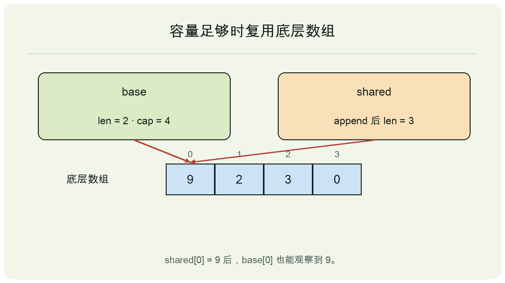
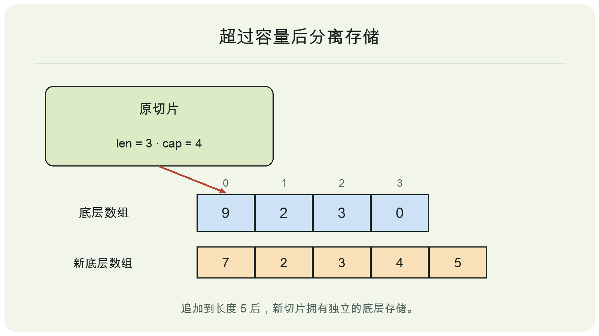
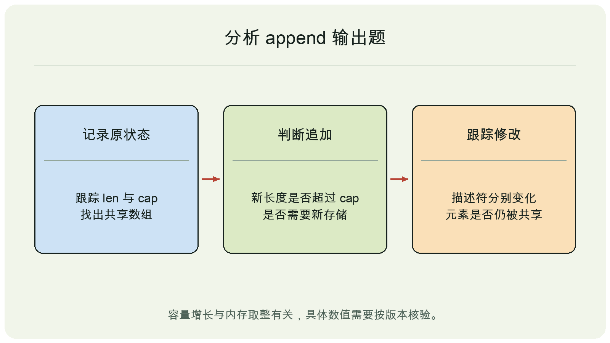

**append 返回追加后的新切片描述符。容量足够时，通常复用原来的底层数组。容量不足时，需要新的底层存储，并复制已有元素。调用方应接住 append 的返回值。**

做切片输出题，可以依次判断原始 len、原始 cap、追加后是否超过 cap，以及哪些切片仍共享原数组。

### 一、容量足够时发生什么

<p style="text-align:center"></p>

假设 s 的 len 为 2、cap 为 4。执行 `t := append(s, 3)`，t 的 len 变为 3，s 的 len 仍为 2。s 和 t 可以继续指向同一个底层数组。

此时修改 t 的已有元素，可能通过 s 观察到变化。s 也可以在容量允许的范围内重新切片，看到新增元素。

### 二、容量不足时发生什么

<p style="text-align:center"></p>

原存储容纳不下新长度时，append 会获得足够大的新存储，复制旧元素，再写入追加值。旧切片继续引用原来的存储，返回的新切片引用新的存储。

```go
package main

import "fmt"

func main() {
	base := make([]int, 2, 4)
	base[0], base[1] = 1, 2

	shared := append(base, 3)
	shared[0] = 9
	fmt.Println(base, shared, base[:3])

	detached := append(shared, 4, 5)
	detached[0] = 7
	fmt.Println(base, shared, detached)
}
```

第一行输出 `[9 2] [9 2 3] [9 2 3]`。第二行输出 `[9 2] [9 2 3] [7 2 3 4 5]`。第二次追加后的长度为 5，超过原容量 4，发生底层存储分离。

### 三、扩容倍数是固定的吗

<p style="text-align:center"></p>

Go 1.27 的容量计算中，小容量阶段通常采用较快增长，较大容量使用平滑增长公式。当新长度远大于旧容量时，会直接按需求增长。实际分配还受到元素大小和内存分配取整影响。

因此，“每次必然翻倍”或“超过某个元素数后必然等于 1.25 倍”都不足以描述所有情况。**语言保证新切片能够容纳追加后的元素，具体容量策略属于版本实现。**

已知最终长度时，可以提前 `make([]T, 0, n)`，减少增长过程中的分配和复制，但也要避免过度预分配。

### 四、函数内 append 为什么容易误判

函数收到切片描述符的副本。append 后，局部副本可能有新的 len、cap 和数据位置。即使复用了数组，调用方原切片的 len 也不会自动改变。

通常让函数返回追加后的切片，再由调用者赋回。代码需要保证追加前后的数据所有权，尤其要关注多个切片共享容量时的覆盖问题。

另外，对一个切片执行两次 append，若都在同一底层数组的同一位置开始追加，第二次追加可能覆盖第一次追加的数据。判断依据是实际共享的存储位置。

---

### 面试标准回答

append 返回新的切片描述符。容量足够时复用底层数组，容量不足时重新获得存储并复制已有元素。原切片的长度不会因为另一个描述符执行 append 而自动变化。

分析代码时，要分别跟踪各切片的长度、容量和底层数组。容量增长策略由运行时版本和分配取整共同决定。业务上可以按已知规模预分配，并通过返回新切片让调用者接住追加结果。

示例代码已在 Go 1.27.4 下运行并通过竞态检测，涉及的语言版本差异已在正文说明。

### 参考资料

- [Go 语言规范](https://go.dev/ref/spec#Appending_and_copying_slices)
- [Go 1.27.4 源码 · slice.go](https://github.com/golang/go/blob/go1.27.4/src/runtime/slice.go)
