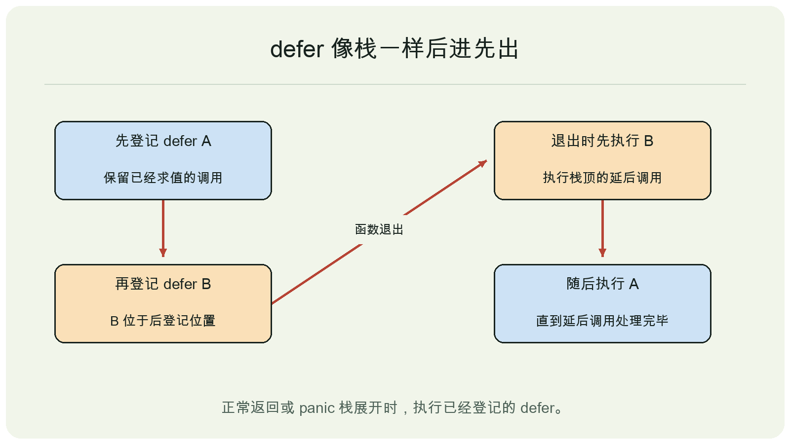
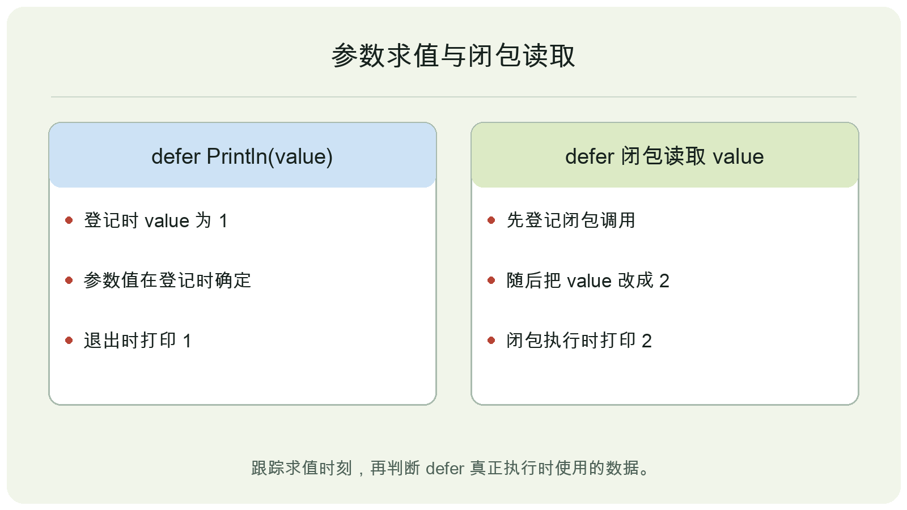
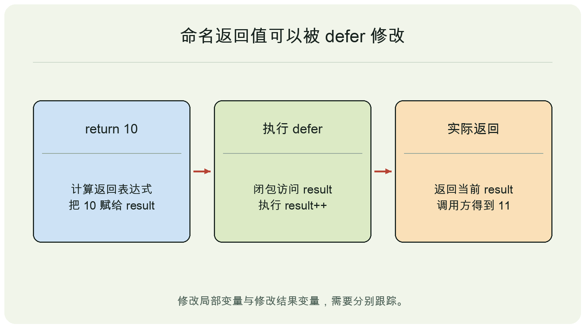

**defer 把一次函数调用登记为延后执行。登记时会求值函数与实参，同一个函数中的多个 defer 按后进先出执行。它可以在返回值已经赋值后、函数真正返回前运行。**

常见用途是解锁、关闭资源和记录耗时。判断输出题时，把“登记调用”和“真正执行”分开，就容易理清顺序。

### 一、多个 defer 怎样排序

<p style="text-align:center"></p>

函数正常返回或因为 panic 展开调用栈时，会执行已经登记的 defer。先登记的后执行，后登记的先执行。

如果调用 `os.Exit`，进程直接结束，defer 没有执行机会。程序遭遇某些无法恢复的运行时致命错误时，也不能依赖 defer 完成全部清理。

### 二、参数什么时候求值

```go
package main

import "fmt"

func changeNamed() (result int) {
	defer func() { result++ }()
	return 10
}

func changeUnnamed() int {
	value := 10
	defer func() { value++ }()
	return value
}

func main() {
	fmt.Println(changeNamed(), changeUnnamed())
	value := 1
	defer fmt.Println("argument", value)
	defer func() { fmt.Println("closure", value) }()
	value = 2
}
```

输出依次是 `11 10`、`closure 2`、`argument 1`。直接把 value 作为参数传给 Println 时，登记 defer 的时刻就已经取到 1。闭包执行时再读取捕获变量，则观察到后来的 2。

<p style="text-align:center"></p>

类似地，`defer time.Since(start)` 会过早求值。记录总耗时可以放进一个延后执行的闭包，在闭包里调用 time.Since。

### 三、为什么命名返回值会被修改

<p style="text-align:center"></p>

可以把 return 的过程理解为三步。先计算返回表达式，再给结果变量赋值，随后执行 defer，最后把结果交给调用者。

命名结果变量在函数体内可见，defer 闭包可以直接修改它。因此示例中 result 先被赋值为 10，再增加到 11。未命名结果的示例，返回结果已经从局部 value 复制完成，defer 修改局部变量后得到的数值没有重新写入返回结果。

如果返回值包含指针，defer 也可能修改这个指针指向的对象。分析时仍要分别跟踪结果变量和被引用对象。

### 四、在循环中使用 defer 要注意什么

循环里登记的 defer，通常要等当前函数结束才执行。一个函数里连续打开很多文件，会让文件描述符保持占用。可以把单次处理封装到独立函数中，让资源在每次处理结束后释放。

对于锁，通常在成功 Lock 后立即 defer Unlock，保证后续路径能够释放锁。对于打开资源的函数，应先检查错误，再登记对有效资源的关闭操作。

---

### 面试标准回答

defer 在当前函数退出前执行，多个 defer 按后进先出排序。调用的函数和实参在登记时求值，闭包对外部变量的读取则与它实际执行时的状态有关。

return 会先求值并给返回结果赋值，再执行 defer。命名结果变量可以被 defer 修改。使用时还要注意循环里的 defer 会积累到函数结束，以及 os.Exit 等退出路径不会执行 defer。

示例代码已在 Go 1.27.4 下运行并通过竞态检测，涉及的语言版本差异已在正文说明。

### 参考资料

- [Go 语言规范](https://go.dev/ref/spec#Defer_statements)
- [Go 官方博客 · defer、panic 与 recover](https://go.dev/blog/defer-panic-and-recover)
- [Go 包文档 · os#Exit](https://pkg.go.dev/os#Exit)
