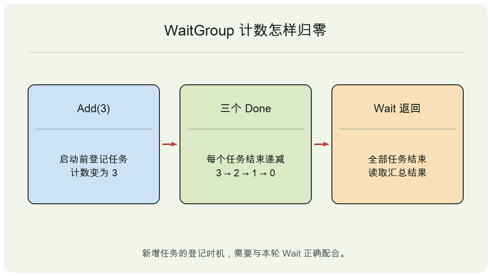
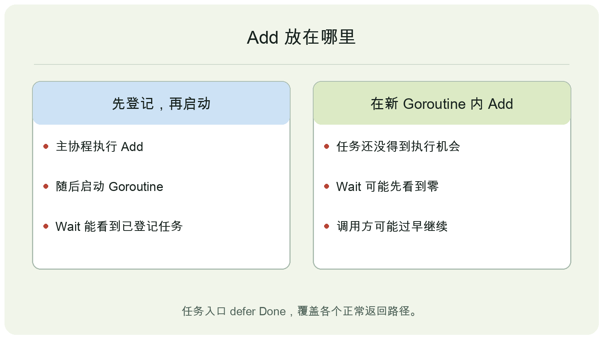
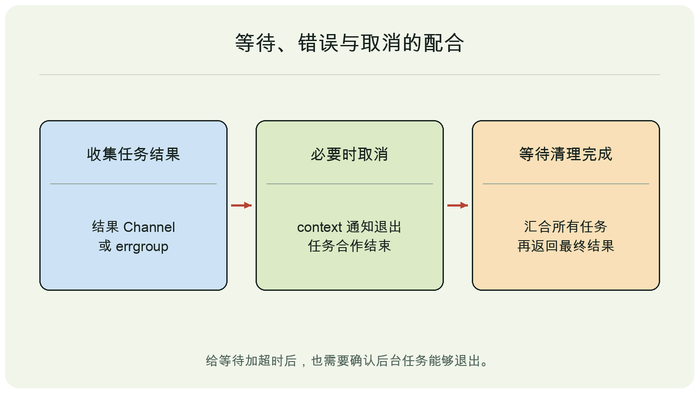

**WaitGroup 用计数器表示尚未完成的任务。Add 登记任务数量，Done 表示一个任务完成，Wait 等待计数归零。它负责汇合任务，错误与取消需要另外传递。**

并发查询多个数据源时，调用者通常需要等全部查询完成再处理结果。WaitGroup 就是实现这一汇合点的常用工具。

### 一、任务计数怎样变化

<p style="text-align:center"></p>

先把待完成任务数加到计数器里，再启动任务。每个任务结束时减一。最后一个任务调用 Done，使等待条件满足，Wait 才能返回。

如果计数器已经是零，新增任务的正数 Add 必须发生在相应 Wait 开始之前。把 Add 放进新 Goroutine，可能出现 Wait 提前看到零并返回的情况。

```go
package main

import (
	"fmt"
	"sync"
)

func main() {
	values := make([]int, 3)
	var wg sync.WaitGroup
	for index := range values {
		wg.Add(1)
		go func(i int) {
			defer wg.Done()
			values[i] = (i + 1) * 10
		}(index)
	}
	wg.Wait()
	fmt.Println(values)
}
```

输出 `[10 20 30]`。不同任务写不同元素，Wait 返回后，主协程读取这些结果。Done 与其解除阻塞的 Wait 返回之间具有文档规定的同步关系。

### 二、为什么 Done 通常配合 defer

<p style="text-align:center"></p>

任务可能有多个正常返回路径。入口登记 `defer wg.Done()`，可以让这些路径统一完成计数。漏掉 Done 会造成等待无法结束，额外调用 Done 让计数变成负数会 panic。

WaitGroup 使用后需要避免复制。要复用同一个 WaitGroup 处理下一批任务，应在前一批相关 Wait 已经返回后再登记新一批任务。

### 三、Go 1.25 的 WaitGroup.Go

Go 1.25 起可以写 `wg.Go(func() { /* 任务 */ })`，由 API 完成计数登记和任务启动。这个 API 的函数参数必须遵守文档中的“不发生 panic”的约定，适合正常的任务汇合。

需要兼容更早版本时，可以使用 Add、go、defer Done 的写法。项目应明确最低语言与工具链版本。

### 四、如何同时处理超时与错误

<p style="text-align:center"></p>

WaitGroup 自身没有返回 error 或直接取消等待的接口。可以用结果 Channel 收集错误，用 context 通知任务退出，再通过 WaitGroup 确认所有任务确实结束。

`errgroup` 可以组合等待、错误和派生 context，适合存在失败传播的任务组。即使发出取消信号，具体任务仍需要合作退出。只给 Wait 外面包一层超时，而任务永远不停止，会把后台资源留住。

---

### 面试标准回答

WaitGroup 通过计数器汇合并发任务，Add 登记，Done 递减，Wait 等待归零。应在启动任务前登记，并在任务入口 defer Done，避免提前返回或漏减计数。

WaitGroup 使用后不能复制，复用时要等前一批等待完成。Go 1.25 增加了 WaitGroup.Go。涉及错误和超时时，需要配合结果 Channel、context 或 errgroup，同时确认任务已经完成退出。

示例代码已在 Go 1.27.4 下运行并通过竞态检测，涉及的语言版本差异已在正文说明。

### 参考资料

- [Go 包文档 · sync#WaitGroup](https://pkg.go.dev/sync#WaitGroup)
- [Go 1.27.4 源码 · waitgroup.go](https://github.com/golang/go/blob/go1.27.4/src/sync/waitgroup.go)
- [Go 包文档 · golang.org/x/sync/errgroup](https://pkg.go.dev/golang.org/x/sync/errgroup)
