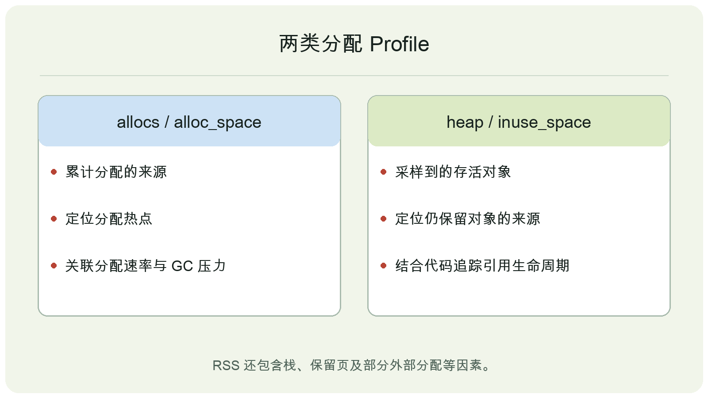
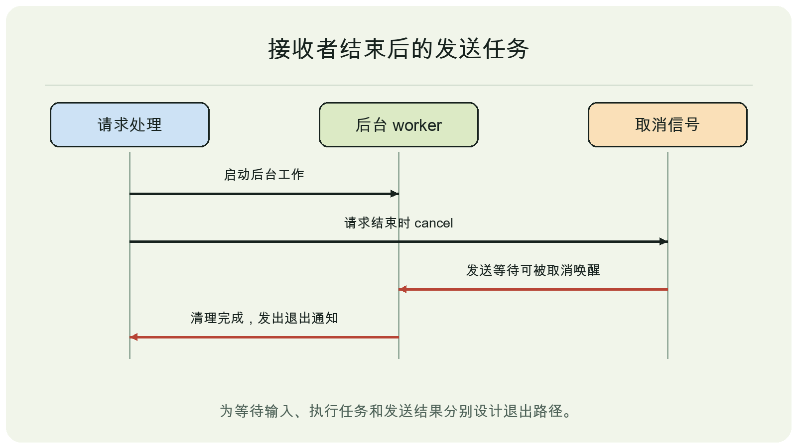
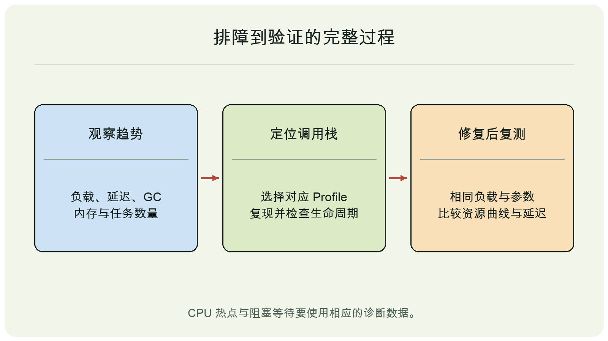

**先看异常随时间怎样变化，再用对应 Profile 定位调用栈。CPU、累计分配、存活堆和 Goroutine 堆栈分别回答不同的问题，需要结合流量、延迟、GC 和资源指标一起分析。**

例如流量已经下降，Goroutine 数量还持续增长，可以先寻找无法退出的任务。如果内存随着缓存规模增长，应进一步确认这些对象是否符合业务保留预期。

### 一、不同 Profile 分别看什么

<p style="text-align:center"></p>

| 现象 | 优先观察 | 主要问题 |
|---|---|---|
| CPU 持续升高 | CPU Profile | 时间主要花在哪些执行路径 |
| 分配量大、GC 频繁 | allocs、alloc_space | 哪些代码累计分配很多 |
| 内存长期偏高 | heap、inuse_space | 哪些分配来源的对象仍存活 |
| Goroutine 增长 | goroutine Profile | 任务在哪些位置等待或运行 |
| 锁等待严重 | mutex、block Profile | 哪些临界区或同步操作在竞争 |

heap Profile 主要反映采样到的分配来源，具体保留它的引用链通常还需要阅读代码并构造实验。RSS 还可能包含栈、运行时保留页和外部分配等部分。

### 二、Goroutine 为什么会泄漏

<p style="text-align:center"></p>

典型场景是请求已经结束，后台任务仍阻塞在发送结果、等待输入或等待锁。Goroutine 的结束需要执行到 return 或发生相应终止，GC 不会替业务决定一个仍有可能被唤醒的任务应该退出。

```go
package main

import (
	"context"
	"fmt"
)

func main() {
	ctx, cancel := context.WithCancel(context.Background())
	results := make(chan int)
	exited := make(chan struct{})

	go func() {
		defer close(exited)
		select {
		case results <- 42:
		case <-ctx.Done():
		}
	}()

	cancel()
	<-exited
	fmt.Println("worker exited")
}
```

即使没有接收 results，任务也能通过取消分支退出，输出 `worker exited`。实际程序的生产、处理和发送阶段，都要检查是否有明确退出路径。

### 三、怎样采集与比较

服务可以通过 `net/http/pprof` 暴露诊断端点，通常绑定本机地址，再按实际环境提供访问方式。采集前后两个 heap Profile，有助于观察同一负载下增长的分配来源。

```bash
go tool pprof -http=127.0.0.1:0 cpu.pprof
go tool pprof -sample_index=inuse_space heap.pprof
go tool pprof -base=before.pprof after.pprof
```

mutex 和 block 等 Profile 需要相应采样配置。采集时记录业务请求量、时间窗口和运行参数，才能解释两次结果之间的差异。

<p style="text-align:center"></p>

### 四、CPU 高或死锁怎样继续定位

CPU 高先看热点是否集中在业务计算、序列化、GC 或空轮询。循环 select 带空 default，是常见的忙轮询入口之一。

死锁关注等待环，例如任务 A 持锁等待 B，B 又需要同一把锁。CPU Profile 可能看不到处于阻塞中的等待者，需要结合 Goroutine 堆栈和 block、mutex 数据。

Go 1.27 提供正式的 `goroutineleak` Profile，可以检测一类永远无法唤醒的等待任务。它的检测有适用边界，仍要结合普通 Goroutine Profile 与任务生命周期排查。

---

### 面试标准回答

我会先确认异常趋势与业务负载，再选择对应 Profile。CPU Profile 看执行热点，allocs 看分配来源，heap 看存活对象的分配位置，goroutine Profile 看等待堆栈，锁竞争再结合 mutex 和 block。

定位后检查数据和任务的生命周期，补齐取消、关闭、释放与等待退出机制，再通过相同负载复测资源曲线和延迟。Go 1.27 的 goroutineleak Profile 可以辅助识别部分无法唤醒的任务。

示例代码已在 Go 1.27.4 下运行并通过竞态检测，涉及的语言版本差异已在正文说明。

### 参考资料

- [Go 包文档 · runtime/pprof](https://pkg.go.dev/runtime/pprof)
- [Go 包文档 · net/http/pprof](https://pkg.go.dev/net/http/pprof)
- [Go 1.27 发布说明](https://go.dev/doc/go1.27#runtime)
