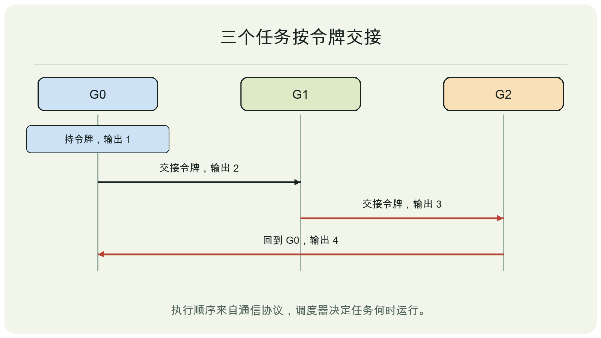
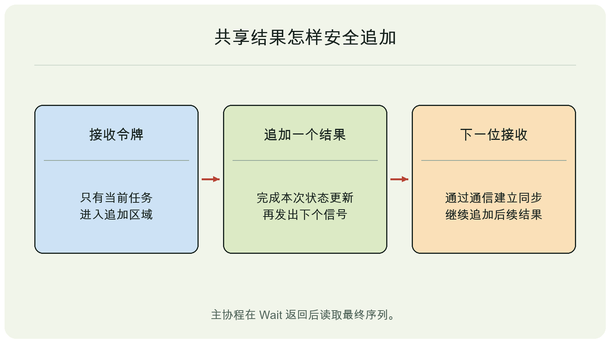
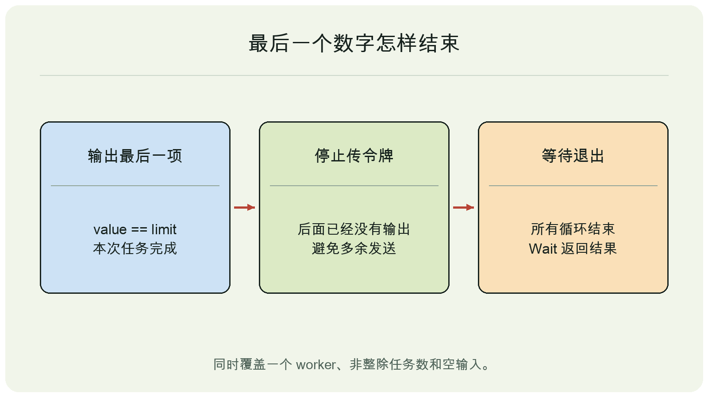

**让多个 Goroutine 按顺序执行，需要显式传递“轮到谁”的信号。可以为每个任务准备一个 Channel，当前任务完成后，把令牌交给下一位。**

这道题重点在同步协议。仅仅依次创建 Goroutine，无法决定它们实际得到执行机会的顺序。

### 一、把问题改写为令牌交接

<p style="text-align:center"></p>

以三个任务打印 1 到 10 为例。第一个任务处理 1、4、7、10，第二个处理 2、5、8，第三个处理 3、6、9。它们先等待自己的信号，拿到后执行，再通知下一个任务。

先给第一个任务一个令牌，就能启动整条执行链。业务执行顺序由通信确定，调度器可以自由选择任务何时获得 CPU。

### 二、完整代码

```go
package main

import (
	"fmt"
	"sync"
)

func ordered(limit, workers int) []int {
	if limit <= 0 || workers <= 0 {
		return nil
	}
	if workers > limit {
		workers = limit
	}

	turns := make([]chan struct{}, workers)
	for i := range turns {
		turns[i] = make(chan struct{}, 1)
	}

	values := make([]int, 0, limit)
	var wg sync.WaitGroup
	wg.Add(workers)
	for worker := 0; worker < workers; worker++ {
		go func(id int) {
			defer wg.Done()
			for value := id + 1; value <= limit; value += workers {
				<-turns[id]
				values = append(values, value)
				if value < limit {
					turns[(id+1)%workers] <- struct{}{}
				}
			}
		}(worker)
	}

	turns[0] <- struct{}{}
	wg.Wait()
	return values
}

func main() {
	fmt.Println(ordered(10, 3))
	fmt.Println(ordered(3, 1))
}
```

输出分别为 `[1 2 3 4 5 6 7 8 9 10]` 和 `[1 2 3]`。示例先把结果收集起来，方便直接验证顺序。也可以把追加结果的位置改为打印操作。

### 三、为什么共享切片没有并发写

<p style="text-align:center"></p>

任一时刻只有拿到令牌的任务能够追加结果。当前追加完成后才发送令牌，下一次接收建立同步关系，形成串行交接。主协程在 Wait 后读取结果。

容量为 1 的 Channel 还让“只有一个 worker”的情况可以正常运行。当前任务能先放下自己的下一轮令牌，再进入下一次接收，避免同一个 G 向自己的无缓冲 Channel 发送时卡住。

### 四、结束条件为什么很重要

<p style="text-align:center"></p>

最后一个数字完成后，后面已经没有接收者需要执行，因此代码只在 `value < limit` 时继续传递令牌。否则末尾的一次发送可能永远等不到对应接收。

这里每个任务的循环次数已经确定，WaitGroup 负责确认任务结束，所以 Channel 可以随着函数返回被回收。需要 range 接收的方案，则要另外设计关闭协议。

### 五、怎样扩展成 ABC 或一百个任务

循环打印 ABC 时，可以把令牌接收后的操作改成对应字符输出，并规定总轮数。每个数字一个 G 时，可以把 workers 设置为 limit。生产系统则通常选择有界任务数量，控制管理成本。

这份实现展示有限任务的顺序协议。如果需要中途取消，应在收发令牌的位置加入同一条 context 退出路径，并等待全部任务结束。

---

### 面试标准回答

我会用 Channel 传递执行令牌，为每个 Goroutine 分配自己的输入信号。任务拿到令牌后完成当前输出，再把令牌传给下一位，从而建立明确的执行顺序。

最后一次输出后停止发送，并用 WaitGroup 等待所有任务退出。实现时要覆盖单任务、任务数超过输出数、输出数不能整除任务数等边界，避免最后一次发送形成死锁。

示例代码已在 Go 1.27.4 下运行并通过竞态检测，涉及的语言版本差异已在正文说明。

### 参考资料

- [Go 内存模型](https://go.dev/ref/mem#Channel_communication)
- [Go 包文档 · sync#WaitGroup](https://pkg.go.dev/sync#WaitGroup)
- [小红书 · 滴滴面经](https://www.xiaohongshu.com/explore/6878ac580000000010026c75)
