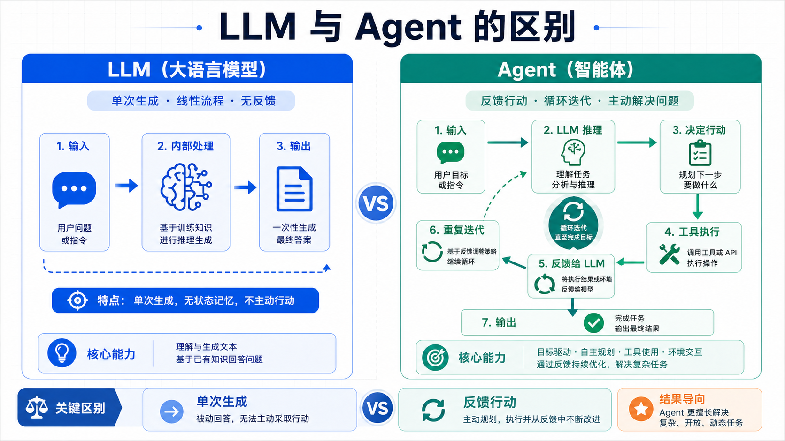

## 知识点讲解



### 1. 核心概念

这道题看起来简单，但面试官真正想听的是你对这两层架构关系的理解，不只是"一个能用工具一个不能"这种表面答案。

最精准的定位是这样：**LLM 是 Agent 的大脑，但大脑本身不等于人**。LLM 只管生成下一段文本；Agent 是围绕 LLM 搭起来的整套系统——有记忆、有工具、有执行循环、有状态管理。

| 维度 | LLM | Agent |
| --- | --- | --- |
| 执行模式 | 一次调用，一次输出 | 多步循环，动态决策 |
| 状态 | 无状态 | 有状态，维护执行上下文 |
| 工具调用 | 无（或只做 one-shot function calling） | 是核心能力 |
| 实时数据 | 受训练截止日期限制 | 可通过工具获取 |
| 失败处理 | 没有重试机制 | 可重试、可换策略、可 replan |
| 适合场景 | 文本生成、翻译、QA | 多步任务自动化、复杂问题求解 |

### 2. 技术细节

#### 2.1 LLM 的本质

LLM 做的事情只有一件：给定一段 token 序列，预测下一个最可能的 token。这件事它做得极好，但也仅此而已。

- 无状态：每次调用从零开始，对话历史要靠调用方塞进 prompt
- 无规划：不会主动拆分目标，看到什么 prompt 就生成什么输出
- 无行动：没有工具调用能力（function calling 是框架加的，不是 LLM 本身的行为）
- 单步：给完输出就结束，不会回头检查自己对不对

#### 2.2 Agent 在 LLM 之上加了什么

```latex
LLM 调用（推理引擎）
    ↓
工具路由层（决定调哪个工具）
    ↓
工具执行（搜索/数据库/代码执行/...）
    ↓
观察结果注入（observation 回到上下文）
    ↓
记忆更新（短期上下文 + 长期向量存储）
    ↓
下一步决策（继续 or 完成 or 求助人工）
```

这套循环控制逻辑，是 LLM 本身完全没有的。Agent 框架（LangChain、LangGraph 等）干的就是搭这层骨架。

#### 2.3 一个直观的例子

同样问「北京今天 PM2.5 是多少」：

- **纯 LLM**：会编一个看起来合理但可能完全错误的数字，因为它的训练数据里有北京的空气质量统计，但不知道「今天」是哪天
- **Agent**：调一次空气质量 API → 拿到实时数据 → 返回真实结果

数据新鲜度只是其中一个维度，更关键的是 Agent 知道「我不知道，我得去查」，LLM 不知道自己不知道。

### 3. 对比与拓展

#### 3.1 什么时候用 LLM 就够了

任务简单、单步可以完成、不需要实时数据的情况下，直接调 LLM 是最优解——省成本、省延迟、省复杂度。Agent 是有代价的：多次 LLM 调用 + 工具调用，总成本可能是单次 LLM 的 5-10 倍，延迟也从秒级变成十几秒甚至分钟级。

#### 3.2 混合用法

其实很常见的做法是混合：主流程用 Agent 处理复杂决策，某些节点内部只是简单 LLM 调用（比如格式化输出、做文本摘要），不需要每个子步骤都跑完整 Agent 循环。

## 面试怎么答

LLM 是 Agent 的推理核心，但两者是完全不同的系统层级。LLM 本质是无状态的文本预测器——给输入、出输出、结束，没有记忆、没有工具、没有执行循环。

Agent 是建在 LLM 上面的系统：LLM 负责推理和决策，Agent 框架负责工具调用、状态维护、执行控制、失败处理这些 LLM 本身做不了的事情。可以类比成：LLM 是大脑，Agent 是有手有脚有记忆的完整人。

选哪个要看任务本身。简单的单步任务——改写文本、翻译、摘要——用 LLM 直接调更快更省；多步的、需要实时数据的、中间依赖工具的任务才值得上 Agent。Agent 的成本和延迟比裸 LLM 高不少，不要为了"显得高级"强行上 Agent。

## 高频追问 & 加分点

- **Q1：function calling 算 Agent 吗？**  
    单次 function calling 不算——那只是"带工具的 LLM 调用"。Agent 必须有多步循环、状态维护和动态决策，缺任何一个都只是"增强版 LLM"。
- **Q2：Agent 一定比 LLM 准确吗？**  
    不一定。Agent 在需要实时数据、多步推理的场景下准确性更高；但如果任务本身 LLM 就能答对，加一圈 Agent 只会引入更多出错点（工具调用失败、上下文组装错误等）。
- **Q3：LLM 的幻觉问题 Agent 能解决吗？**  
    能缓解，不能根除。Agent 通过工具调用把"需要查"的部分交给真实数据源，减少 LLM 瞎编的机会；但规划逻辑、工具选择等环节还是靠 LLM 推理，那里还是可能出错。
- **Q4：Agent 架构的主要成本在哪里？**  
    两块：①LLM 调用次数（多步 Agent 每步都调一次，加上规划、反思，总调用次数可能是 5-20 次）；②工具调用的外部成本（API 费用、数据库查询时间）。所以 Agent 设计要有意识地控制 token 和调用次数。
- **Q5：生产里怎么监控 LLM 和 Agent 的质量差异？**  
    LLM 的评估相对简单（固定测试集、BLEU/ROUGE 等指标）；Agent 的评估复杂很多——需要评估最终任务完成率、中间步骤合理性、工具调用的准确率、平均步数效率。我自己习惯在 Agent 里加详细的 trace log，每步的 thought/action/observation 都存下来，方便离线分析失败案例。
