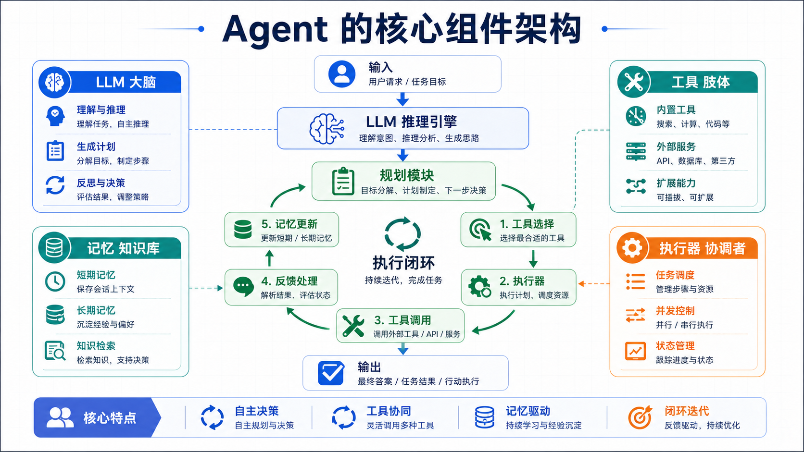

## 知识点讲解



### 1. 核心概念

Agent 的组件这道题是基础中的基础，但很多人只能答出"LLM + 工具 + 记忆"三件套，漏掉规划和反馈控制，或者说不清各组件怎么协作。

完整的 Agent 有五个核心组件：

| 组件 | 职责 |
| --- | --- |
| 推理引擎（LLM） | 理解目标、制定计划、选择行动、反思结果 |
| 工具集（Tools） | 扩展 Agent 的实际执行能力 |
| 记忆系统（Memory） | 维护短期上下文和长期经验 |
| 规划模块（Planner） | 把复杂目标拆解成可执行的子步骤 |
| 执行控制（Executor） | 调度工具调用、处理反馈、判断是否完成 |

五个缺一不可，少一个就只能叫"带工具的 LLM"或者"固定 workflow"，算不上完整的 Agent。

### 2. 技术细节

#### 2.1 推理引擎

LLM 是整个 Agent 的大脑。它做的事情：看 prompt（目标 + 历史 + 工具列表）→ 决定下一步做什么 → 输出 action 或者最终答案。

推理质量直接决定 Agent 的上限。同样的架构，GPT-4 和一个弱模型跑出来的效果可以差好几个数量级。这也是为什么 Planner 和 Executor 有时候会用不同的模型——Planner 用强模型出大方向，Executor 用弱模型省成本。

#### 2.2 工具集

工具让 Agent 真正能"做事"而不只是"说事"。工具的几个设计要点：

- **描述要精准**：LLM 靠描述来选工具，描述模糊就选错
- **数量要控制**：超过 20 个工具时，LLM 的选择准确率会明显下降；大量工具建议分组或层级管理
- **输出要可解析**：工具返回值要结构化，方便 LLM 读懂 observation

常见工具分类：搜索类（网络搜索、数据库查询）、计算类（计算器、代码执行）、操作类（文件读写、API 调用、消息发送）。

#### 2.3 记忆系统

记忆是 Agent 的"状态持久化"，分三层：

- **短期记忆**：就是当前 context window，存放本次对话或任务的上下文，有容量限制（一般 8K-128K tokens）
- **工作记忆**：任务执行过程中的中间状态，工具调用的参数和返回值，步骤间传递数据
- **长期记忆**：向量数据库存的历史经验、知识文档，用语义检索按需拉取

没有记忆，Agent 每步都是从零开始，上下文丢失，任务很难连贯执行。

#### 2.4 规划模块

规划负责把"用户目标"翻译成"可执行步骤序列"。好的规划要做到：

- 步骤粒度合适：太细了依赖爆炸，太粗了子步骤里还得再规划
- 依赖关系清晰：是线性执行还是可以并行，需要一个 DAG 而不只是 list
- 支持 replan：计划中途失效时能局部调整，不必全部推翻重来

#### 2.5 执行控制

执行控制是让整个循环转起来的"调度器"：

```latex
目标输入 → 规划 → 循环{
    LLM 决策 → 选工具 → 执行工具 → 获得 observation → 更新记忆
    判断：是否完成？继续 or 停止
} → 输出结果
```

执行控制还负责失败处理（重试/跳过/replan）和终止判断（防止无限循环）。

### 3. 对比与拓展

#### 3.1 最简 Agent vs 完整 Agent

最简可运行的 Agent 只需要：LLM + 工具 + 循环控制。记忆、规划是进阶配置，根据任务复杂度按需加。生产级 Agent 五个组件都得有。

## 面试怎么答

Agent 有五个核心组件：**LLM 推理引擎**负责理解目标和做决策；**工具集**扩展实际执行能力（搜索、计算、API 调用等）；**记忆系统**维护上下文连贯性——短期放 context window，长期放向量库；**规划模块**把复杂目标拆解成子步骤、管理依赖关系；**执行控制**把这些串起来，负责调度、反馈处理和终止判断。

五个缺任何一个都不算完整。最常见的缺失是记忆——很多"伪 Agent"每步都从头来，前面做过什么全忘了，任务稍微复杂就失败。

设计时有几个要注意的点：工具描述要清晰（LLM 靠描述选工具）；工具数量别太多（超过 20 个选择准确率下降）；终止条件要有多重保险（max_steps + LLM 自判 + 外部 verifier），光信 LLM 自己说"我完成了"不可靠。

## 高频追问 & 加分点

- **Q1：规划和执行控制可以合并吗？**  
    小任务可以。ReAct 就是典型的"边规划边执行"，没有独立的规划模块。但任务复杂度上来之后，分离规划和执行（Plan-and-Execute 模式）效果更好——Planner 用强模型，Executor 可以用弱模型，省成本。
- **Q2：工具多了怎么管？**  
    分组管理或层级管理。比如先让 LLM 选"工具分类"，再从分类里选具体工具，把大问题变成两步小问题。工具数目极多的情况下还可以做工具检索（把工具描述做向量化，按需检索相关工具）。
- **Q3：记忆超出上下文窗口怎么处理？**  
    两种策略：①摘要压缩（把早期对话摘要成一段话，压缩掉细节）；②向量化存储（把历史存到向量库，每步按需检索最相关的几条），两者可以结合用。
- **Q4：Agent 的失败处理策略是什么？**  
    分四级：单步失败 → 重试（最多 2-3 次）；反复失败 → 局部 replan；方向性错误 → 整体 replan；replan 还不行 → Human-in-the-Loop。一失败就整体 replan 是常见的反模式，token 成本根本扛不住。
- **Q5：如何判断 Agent 是否完成了任务？**  
    三重保险：硬上限（max_steps、max_tokens、超时）+ LLM 自判（每 N 步问一次"进展如何"）+ 外部 verifier（用规则或另一个模型验证输出是否满足原始目标）。三个任意一个触发就结束，不能只靠 LLM 自己说 finish。
