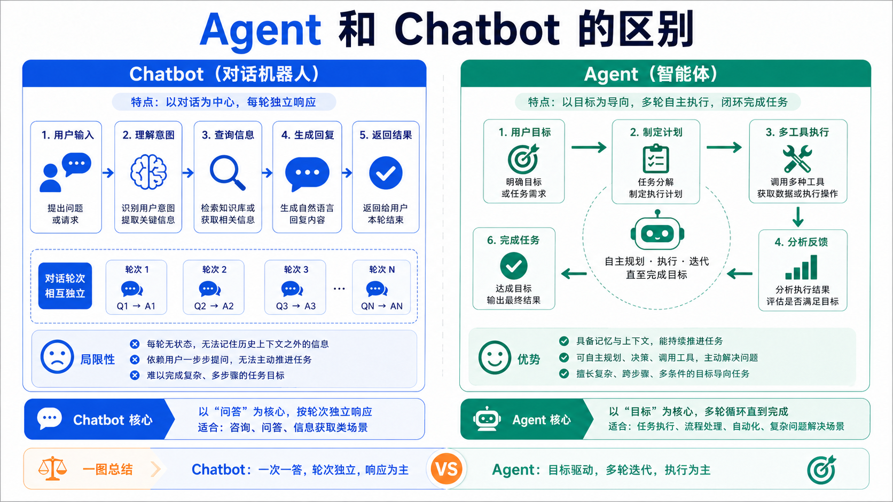

## 知识点讲解

### 1. 核心概念

这道题的陷阱在于：带 LLM 的 Chatbot 和 Agent 在界面上看起来一样——都是一个对话框，都能回复你。但底层逻辑差很多。

最简洁的分界线：**Chatbot 的核心目标是"说"，Agent 的核心目标是"做"**。

Chatbot 的成功标准是"这轮回复让用户满意"；Agent 的成功标准是"这个任务有没有完成"。

### 2. 技术细节

#### 2.1 Chatbot 是什么

Chatbot 的设计围绕对话质量优化：

- 交互模式是轮流问答：用户说一句，机器人回一句
- 决策逻辑简单：当前输入 + 对话历史 → 生成回复
- 工具能力有限：通常只挂 1-3 个工具（FAQ 查询、订单查询等）
- 失败策略保守：不理解就说"我不知道"或者转人工

Chatbot 的最终产物是**文本**——一个让用户觉得有帮助的回复。

#### 2.2 Agent 是什么

Agent 围绕任务完成优化：

- 交互模式是"提交目标 → 等结果"：用户给一个目标，Agent 自主执行
- 决策逻辑复杂：需要规划、工具调用、状态管理、多步循环
- 工具能力强：集成多种工具、灵活组合
- 失败策略主动：重试、replan、换策略，不轻易放弃

Agent 的最终产物是**行动结果**——一个已经发出的邮件、一份生成的报告、一个已执行的操作。

#### 2.3 核心差异对比

| 特性 | Chatbot | Agent |
| --- | --- | --- |
| 核心目标 | 自然对话，提供信息 | 自主完成任务 |
| 用户需要做什么 | 逐步引导，多轮交互 | 提交目标，等待结果 |
| 工具数量 | 1-3 个 | 5-20+ 个 |
| 自主性 | 低（遵循对话脚本） | 高（自行规划执行） |
| 失败恢复 | 有限（转人工） | 主动（重试/replan） |
| 适用场景 | 客服、FAQ、知识问答 | 自动化流程、复杂任务 |

### 3. 对比与拓展

#### 3.1 两者可以结合

带工具、带记忆、带任务闭环的 Chatbot，本身就是 Agent。界限不是非此即彼的。

一种常见的混合架构：前面是 Chatbot 做意图识别（理解用户想干什么），后面触发 Agent 执行（自动完成任务）。用户看到的是对话，底层跑的是 Agent。

#### 3.2 什么时候用 Chatbot 就够了

- 用户期望的就是和 AI 对话、获取信息建议
- 任务简单，不需要跨系统操作
- 用户习惯于多轮引导，不需要一次性给完整目标
- 成本和延迟要求严格

Agent 适合的是"用户只想要结果，不想手动一步一步操作"的场景。

## 面试怎么答

Chatbot 和 Agent 的核心区别在目标：Chatbot 优化对话质量，追求"用户满意这轮回复"；Agent 优化任务完成，追求"把这件事情办成"。

交互模式上，Chatbot 是轮流问答、用户逐步引导；Agent 是用户提交目标、系统自主执行多步然后返回结果。Chatbot 的产物是文本，Agent 的产物是行动和结果。

两者并不互斥，可以结合。带工具、带记忆、带执行闭环的 Chatbot 本身就是 Agent。实际产品里经常是对话界面 + Agent 后端的组合——用户觉得自己在聊天，但底层是 Agent 在跑多步任务。

## 高频追问 & 加分点

- **Q1：有没有既是 Chatbot 又是 Agent 的系统？**  
    有，而且越来越多。Claude、ChatGPT 带 tool use 的版本，本质上就是 Agentic Chatbot。判断标准不是界面形式，而是有没有工具调用 + 多步循环 + 动态决策。
- **Q2：Chatbot 和 Agent 的成本结构有什么不同？**  
    Chatbot 通常是一轮一次 LLM 调用，成本可预测；Agent 每步一次 LLM 调用加工具调用，总成本随任务步骤数线性增长，不可预测。做 Agent 必须设 cost budget 上限，防止失控。
- **Q3：为什么 Agent 的用户体验有时不如 Chatbot？**  
    Agent 关注任务完成，过程中可能不解释在做什么，用户等着也不知道进展，体验会焦虑。改善方法是加"步骤播报"——每执行一步告诉用户"我在做什么"，让过程可见。
- **Q4：客服场景用 Chatbot 还是 Agent？**  
    看具体需求。如果只是解答问题、查订单状态，Chatbot 够用；如果需要自动处理退款、修改订单、联动多个系统，就需要 Agent。现在很多公司在做混合方案：Chatbot 先接，识别到复杂任务再路由给 Agent。
- **Q5：Chatbot 转 Agent 改造难吗？**  
    最大的挑战是把"回复逻辑"改成"执行逻辑"——原来的设计以生成好文本为目标，Agent 化后要以完成任务为目标，这涉及到工具设计、执行控制、失败处理等一套新的工程基础设施，不只是换个框架那么简单。
