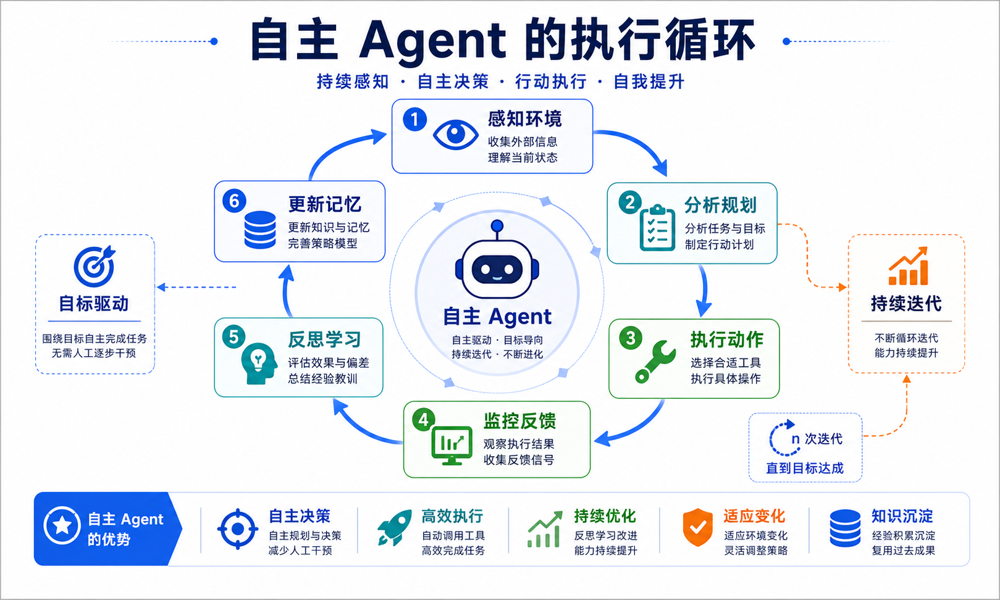

## 知识点讲解



### 1. 核心概念

"自主"这个词在 Agent 语境里被严重滥用。很多人以为自主 Agent 就是"完全不需要人的 AI"，实际上这样的系统在生产里基本跑不稳。

准确的理解是：**自主 Agent 是在明确边界内自主决策的系统**。边界以内它自己搞定；边界以外，主动求助或者停下来等待人工确认。

关键词是"明确边界"。没有边界的"完全自主"是风险源，不是能力体现。

### 2. 技术细节

#### 2.1 自主性的四个维度

| 维度 | 低自主 | 高自主 |
| --- | --- | --- |
| 时间跨度 | 单步需要人确认 | 可长期独立运行 |
| 决策范围 | 人定策略，Agent 执行 | Agent 自主制定和调整策略 |
| 失败恢复 | 失败即停止等待人工 | 自动重试、replan、换策略 |
| 资源管理 | 固定预算，超出报警 | 自主分配 token/工具调用预算 |

现实中大多数生产 Agent 在中间区间——某些操作完全自主，某些操作需要人工确认，某些情况主动请求人工介入。

#### 2.2 自主 Agent 的核心循环

一个完整的自主 Agent 循环长这样：

```latex
接收目标
  → 感知（读取环境状态、历史上下文、可用工具）
  → 推理（分析当前情况，决定下一步）
  → 行动（调用工具、执行操作）
  → 观察（获取执行结果、环境反馈）
  → 评估（判断是否朝目标推进，是否出现异常）
  → 反思（失败了怎么调整？策略还对吗？）
  → 循环 or 结束
```

"自主"体现在：每一步的决定都是 Agent 自己做的，不是人写死的流程。

#### 2.3 自主度的工程设计

不同风险等级的操作应该有不同的自主度设置：

| 操作类型 | 风险等级 | 自主度 |
| --- | --- | --- |
| 读取数据、查询信息 | 低 | 完全自主，无需确认 |
| 生成内容、发送通知 | 中 | 自主执行，记录日志 |
| 修改数据、调用付费 API | 中高 | 需要二次确认 |
| 删除操作、金融交易、外部发布 | 高 | 强制人工审批 |

这个分级不是固定的，要根据业务场景和风险偏好调整。

### 3. 对比与拓展

#### 3.1 受控 Agent vs 自主 Agent

受控 Agent：路径事先写死，LLM 只在指定节点跑，人随时可以接管——这其实更接近 Workflow + LLM 的组合，而不是真正的 Agent。

自主 Agent：路径运行时决定，Agent 根据观察自主选择下一步，人只在边界点介入。

区别不在于"有没有人在场"，而在于"路径由谁决定"。

#### 3.2 为什么完全自主在生产里很难

三个原因：

1. **累积误差**：多步执行中每步的小偏差会累积，离目标越来越远
2. **边界外情况**：现实世界的任务总会遇到训练数据里没有的边界情况
3. **责任归属**：自动化操作出了问题，必须有人能接管和负责

所以 Human-in-the-Loop 不是退而求其次，而是让 Agent 能真正在生产里跑起来的必要设计。

## 面试怎么答

自主 Agent 指的是在最少人工干预下、能自主感知、规划、执行、调整的智能系统。这里的关键词是"最少"而不是"零"——完全零人工干预在生产里基本不可用。

自主性体现在四个维度：时间跨度（能跑多久不需要人介入）、决策范围（哪些决策自己做）、失败恢复（出错后自己处理还是等人来）、资源管理（预算怎么分配）。

工程上的合理设计是按风险分级：读取查询类操作完全自主；生成发布类操作自主执行但记录日志；修改删除类操作需要二次确认；高风险操作强制人工审批。这叫"在合理边界内自主"，不是说什么都自己来。

## 高频追问 & 加分点

- **Q1：AutoGPT 那种"完全自主"的 Agent 为什么没有成为主流？**  
    因为没有边界控制。完全自主的 Agent 容易陷入无限循环、做出越权操作、累积错误导致严重后果，工程上根本驾驭不了。现在主流的 Agent 产品都有明确的 Human-in-the-Loop 设计。
- **Q2：自主 Agent 如何保证安全性？**  
    四层保护：①权限最小化（Agent 只有完成任务必要的权限）；②操作沙箱（危险操作在隔离环境先试跑）；③审计日志（每步操作可追溯）；④终止机制（随时可以停止 Agent 的执行）。
- **Q3：自主 Agent 怎么处理它"不确定"的情况？**  
    好的 Agent 应该能识别自己的不确定性并主动求助，而不是猜一个答案往下走。实现方式是在 prompt 里明确告诉 Agent"遇到不确定情况请停下来问用户"，同时在执行层面监控 LLM 的置信度（token 概率）作为辅助信号。
- **Q4：如何评估一个 Agent 的自主能力？**  
    三个指标：①任务完成率（在没有人工干预的情况下能完成多少比例的任务）；②人工介入率（平均每个任务需要多少次人工确认）；③平均步数效率（实际步数 vs 最优步数的比值，反映有没有在绕弯路）。
- **Q5：未来自主 Agent 会越来越自主还是越来越受控？**  
    我的判断是：整体趋势是自主范围扩大，但边界设计会更精细。不是"更自主"或"更受控"，而是"在更多场景下自主，同时有更好的安全机制保证边界"。
