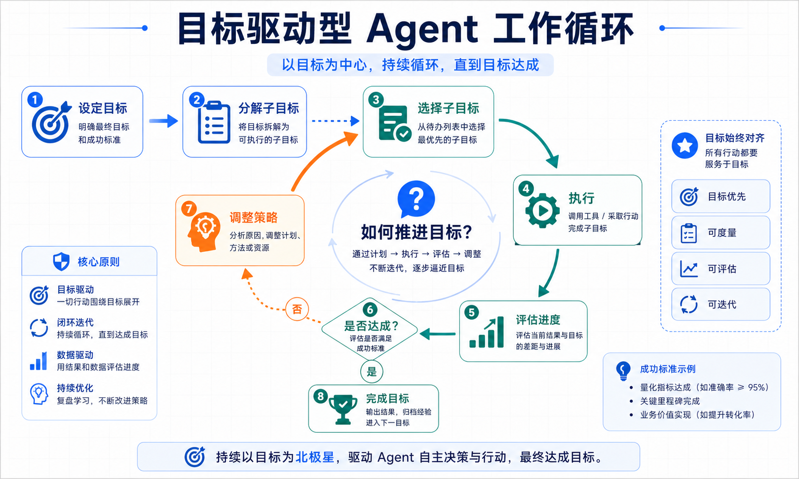

## 知识点讲解

### 1. 核心概念

目标驱动型 Agent，其实这是 Agent 最本质的特征——几乎所有 Agent 都是目标驱动的。所以这道题的关键不是解释"什么叫目标驱动"，而是讲清楚**目标驱动和任务驱动的区别**，以及目标驱动在工程上要解决什么问题。

最直白的区分：

- **任务驱动**：给你一个清单，一条一条执行，执行完就结束
- **目标驱动**：给你一个目标，自己想怎么达到，路径是灵活的，结果符合目标就算成功

任务驱动关注的是"有没有按步骤做"，目标驱动关注的是"有没有真的把事情办成"。

### 2. 技术细节

#### 2.1 目标的三个层次

目标驱动型 Agent 的"目标"通常有三个层次：

| 层次 | 含义 | 示例 |
| --- | --- | --- |
| 最终目标 | 用户真正想要的结果 | "提高本季度销售额" |
| 中间目标 | 为达成最终目标设的子目标 | "找出流失率最高的客户群" |
| 即时目标 | 当前步骤要完成的具体操作 | "查询过去 30 天的购买记录" |

Agent 要做的是把最终目标逐层分解，一直分解到可以直接执行的即时目标。

#### 2.2 目标驱动的核心机制

目标驱动型 Agent 有两个关键机制，是任务驱动没有的：

**① 目标进度评估**

每执行一步，评估当前状态离目标还有多远。这不只是"完成了几步"，而是"按这个方向继续能不能真的达到目标"。如果方向错了，早发现早纠正，比走完全程再发现强多了。

**② 路径灵活调整**

目标不变，但路径可以变。原定的步骤 A 失败了，可以试步骤 B、可以换一个工具、可以重新规划子目标。任务驱动的 Agent 步骤 A 失败就卡住；目标驱动的 Agent 会问"有没有其他方式达到这个目标"。

#### 2.3 目标分解的工程要点

拆目标是技术活，有几个常见坑：

- **分解太细**：子目标之间依赖关系复杂，执行顺序难管理
- **分解太粗**：子目标还是不可直接执行，需要 Agent 再次规划，效率低
- **成功条件不清晰**：子目标完成了但不知道算不算完成，LLM 判断飘忽

我自己习惯的粒度是：**每个子目标用 1-3 次工具调用就能搞定**，太多了说明还需要继续分解。

### 3. 对比与拓展

#### 3.1 目标驱动 vs 任务驱动的典型场景

同样是"生成季度报告"：

- **任务驱动**：步骤 1 查数据库 → 步骤 2 计算增长率 → 步骤 3 写报告 → 完成。每步按顺序来，步骤 2 如果数据不够用就报错。
- **目标驱动**：目标是"生成一份包含关键业务指标的报告"。数据库查询不够用的时候，自己去找其他数据源；发现数据异常，先去验证再写报告；最终目标是报告质量，而不是步骤执行完毕。

## 面试怎么答

目标驱动型 Agent 的核心是：决策和行动以"目标是否达成"为标准，而不是以"步骤有没有执行"为标准。

和任务驱动的区别很具体：任务驱动给你一个 checklist，做完就结束；目标驱动给你一个目标，路径是灵活的，中间遇到障碍会调整策略，只要最终目标达成就算成功。

工程上要解决三个问题：①目标分解（把高层目标拆成可执行子目标，粒度要合适）；②进度评估（每步都要判断是否在朝目标推进）；③路径调整（当前路径不可行时，能重新规划而不是直接失败）。这三块做好了，才叫真正的目标驱动，否则只是把步骤清单换了个名字。

## 高频追问 & 加分点

- **Q1：目标驱动型 Agent 怎么定义"目标完成"？**  
    需要在目标设定时就定好成功标准（Success Criteria）。标准越可量化越好——"写一份报告"是模糊目标，"生成一份包含 Q3 收入、环比增长率、Top5 异常的报告"是可评估的目标。LLM 的终止判断依赖这个标准，标准模糊 Agent 就容易提前停或者永不停。
- **Q2：目标冲突时怎么处理？**  
    先看冲突类型：时间冲突（A 要完成才能做 B）靠依赖管理；资源冲突（两个子目标都需要同一个 API，有频率限制）靠调度；价值冲突（两个目标方向不一致）需要上升到用户层确认优先级，Agent 自己别擅自决定。
- **Q3：目标和约束怎么区分？**  
    目标是"我要达到什么"，约束是"达到过程中不能做什么"。比如目标是"最大化搜索排名"，约束是"不能用黑帽 SEO"。设计 Agent 时这两个要分开管理，约束违反要硬停，目标可以灵活调整路径。
- **Q4：目标分解失败怎么办？**  
    两种情况：①分解本身出错（子目标不对）→ LLM 重新规划；②执行发现子目标无法完成（数据不存在等）→ 从这个失败点 replan 剩余部分，不必整体推翻。关键是要有失败记录，让 LLM replan 时能看到"这个方向已经试过了，行不通"。
- **Q5：目标驱动型 Agent 和强化学习 Agent 有什么关系？**  
    都是目标驱动，但机制不同。强化学习通过奖励信号在大量试错中学策略；LLM-based 目标驱动 Agent 靠 LLM 的推理能力直接生成策略，不需要大量试错。前者适合状态空间明确的游戏类任务，后者适合开放域、语言描述目标的任务。
