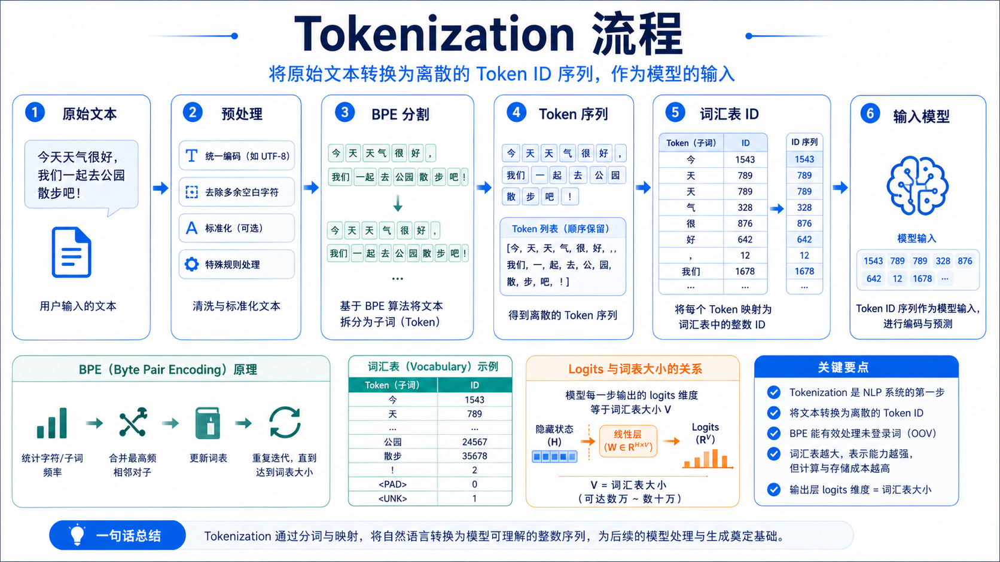

## 知识点讲解



### 1. 核心概念

Token 是 LLM 处理文本的最小单位。它既不是字符，也不是词，而是由 Tokenizer（分词器）把文本切割出来的"片段"。

英文里，一个常见词通常是 1 个 Token，长词可能拆成 2-3 个；中文通常 1-2 个汉字对应 1 个 Token。所以同样的内容，中文消耗的 Token 数普遍比英文多。

Token 的重要性不仅仅是概念层面的——它直接决定三件事：**上下文窗口用量**（模型能看多少文字）、**API 成本**（几乎所有 LLM API 按 Token 计费）、**推理速度**（Token 越多越慢）。

### 2. 技术细节

#### 2.1 分词算法

| 算法 | 代表模型 | 特点 |
| --- | --- | --- |
| 字符级 | 早期模型 | Token 多，稀有词好处理，效率差 |
| 词级 | 早期 NLP | 英文友好，中文几乎不可用 |
| BPE（字节对编码） | GPT 系列 | 主流，平衡性最好 |
| WordPiece | BERT | 按最大化语料似然合并子词（vs BPE 按频率） |
| SentencePiece | Llama、mT5 | 支持任何语言，从字节开始 |

BPE 的核心思想：从字符出发，统计相邻字符对频率，把最频繁的对合并成一个新 Token，反复迭代直到词表达到目标大小（通常 3.2 万-10 万）。

#### 2.2 Token 与字符的换算关系

粗略经验值：

- 英文：1 Token ≈ 4 个字符 ≈ 0.75 个词
- 中文：1 Token ≈ 1-2 个汉字
- 代码：1 Token ≈ 3-4 个字符（代码字符密度高）

所以写同一篇文章，中文版通常比英文版多消耗 20-50% 的 Token。

#### 2.3 Token 经济学

- **输出比输入贵**：大多数 API 输出 Token 的价格是输入的 2-4 倍
- **Prompt Caching**：把重复的长 System Prompt 缓存，后续调用复用，成本能降 60-80%
- **上下文窗口**：模型最多能处理的 Token 数量，决定了它能看多少"上下文历史"

## 代码示例

```python
from transformers import AutoTokenizer
import tiktoken  # OpenAI 的 tokenizer

# --- 用 HuggingFace tokenizer 看分词结果 ---
tokenizer = AutoTokenizer.from_pretrained("meta-llama/Llama-3.1-8B-Instruct")

texts = [
    "Hello, how are you?",          # 英文
    "今天天气真不错",                  # 中文
    "def hello_world():",           # 代码
]

for text in texts:
    tokens = tokenizer.tokenize(text)
    ids    = tokenizer.encode(text)
    print(f"原文: {text!r}")
    print(f"  Tokens ({len(tokens)}): {tokens}")
    print(f"  IDs:    {ids}")
    print()

# --- 用 tiktoken 估算 OpenAI API 成本 ---
# 注：gpt-4 旧模型已停用，价格定期调整，请以官网为准
enc = tiktoken.encoding_for_model("gpt-4o")

def estimate_cost(prompt: str, response: str,
                  input_price_per_m=2.5, output_price_per_m=10.0) -> dict:
    """估算 gpt-4o 调用成本（价格 per 1M tokens，仅作示例）"""
    n_input  = len(enc.encode(prompt))
    n_output = len(enc.encode(response))
    cost = n_input * input_price_per_m / 1_000_000 + n_output * output_price_per_m / 1_000_000
    return {"input_tokens": n_input, "output_tokens": n_output, "cost_usd": cost}

result = estimate_cost(
    prompt="请总结以下文章：" + "这是一篇很长的文章。" * 100,
    response="这篇文章主要讲..."
)
print(result)

# --- 不同模型的 tokenizer 对同一文本产生不同 Token 数 ---
gpt_enc   = tiktoken.encoding_for_model("gpt-4o")
llama_tok = AutoTokenizer.from_pretrained("meta-llama/Llama-3.1-8B-Instruct")

text = "The attention mechanism in Transformers"
print(f"GPT-4 tokenizer:  {len(gpt_enc.encode(text))} tokens")
print(f"Llama tokenizer:  {len(llama_tok.encode(text))} tokens")
# 同一段文本，两个 tokenizer 结果可能差 10-30%
```

## 面试怎么答

Token 是 LLM 处理文本的最小单位，既不是字符也不是词，而是 Tokenizer 切出来的子词片段。英文常见词通常 1 个 Token，中文大概 1-2 个汉字 1 个 Token。

现在主流算法是 BPE——从字符开始，统计频繁出现的字符对，反复合并直到词表大小合适。这样可以用有限词表（3 万-10 万）处理几乎任意文本，稀有词就拆成多个子词。

Token 这个概念对工程师很重要，因为它直接影响三件事：API 成本（按 Token 计费）、上下文窗口使用量、推理速度。同一内容中文比英文多 20-50% 的 Token，这个差距在高并发系统里是真实的成本。

## 高频追问 & 加分点

- **Q1：为什么不直接用字符或词作为单位？**  
    字符级 Token 数太多，序列太长，注意力计算开销 O(n²)，不划算；词级对中文不友好，而且词表要非常大才能覆盖所有词汇（英文就有几十万个词）。BPE 是折中：词表可控、稀有词可处理、效率可接受。
- **Q2：Token 数如何精确计算？**  
    必须用对应模型的 Tokenizer 来算，不同模型的 Tokenizer 结果不同。OpenAI 的 tiktoken 是开源的，可以直接用。HuggingFace 上几乎每个开源模型都有配套的 Tokenizer。
- **Q3：上下文窗口快满了怎么办？**  
    三条路：① 截断（从头或从中间删，看任务需要哪部分）；② 摘要压缩（把历史对话先 summarize 压缩再拼回去）；③ RAG（把知识放到向量库，按需检索而不是全部塞进 prompt）。
- **Q4：Prompt Caching 是什么？**  
    重复的 System Prompt 每次都当输入 Token 计费太贵。Anthropic Claude 和 OpenAI 都支持把 System Prompt 的 KV-Cache 缓存在服务端，后续调用直接复用，价格打 0.1 折。对于长 System Prompt 的 Agent 系统，这个省钱效果很明显。
