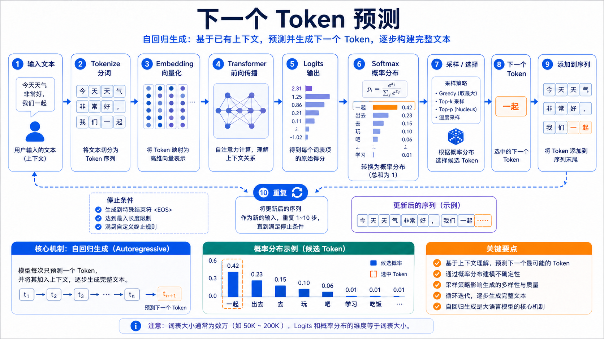

## 知识点讲解



### 1. 核心概念

下一个 Token 预测（Next Token Prediction）是 LLM 最核心的机制。给定一段 Token 序列，模型输出一个概率分布，告诉你词表里每个 Token 接下来出现的可能性，然后按某种策略采样一个作为下一个 Token。

整个文本生成就是不断重复这个过程：预测 → 采样 → 追加到序列 → 再预测，直到生成 EOS（结束符）或者达到长度上限。

预测本身是简单的，但这个简单机制配上海量训练数据和超大参数量，涌现出了推理、问答、代码生成等"高级"能力。

### 2. 技术细节

#### 2.1 预测过程的四步

1. **Tokenize**：把文本转成 Token ID 序列
2. **前向传播**：Transformer 处理序列，输出每个位置的隐状态
3. **LM Head**：把最后一个位置的隐状态乘以词表矩阵，得到 logits（维度 = 词表大小，通常 3-15 万）
4. **Softmax 采样**：把 logits 转概率分布，按某种策略选下一个 Token

#### 2.2 采样策略对比

| 策略 | 描述 | 多样性 | 质量 | 适用场景 |
| --- | --- | --- | --- | --- |
| 贪心搜索 | 每步选概率最高的 | 无 | 中（易重复） | 简单任务 |
| 随机采样 | 按概率分布随机选 | 高 | 差 | 几乎不用 |
| Top-K | 只在前 K 个里采样 | 中 | 好 | 通用 |
| Top-P（核采样） | 累积概率达到 P 就截止 | 中（自适应） | 好 | 通用 |
| Beam Search | 维护 K 条候选序列选最优 | 低 | 最好 | 翻译、摘要 |

实际工程里最常用的组合是：**Temperature + Top-P + 频率惩罚**，三个参数配合控制生成风格。

#### 2.3 训练时的预测 vs 推理时的生成

这两个"预测"不一样：

- **训练时**：用真实序列做"教师强制"——输入 `t[0..n-1]`，同时预测 `t[1..n]` 所有位置，一次前向传播算所有位置的 loss，高效并行。
- **推理时**：自回归，每次只能生成一个 Token 追加进去，再跑一次前向，效率低得多——这是 LLM 推理慢的根本原因。

## 代码示例

下面展示从 logits 到采样的完整过程，以及几种主要策略的实现。

```python
import torch
import torch.nn.functional as F
from transformers import AutoModelForCausalLM, AutoTokenizer

model_name = "gpt2"
tokenizer  = AutoTokenizer.from_pretrained(model_name)
model      = AutoModelForCausalLM.from_pretrained(model_name)
model.eval()

def get_next_token_logits(input_ids: torch.Tensor) -> torch.Tensor:
    """前向传播，取最后一步的 logits"""
    with torch.no_grad():
        outputs = model(input_ids)
    return outputs.logits[0, -1, :]   # (vocab_size,)

def greedy(logits: torch.Tensor) -> int:
    return logits.argmax().item()

def top_k_sampling(logits: torch.Tensor, k: int = 50, temperature: float = 1.0) -> int:
    logits = logits / temperature
    top_k_logits, top_k_indices = torch.topk(logits, k)
    probs   = F.softmax(top_k_logits, dim=-1)
    idx     = torch.multinomial(probs, num_samples=1).item()
    return top_k_indices[idx].item()

def top_p_sampling(logits: torch.Tensor, p: float = 0.9, temperature: float = 1.0) -> int:
    logits = logits / temperature
    sorted_logits, sorted_indices = torch.sort(logits, descending=True)
    cumsum_probs = torch.cumsum(F.softmax(sorted_logits, dim=-1), dim=-1)

    # 找到累积概率超过 p 的截断点
    cutoff = (cumsum_probs <= p).sum().item() + 1
    filtered_logits = sorted_logits[:cutoff]
    filtered_probs  = F.softmax(filtered_logits, dim=-1)

    idx = torch.multinomial(filtered_probs, num_samples=1).item()
    return sorted_indices[idx].item()

# 自回归生成主循环
def generate(prompt: str, max_new: int = 30, strategy: str = "top_p") -> str:
    input_ids = tokenizer.encode(prompt, return_tensors="pt")
    n_prompt  = input_ids.shape[1]

    for _ in range(max_new):
        logits = get_next_token_logits(input_ids)

        if strategy == "greedy":
            next_id = greedy(logits)
        elif strategy == "top_k":
            next_id = top_k_sampling(logits, k=40, temperature=0.8)
        else:  # top_p
            next_id = top_p_sampling(logits, p=0.9, temperature=0.8)

        if next_id == tokenizer.eos_token_id:
            break
        input_ids = torch.cat([input_ids, torch.tensor([[next_id]])], dim=1)

    new_ids = input_ids[0, n_prompt:]
    return tokenizer.decode(new_ids, skip_special_tokens=True)

print(generate("Once upon a time", strategy="top_p"))
```

## 面试怎么答

Next-token prediction 是 LLM 的核心机制：把前面所有 Token 输入 Transformer，拿最后一步的输出乘词表矩阵得到 logits，softmax 转概率，按某策略采样一个 Token，追加进序列再重复。生成就是这个循环。

采样策略上，贪心每步选最高概率，确定但容易重复；Top-K 在前 K 个里随机，多样又可控；Top-P 动态截断，累积概率到 p 就停，对不同分布适应性更好；Beam Search 同时维护多条序列选最优，质量最高但速度最慢。工程里常见的是 Top-P + Temperature 组合。

有一点值得强调：训练时是并行算所有位置的 loss（教师强制），推理时是逐 Token 自回归生成，每生成一个都要跑一次完整前向——这就是 LLM 推理天生比较慢的原因，也是 KV-Cache 这类推理优化技术的出发点。

## 高频追问 & 加分点

- **Q1：为什么 LLM 推理比训练慢？**  
    训练时一次前向传播处理整个序列所有位置（并行），推理时必须逐个 Token 生成（自回归，串行）。生成 100 个 Token = 100 次前向传播。KV-Cache 把历史的 K/V 缓存起来，后续步骤不用重算历史，是最重要的推理加速手段。
- **Q2：Beam Search 为什么不常用？**  
    它维护 B 条候选序列，计算量是贪心的 B 倍，延迟高；而且实验发现在开放生成（对话、创意写作）里 Beam Search 的结果反而比 Top-P 差——高质量不等于人觉得好。对话类任务通常 Top-P 就够了。
- **Q3：频率惩罚（Frequency Penalty）是怎么回事？**  
    生成过程中对已经出现过的 Token 的 logits 减分，出现越频繁减得越多，避免重复输出。OpenAI API 的 `frequency_penalty` 和 `presence_penalty` 就是这个思路，工程里建议都设一个小正值（0.1-0.3）。
- **Q4：投机解码（Speculative Decoding）是什么？**  
    一种加速推理的方法：用一个**小的 draft 模型**快速生成多个候选 Token，再用大模型一次性并行验证这些候选，接受合法的部分。等于把串行多步压缩成"小模型猜 + 大模型验"，常见提速 2-3 倍，是目前主流推理加速方向之一。变体 **self-speculative**（如 Medusa、EAGLE）用同一个大模型的浅层或额外预测头做 draft，省了独立小模型，部署更简单。回答时区分清楚两者是加分项。
