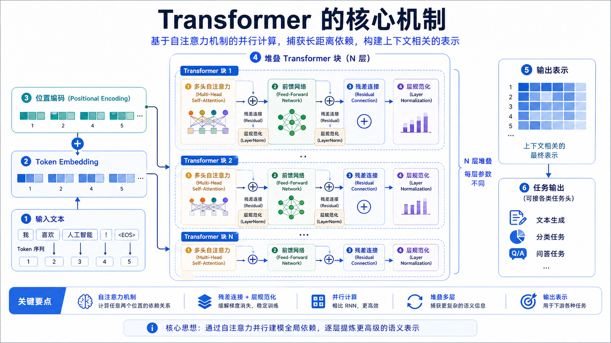

## 知识点讲解



### 1. 核心概念

Transformer 是现代 LLM 的基础架构，2017 年的论文《Attention Is All You Need》提出。它的核心创新是**自注意力（Self-Attention）机制**：允许序列中每个位置同时关注所有其他位置，打破了 RNN 必须顺序处理的限制，实现并行训练。

从整体结构上看，一个 Transformer 解码器（LLM 用的那种）就是：

**Embedding → N × (Masked Self-Attention + FFN + LayerNorm + 残差) → LM Head**

N 就是层数，GPT-4 据估计有 96-120 层。

### 2. 技术细节

#### 2.1 核心组件拆解

**① 自注意力（Self-Attention）**

对每个 Token，计算它和序列中所有其他 Token 的相关性，然后加权汇总所有 Token 的值。

数学上：

```
Attention(Q, K, V) = softmax(QK^T / sqrt(d_k)) · V
```

Q（Query）、K（Key）、V（Value）是同一个输入的三种线性变换，`sqrt(d_k)` 是缩放因子，防止内积过大导致 softmax 梯度消失。

**② 多头注意力（Multi-Head Attention）**

把 d_model 维度切成 H 份，每份独立做注意力（每个"头"学不同的依赖关系），最后把 H 个结果拼回来。典型设置：GPT-2 小版本用 12 个头，GPT-3 用 96 个头。

**③ 前馈网络（FFN）**

注意力捕捉"哪些位置相关"，FFN 做"对每个位置的独立变换"。结构是两层线性 + 激活函数（GELU 或 SwiGLU），隐层通常是输入维度的 4 倍。

**④ 因果掩码（Causal Mask）**

LLM 生成时不能看"未来"的 Token，所以注意力矩阵的右上角置为 -∞，softmax 后权重变成 0——只能看当前和过去。

**⑤ 残差连接 + LayerNorm**

残差保证梯度能顺畅流过深层；LayerNorm 稳定训练。现代 LLM 通常用 Pre-LN（LayerNorm 放在注意力之前），比原始 Post-LN 更稳定。

#### 2.2 Transformer vs RNN

| 维度 | Transformer | RNN/LSTM |
| --- | --- | --- |
| 并行度 | 完全并行（训练） | 必须顺序 |
| 长距离依赖 | 直接计算（O(1) 路径） | 随距离衰减 |
| 内存 | 注意力 O(n²) | O(n) |
| 扩展性 | 极好（Scale to 千亿） | 差（梯度爆炸/消失） |

RNN 的长距离依赖靠隐状态"传递"，信息会逐步衰减；Transformer 对任意两个位置的依赖都是直接计算，1000 Token 前的信息和当前 Token 是平等的。

#### 2.3 现代 LLM 的改进

原始 Transformer 在实际 LLM 中已经有不少改动：

- **RoPE / ALiBi**：替代绝对位置编码，更好支持上下文外推
- **GQA（Grouped Query Attention）**：把 K、V 的头数分组共享，减少 KV-Cache 内存
- **SwiGLU / GeGLU**：比 ReLU 效果更好的 FFN 激活函数
- **Flash Attention**：用 IO 感知算法实现注意力，速度快、显存省

## 代码示例

下面是一个完整的 Transformer Block 实现，包含多头注意力、FFN、残差和 LayerNorm。

```python
import torch
import torch.nn as nn
import math

class MultiHeadAttention(nn.Module):
    def __init__(self, d_model: int, num_heads: int):
        super().__init__()
        assert d_model % num_heads == 0
        self.num_heads = num_heads
        self.d_k = d_model // num_heads

        self.W_q = nn.Linear(d_model, d_model, bias=False)
        self.W_k = nn.Linear(d_model, d_model, bias=False)
        self.W_v = nn.Linear(d_model, d_model, bias=False)
        self.W_o = nn.Linear(d_model, d_model, bias=False)

    def forward(self, x: torch.Tensor, causal: bool = True) -> torch.Tensor:
        B, T, C = x.shape

        # 线性变换 → reshape 成多头
        Q = self.W_q(x).view(B, T, self.num_heads, self.d_k).transpose(1, 2)
        K = self.W_k(x).view(B, T, self.num_heads, self.d_k).transpose(1, 2)
        V = self.W_v(x).view(B, T, self.num_heads, self.d_k).transpose(1, 2)

        # 注意力得分
        scores = torch.matmul(Q, K.transpose(-2, -1)) / math.sqrt(self.d_k)

        # 因果掩码：右上角置 -inf
        if causal:
            mask = torch.triu(torch.ones(T, T, device=x.device), diagonal=1).bool()
            scores.masked_fill_(mask, float("-inf"))

        attn   = torch.softmax(scores, dim=-1)
        output = torch.matmul(attn, V)

        # 合并多头 → 线性输出
        output = output.transpose(1, 2).contiguous().view(B, T, C)
        return self.W_o(output)


class TransformerBlock(nn.Module):
    def __init__(self, d_model: int, num_heads: int, d_ff: int, dropout: float = 0.1):
        super().__init__()
        self.attn  = MultiHeadAttention(d_model, num_heads)
        self.ffn   = nn.Sequential(
            nn.Linear(d_model, d_ff),
            nn.GELU(),
            nn.Linear(d_ff, d_model),
        )
        self.norm1 = nn.LayerNorm(d_model)
        self.norm2 = nn.LayerNorm(d_model)
        self.drop  = nn.Dropout(dropout)

    def forward(self, x: torch.Tensor) -> torch.Tensor:
        # Pre-LN：先 Norm 再 Attention（现代 LLM 的做法）
        x = x + self.drop(self.attn(self.norm1(x)))
        x = x + self.drop(self.ffn(self.norm2(x)))
        return x

# 快速验证
block = TransformerBlock(d_model=512, num_heads=8, d_ff=2048)
x     = torch.randn(2, 64, 512)   # (batch=2, seq=64, d_model=512)
out   = block(x)
print(out.shape)   # torch.Size([2, 64, 512])
```

## 面试怎么答

Transformer 的核心是自注意力机制：把每个 Token 的表示分成 Q、K、V 三部分，用 Q 和所有位置的 K 点积计算相关性权重，再加权汇总所有 V，就得到这个 Token 综合了整个序列信息后的新表示。这个过程在序列所有位置并行发生，所以训练比 RNN 快很多。

多头注意力是把 d_model 切成 H 份并行做，让每个头学不同的依赖关系，比单头容量更大。每个 Transformer Block 是"注意力 + FFN"两层叠加残差，实际模型就是把这个 Block 堆叠 N 次（GPT-3 175B 版本是 96 层、96 个注意力头）。

LLM 用的是解码器，注意力加了因果掩码——只能看自己和之前的 Token，不能看未来。现代 LLM 在原始 Transformer 上做了很多改进：RoPE 位置编码、GQA 减少 KV-Cache 内存、SwiGLU 激活函数、Flash Attention 加速——这些改进加在一起大概能让推理快 3-5 倍。

## 高频追问 & 加分点

- **Q1：为什么要缩放 sqrt(d_k)？**  
    Q 和 K 的维度 d_k 越大，点积的数值越大，softmax 的梯度越接近 0（饱和区），梯度流不回去。除以 sqrt(d_k) 把数值拉回合理范围，让训练稳定。
- **Q2：注意力的计算复杂度是多少，有什么问题？**  
    O(n²)，n 是序列长度。上下文 4K → 16M 个注意力值；128K → 16B 个。这就是长上下文 LLM 的核心挑战。Flash Attention 用分块计算优化显存 IO 但不改变复杂度；线性注意力（如 Mamba）试图把复杂度降到 O(n)，但目前能力还不如 Transformer。
- **Q3：GQA 是什么，为什么重要？**  
    Grouped Query Attention：把 Q 维持 H 个头，K 和 V 只用 G 个头（G &lt; H），每组 Q 共享一对 K/V。好处是 KV-Cache 大小降为原来的 G/H，推理时显存大幅节省。Llama 2 70B 和 Mistral 7B 都用了 GQA。
- **Q4：Flash Attention 解决的是什么问题？**  
    标准注意力要把整个 attention_score 矩阵（n×n）写到显存，再读回来。Flash Attention 把矩阵切块在 SRAM 里处理，大幅减少 HBM 读写次数，速度提升 2-4 倍、显存节省 5-10 倍，现在是 LLM 训练和推理的标配。
