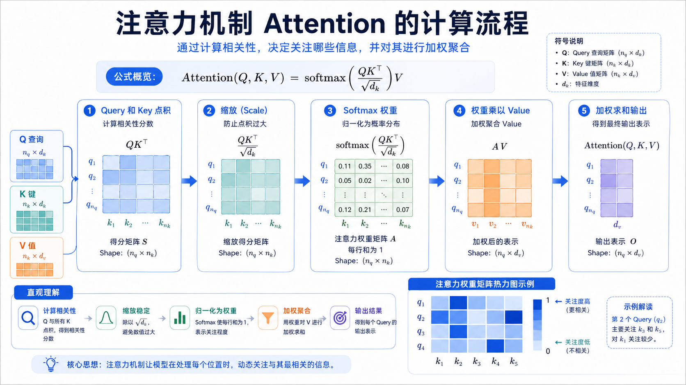

## 知识点讲解



### 1. 核心概念

注意力机制（Attention）的直觉很简单：当你理解一个词时，你会同时参考上下文里不同位置的信息，而且不同位置的重要性不一样。注意力机制把这个"参考"过程数学化了。

具体做法：把每个 Token 的表示拆成三个角色：

- **Query（Q）**：我是谁，我在问什么
- **Key（K）**：我是谁，我有什么可以被查询
- **Value（V）**：我实际携带的信息

用 Q 和所有位置的 K 计算相关性，softmax 归一化成权重，再加权汇总所有的 V，得到"综合了相关上下文信息"的新表示。

一句话公式：

```
Attention(Q, K, V) = softmax(QK^T / sqrt(d_k)) · V
```

### 2. 技术细节

#### 2.1 计算过程逐步拆解

给定输入序列 X（shape: seq_len × d_model），注意力的四步：

1. **线性映射**：`Q = XW_Q`，`K = XW_K`，`V = XW_V`（三个不同的权重矩阵，训练时学习）
2. **相关性计算**：`scores = QK^T / sqrt(d_k)`（shape: seq_len × seq_len，每个位置对每个位置的相关性）
3. **归一化**：`weights = softmax(scores)`（权重和为 1，可解读为"关注程度"）
4. **加权求和**：`output = weights · V`

#### 2.2 三种注意力变体

| 类型 | Q 来自 | K/V 来自 | 用途 |
| --- | --- | --- | --- |
| 自注意力（Self-Attention） | 当前序列 | 当前序列 | 理解序列内部依赖 |
| 交叉注意力（Cross-Attention） | 解码器 | 编码器输出 | 序列到序列（翻译等） |
| 多头注意力（Multi-Head） | X（分多份） | X（分多份） | 并行学多种依赖 |

LLM（decoder-only 结构）只用**带因果掩码的自注意力**——通过把注意力矩阵右上角置为 -∞，让每个 Token 只能看自己和之前的位置，防止"看未来"。

#### 2.3 缩放因子为什么要除以 sqrt(d_k)

当 d_k 很大时，Q 和 K 的点积方差 = d_k，数值会变得很大，softmax 进入饱和区，梯度接近 0，训练停滞。除以 sqrt(d_k) 把方差拉回 1，softmax 的梯度恢复正常。

#### 2.4 注意力权重的可视化意义

注意力权重矩阵（seq × seq）可以可视化成热图。每一行代表一个位置"关注了哪些位置"。实际上不同头会关注不同模式：有的头关注上一个词，有的头关注句子里的动词主语关系，有的关注标点边界。

但要注意：权重高 ≠ 信息主要从那里来，残差连接也携带大量信息，光看注意力权重是不完整的分析。

## 代码示例

```python
import torch
import math
import torch.nn.functional as F

def scaled_dot_product_attention(
    Q: torch.Tensor,   # (batch, heads, seq, d_k)
    K: torch.Tensor,
    V: torch.Tensor,
    causal: bool = True
) -> tuple[torch.Tensor, torch.Tensor]:
    """
    返回 output 和 attention_weights，
    attention_weights 可用于可视化。
    """
    d_k = Q.shape[-1]
    # 1. 相关性计算
    scores = torch.matmul(Q, K.transpose(-2, -1)) / math.sqrt(d_k)

    # 2. 因果掩码（仅 decoder 需要）
    if causal:
        seq_len = Q.shape[-2]
        mask = torch.triu(torch.ones(seq_len, seq_len, device=Q.device), diagonal=1).bool()
        scores = scores.masked_fill(mask, float("-inf"))

    # 3. Softmax 归一化
    weights = F.softmax(scores, dim=-1)

    # 4. 加权求和
    output  = torch.matmul(weights, V)
    return output, weights


# 演示：一个 4 Token 的序列，2 头，d_k=8
batch, heads, seq, d_k = 1, 2, 4, 8
Q = torch.randn(batch, heads, seq, d_k)
K = torch.randn(batch, heads, seq, d_k)
V = torch.randn(batch, heads, seq, d_k)

output, weights = scaled_dot_product_attention(Q, K, V, causal=True)
print("output shape:", output.shape)       # (1, 2, 4, 8)
print("attention weights shape:", weights.shape)   # (1, 2, 4, 4)

# 可视化（需要 matplotlib）
# import matplotlib.pyplot as plt
# plt.imshow(weights[0, 0].detach().numpy(), cmap="Blues")
# plt.title("Causal Attention Weights (Head 0)")
# plt.colorbar(); plt.show()

# 验证因果性：右上角应全为 0（不能看未来）
print("上三角（右上）是否全零:", weights[0, 0].triu(diagonal=1).sum().item() == 0.0)
```

## 面试怎么答

注意力机制的核心是三个矩阵：Q、K、V。给定输入序列，每个 Token 的表示经过三个不同的线性变换得到 Q、K、V。然后用 Q 和所有位置的 K 点积算相关性，除以 sqrt(d_k) 缩放（防止 softmax 饱和），softmax 转成概率权重，最后加权汇总所有的 V，得到综合了上下文信息的新表示。

LLM 用的是带因果掩码的自注意力，通过把注意力矩阵右上角置为负无穷，让每个位置只能参考自己和之前的 Token，不能"看未来"。多头注意力是把维度切成 H 份并行做，每个头学不同的依赖关系，合并后信息更丰富。

注意力权重可以可视化，但它只是"显式依赖"的一部分，残差连接同样携带信息，不能只靠权重热图来解读模型行为。

## 高频追问 & 加分点

- **Q1：自注意力复杂度是多少？影响是什么？**  
    O(n²d)，n 是序列长度，d 是维度。序列长度翻倍，注意力计算翻 4 倍。这是长上下文模型的瓶颈——128K 上下文的注意力矩阵会有 16B 个元素。Flash Attention 用分块计算大幅节省显存，但复杂度没变；线性注意力尝试降到 O(n) 但效果还不够好。
- **Q2：多头注意力为什么比单头好？**  
    不同头能关注不同类型的依赖：语法关系、长距离指代、邻近词、标点边界等。单头注意力一次只能捕捉一种综合模式，多头并行捕捉多种，表达能力更强。实验上，增加头数（在参数总量不变的情况下）通常有帮助，但超过某个数量后收益递减。
- **Q3：KV-Cache 是怎么工作的？**  
    推理时每生成一个新 Token，新 Token 的 K、V 需要和历史所有 Token 的 K、V 做注意力。如果每步都从头算历史的 K、V，就是 O(n²) 的计算。KV-Cache 把历史的 K、V 存下来，每步只算新 Token 的 Q，和缓存中所有 K 做点积，历史 K/V 不用重算，计算量变成 O(n)。代价是显存：序列越长，KV-Cache 越大。
- **Q4：交叉注意力在哪里用？**  
    Encoder-Decoder 结构里，解码器每层都有一个交叉注意力，Q 来自解码器自身，K/V 来自编码器的输出。这让解码器在生成每个词时都能直接参考完整的输入序列（比如翻译时参考源语言）。纯 decoder-only 的 LLM 没有交叉注意力。
