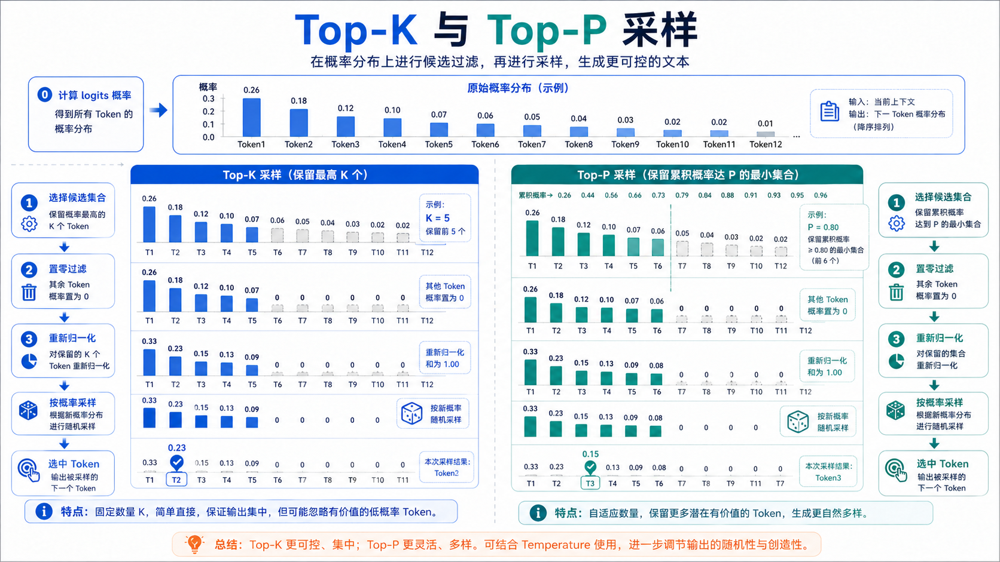

## 知识点讲解



### 1. 核心概念

Top-K 和 Top-P 都是为了解决同一个问题：怎么在"质量"和"多样性"之间找到平衡。纯贪心（每步选最高概率）质量稳但单调；完全随机采样多样但质量差，可能生成乱码。

**Top-K**：只保留概率最高的 K 个 Token，其余置 0，在这 K 个里随机采样。K 固定。

**Top-P（核采样，Nucleus Sampling）**：按概率从高到低排序，累计直到概率和 ≥ P，把这个"核"里的 Token 重新归一化后采样。P 固定，但候选 Token 数是动态的——概率分布尖的时候候选少，分布平的时候候选多。

Top-P 因为自适应性更强，现在是更主流的选择。

### 2. 技术细节

#### 2.1 Top-K 的工作逻辑

1. 对 vocab_size 个 logits 排序，取前 K 个
2. 其余 Token 的 logits 置为 -∞
3. Softmax 得到新的概率（只有 K 个非零）
4. 从 K 个里按概率采样

问题：K 是固定的，但不同上下文的概率分布形状差异很大。概率很集中时（下一个词基本确定），K=50 还是会引入大量低质 Token；概率分散时，K=50 又可能把有价值的候选截断。

#### 2.2 Top-P 的工作逻辑

1. 按概率从高到低排序
2. 累积概率，找到刚好 ≥ P 的截断点
3. 截断点之前的 Token 保留，其余置 0
4. 重新归一化后采样

这样，当模型非常确定（比如生成一个固定搭配）时，可能只有 2-3 个 Token 进入核；当模型不确定时，可能有几十个 Token 进入核。

#### 2.3 两者对比与组合

| 维度 | Top-K | Top-P |
| --- | --- | --- |
| 候选数量 | 固定（K 个） | 动态（随分布变化） |
| 对尖峰分布 | 可能引入低质 Token | 自动缩小候选 |
| 对平坦分布 | 可能过早截断 | 自动扩大候选 |
| 实现复杂度 | 低 | 稍高 |
| 工程推荐 | 辅助过滤 | 主策略 |

实践中常见的组合是 **Temperature + Top-P + Frequency Penalty**：

- Temperature 调整分布胖瘦
- Top-P 截断尾部低概率 Token
- Frequency Penalty 抑制重复

同时开 Top-K 和 Top-P 也可以——先 Top-K 过滤，再在结果里做 Top-P，双重保险。

## 代码示例

```python
import torch
import torch.nn.functional as F

def top_k_sampling(logits: torch.Tensor, k: int = 50, temperature: float = 1.0) -> int:
    """Top-K 采样"""
    logits = logits / max(temperature, 1e-8)

    # 只保留前 K 个，其余置 -inf
    top_k_logits, top_k_indices = torch.topk(logits, k)
    filtered = torch.full_like(logits, float("-inf"))
    filtered.scatter_(0, top_k_indices, top_k_logits)

    probs = F.softmax(filtered, dim=-1)
    return torch.multinomial(probs, num_samples=1).item()


def top_p_sampling(logits: torch.Tensor, p: float = 0.9, temperature: float = 1.0) -> int:
    """Top-P（核采样）"""
    logits = logits / max(temperature, 1e-8)
    probs  = F.softmax(logits, dim=-1)

    # 按概率从大到小排序
    sorted_probs, sorted_indices = torch.sort(probs, descending=True)
    cumsum = torch.cumsum(sorted_probs, dim=-1)

    # 找截断点：累积概率 > p 之后的都丢掉
    # 注意：至少保留第一个（防止全部被丢）
    remove_mask = (cumsum - sorted_probs) >= p   # shifted: 超过 p 的截掉
    sorted_probs[remove_mask] = 0.0
    sorted_probs /= sorted_probs.sum()  # 重新归一化

    idx = torch.multinomial(sorted_probs, num_samples=1).item()
    return sorted_indices[idx].item()


def combined_sampling(logits: torch.Tensor,
                      temperature: float = 0.8,
                      top_k: int = 50,
                      top_p: float = 0.9) -> int:
    """Top-K + Top-P 组合"""
    logits = logits / max(temperature, 1e-8)

    # 先 Top-K 过滤
    if top_k > 0:
        top_k_val = torch.topk(logits, top_k)[0][-1]
        logits[logits < top_k_val] = float("-inf")

    # 再 Top-P 过滤
    probs  = F.softmax(logits, dim=-1)
    sorted_probs, sorted_indices = torch.sort(probs, descending=True)
    cumsum = torch.cumsum(sorted_probs, dim=-1)
    remove = (cumsum - sorted_probs) >= top_p
    sorted_probs[remove] = 0.0
    sorted_probs /= sorted_probs.sum()

    idx = torch.multinomial(sorted_probs, num_samples=1).item()
    return sorted_indices[idx].item()


# 演示：同一组 logits，比较各策略的候选数量
logits = torch.randn(100)   # 假设词表 100 个
probs  = F.softmax(logits, dim=-1)

# Top-K 候选固定 20 个
k_candidates = torch.topk(probs, 20)[1].tolist()

# Top-P 候选数随分布变化
sorted_p, sorted_idx = torch.sort(probs, descending=True)
cumsum = torch.cumsum(sorted_p, dim=-1)
p_candidates = sorted_idx[(cumsum - sorted_p) < 0.9].tolist()

print(f"Top-K (k=20) 候选数: {len(k_candidates)}")
print(f"Top-P (p=0.9) 候选数: {len(p_candidates)}")
```

## 面试怎么答

Top-K 是把概率最高的 K 个 Token 保留，其余置零，在 K 个里采样。简单有效，但 K 固定，对不同分布形状的适应性差。

Top-P（核采样）解决了这个问题：按概率排序累积，到达 P 就截止，候选数随分布动态变化——分布集中时候选少，分布分散时候选多。这种自适应性让 Top-P 在实践里比 Top-K 更常用，尤其是对话、创意写作这类分布差异大的场景。

工程里我自己的默认配置是 `temperature=0.7, top_p=0.9`，大多数情况这个组合效果都还不错。工具调用类的任务要设低温，防止格式出错。同时开 Top-K 和 Top-P 也可以，先 K 再 P 做双重过滤。

## 高频追问 & 加分点

- **Q1：Top-P 的 P 设多少合适？**  
    通用对话通常 0.9-0.95。P 越高，候选越多，越多样但也可能引入低质 Token；P 越低，越接近贪心。不建议设低于 0.8（太保守，多样性很差）或高于 0.99（几乎等于随机采样）。
- **Q2：为什么 Beam Search 在对话任务上效果反而差？**  
    Beam Search 选的是"全局概率最高的序列"，这个序列往往是最"平均"、最"安全"的回答，听起来像套话。人类觉得好的回答往往有一点创意和意外，但这对 Beam Search 来说概率不高。Top-P 在语言生成这种开放任务上实验结果普遍好于 Beam Search。
- **Q3：Frequency Penalty 和 Presence Penalty 有什么区别？**  
    两个都是惩罚重复，但逻辑不同。Frequency Penalty 和已出现次数成正比（出现 3 次比出现 1 次惩罚更重）；Presence Penalty 是"只要出现过就惩罚同样的分"，不管出现多少次。前者抑制"啰嗦"，后者抑制"重复话题"。
- **Q4：这些参数在 Agent 工具调用时该怎么设？**  
    工具调用对格式要求极严格，一个括号错就解析失败。我的建议：temperature=0.0（或接近 0），关掉所有采样策略，直接贪心。这里不需要多样性，只需要正确。
