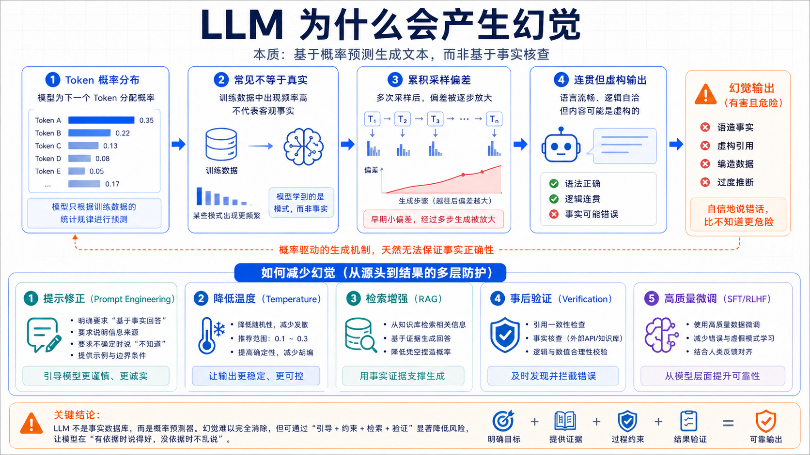

## 知识点讲解



### 1. 核心概念

LLM 产生幻觉的根本原因：**它是一个概率文本预测器，不是一个事实数据库**。

训练目标是"给定前文，预测下一个 Token 的概率"。这个目标和"生成事实正确的内容"在大多数情况下是对齐的，但不是完全等价的。对模型来说，一个"听起来很合理"的错误答案，其 Token 概率可能并不比正确答案低多少，甚至更高。

所以幻觉不是偶然失误，而是这个机制的系统性产物。

### 2. 技术细节

#### 2.1 从机制层面看幻觉的六个来源

**① 概率本质，而非事实本质**

模型的训练目标是最大化训练语料的似然，不是最大化"事实正确率"。当一个 Token 序列在训练语料中频繁出现，模型就倾向于生成它，不管它是不是真的。

**② 知识的模糊存储**

LLM 把知识以分布式方式编码在数以千亿计的参数里，不是一张事实数据库。对于频率高的知识，"编码"相对准确；对于训练中出现少的冷知识，参数里存的只是一个模糊的概率近似，容易失真。

**③ 训练数据质量**

互联网文本里本来就有大量错误信息、过时信息、矛盾陈述。模型吃进去的数据就有噪声，输出自然也有。

**④ 知识截止**

训练数据有截止日期。对于截止后的事件，模型没有真实知识，但 RLHF 训练让它倾向于给出答案而不是说"我不知道"，于是就编。

**⑤ 上下文混淆**

相似的上下文可能导致模型"混用"不同的知识。比如在描述两个相似的历史人物时，模型可能把 A 的事迹接到 B 的名字后面。

**⑥ RLHF 强化了自信表达**

人类标注者倾向于给"有帮助、听起来自信"的回答打高分，RLHF 训练让模型学会用确信的语气回答——但语气自信 ≠ 内容正确。

#### 2.2 什么情况下幻觉风险更高

| 风险因素 | 幻觉概率 | 工程应对 |
| --- | --- | --- |
| 冷知识 / 小众话题 | 高 | RAG 注入文档 |
| 知识截止后的事件 | 高 | 联网检索 / 明确说明知识截止 |
| 具体数字、日期、名字 | 中高 | 要求引用来源 |
| 复杂多步推理 | 中 | Chain of Thought + 验证 |
| 常见话题 | 低 | 通常可以信任 |

#### 2.3 应对策略的原理

- **RAG（检索增强）**：把知识从参数里"外置"到可检索的文档库，模型回答时参考文档而不是依赖记忆，准确率大幅提升
- **低温度采样**：减少采样随机性，让模型倾向于最高概率（通常更准确）的 Token
- **明确不确定性指令**：prompt 里加"不知道就说不知道"，对抗 RLHF 带来的过度自信
- **自我验证 / 多次采样**：让模型对自己的回答做 fact-check，或多次采样取共识（Self-Consistency）

## 代码示例

```python
from typing import Callable

def generate_with_hallucination_mitigation(
    llm: Callable,
    query: str,
    retriever: Callable,
    temperature: float = 0.1,
    n_samples: int = 3,
) -> dict:
    """
    综合三种策略减少幻觉：
    1. RAG：检索外部文档作为事实依据
    2. 低温度：减少随机性
    3. 自我一致性：多次采样取共识
    """

    # 策略 1：RAG
    docs = retriever(query)
    docs_text = "\n".join(f"- {d}" for d in docs)

    rag_prompt = f"""请基于以下参考资料回答问题。
如果资料中没有相关信息，请说"根据现有资料无法确定"。

参考资料：
{docs_text}

问题：{query}
回答："""

    # 策略 2 + 3：低温多次采样
    responses = []
    for _ in range(n_samples):
        resp = llm(rag_prompt, temperature=temperature)
        responses.append(resp)

    # 简单共识：找出现频率最高的关键答案片段
    # 实际可以用 LLM 做 consistency 检查
    from collections import Counter
    # ... 实际共识逻辑根据业务定制
    consensus = responses[0]   # 简化：取第一个

    return {
        "response": consensus,
        "all_samples": responses,
        "sources": docs,
        "confidence": "高" if len(set(responses)) == 1 else "中"
    }


def self_check_hallucination(llm: Callable, claim: str) -> dict:
    """
    让 LLM 自我 fact-check 一个陈述。
    对于 Agent 生成的关键事实可以做这个二次验证。
    """
    check_prompt = f"""请评估以下陈述的事实准确性。

陈述：{claim}

请从以下三个方面评估：
1. 你对这个陈述有多大把握（高/中/低）？
2. 这个陈述中哪些部分你不太确定？
3. 用户应该如何核实这个信息？

评估结果："""

    result = llm(check_prompt, temperature=0.1)
    return {"claim": claim, "self_check": result}
```

## 面试怎么答

LLM 幻觉的根本原因是它被训练成"预测概率最高的下一个 Token"，而不是"输出事实正确的信息"。这两件事大多数时候方向一致，但不总是。

具体来说，有几个来源：一是知识以分布式方式存在参数里，冷知识本来就存得不准确；二是训练数据里本身就有噪声；三是 RLHF 让模型学会用自信语气回答，但自信不等于正确；四是知识截止后的信息模型根本没有，但它不擅长说"我不知道"。

应对上，工程里主要靠四条：RAG 把知识外置到可检索文档库（最有效）、低温度减少随机采样、prompt 里明确让模型表达不确定性、关键信息用另一个 LLM 做 fact-check。完全消除做不到，工程目标是把幻觉率降到业务可接受的范围。

## 高频追问 & 加分点

- **Q1：RAG 为什么能减少幻觉？**  
    本质上是把"依赖参数记忆"换成"依赖检索到的文档"。文档可以随时更新、可以验证来源、模型读文档生成答案比从参数里"回忆"准确得多。但 RAG 不能解决检索错误或文档本身有错的问题。
- **Q2：模型变大，幻觉会减少吗？**  
    对常见知识有帮助，因为大模型见过更多的训练数据，常识性错误少。但对冷知识、超出训练分布的问题，大模型一样幻觉，而且因为更自信的表达，有时候"错得更理直气壮"。
- **Q3：Self-Consistency 是怎么减少幻觉的？**  
    对同一个问题多次采样，取共识答案。对于需要推理的问题，不同推理路径如果都得到同一个答案，这个答案的可信度更高；如果结果差异很大，说明模型本身不确定，应该降低置信度或者触发 RAG 兜底。
- **Q4：Agent 系统里怎么处理工具调用的幻觉？**  
    工具调用有一个好处：结果是可验证的。调用了数据库查询，结果对不对一眼能看出来。实践里我会在 Agent 的工具调用结果回来之后，让 LLM 做一个简单的"结果合理性检查"，异常就触发重试或上报。这比纯靠 LLM 生成"靠谱答案"要稳很多。
