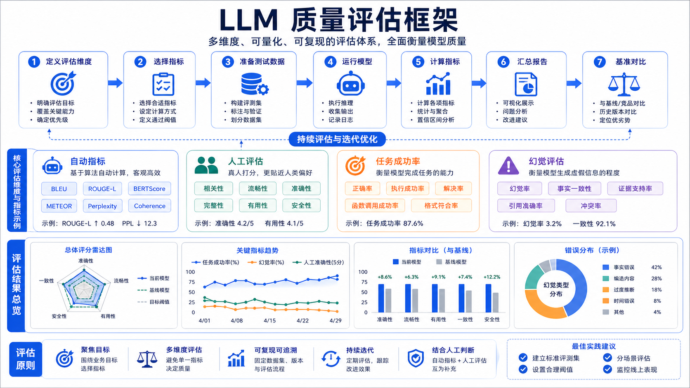

## 知识点讲解



### 1. 核心概念

评估 LLM 的质量，没有单一指标能覆盖全部。不同维度需要不同的评估方法，而且"通用指标好"和"实际任务好"也不完全一致。

实践里的评估框架通常分三层：

- **自动化指标**：快速便宜，但和"人觉得好"的相关性有限
- **标准基准数据集**：有可复现性，适合横向对比模型
- **人工评估 / LLM-as-Judge**：准确但贵，用于关键决策

三层配合用，不能只依赖其中一个。

### 2. 技术细节

#### 2.1 自动化指标

**BLEU / ROUGE**

- BLEU：n-gram 重叠率，主要用于机器翻译
- ROUGE：召回导向，主要用于摘要
- 局限：测的是字面相似，不是语义正确。开放问答用这两个几乎没意义

**Perplexity（困惑度）**

- 模型对测试文本的预测困惑度，越低说明模型越"熟悉"这种文本
- 适合比较同一系列模型，不适合跨模型或跨领域比较
- 困惑度低 ≠ 下游任务好

**准确率 / F1 / EM**

- 用于有标准答案的分类、抽取、选择题类任务
- 准确可靠，但只适用于封闭答案任务

#### 2.2 标准基准数据集

| 基准 | 评测维度 | 特点 |
| --- | --- | --- |
| MMLU | 多领域知识（57 个学科） | LLM 智力的综合测试 |
| HumanEval / MBPP | 代码生成 | 通过率，可自动执行验证 |
| GSM8K / MATH | 数学推理 | 步骤正确率 |
| TruthfulQA | 事实准确性、反幻觉 | 专门测模型不随波逐流 |
| MT-Bench | 多轮对话质量 | 用 GPT-4 打分 |
| BIG-Bench | 超大综合基准 | 集成 200+ 任务 |

#### 2.3 人工评估 / LLM-as-Judge

人工评估是最准确的，但贵：

- 准确性：内容是否事实正确
- 相关性：是否回答了问题
- 有帮助性：是否实际有用
- 安全性：是否包含有害内容

LLM-as-Judge（用 GPT-4 / Claude 替代人类打分）是现在的主流替代方案，成本低 10-100 倍，和人类评分的相关性在 80-90%。MT-Bench 就是这个范式的代表。

#### 2.4 实际项目的评估策略

面试官最关心"你怎么在实际项目里评估"。通常是这样：

1. 先跑标准基准，初步筛选候选模型
2. 用自己业务的测试集做针对性评估（能覆盖 80% 的真实场景）
3. 关键决策点做小范围人工评估
4. 上线后持续监控：在生产流量上采样做 LLM-as-Judge 的实时评估

## 代码示例

```python
import re
from typing import Callable

# --- 基础自动化指标 ---
def compute_exact_match(predictions: list[str], references: list[str]) -> float:
    """精确匹配（适合有标准答案的 QA）"""
    correct = sum(p.strip() == r.strip() for p, r in zip(predictions, references))
    return correct / len(predictions)

def compute_f1(prediction: str, reference: str) -> float:
    """Token F1（适合开放 QA）"""
    pred_tokens = set(prediction.lower().split())
    ref_tokens  = set(reference.lower().split())
    if not pred_tokens or not ref_tokens:
        return 0.0
    overlap = pred_tokens & ref_tokens
    precision = len(overlap) / len(pred_tokens)
    recall    = len(overlap) / len(ref_tokens)
    if precision + recall == 0:
        return 0.0
    return 2 * precision * recall / (precision + recall)


# --- LLM-as-Judge ---
def llm_judge_response(
    judge_llm: Callable,
    question: str,
    response: str,
    criteria: list[str] = None
) -> dict:
    """
    用另一个 LLM 作为评判者，对回答打分。
    criteria 可以是 ['准确性', '有帮助性', '安全性'] 等。
    """
    criteria = criteria or ["准确性", "相关性", "有帮助性"]
    criteria_text = "、".join(criteria)

    prompt = f"""你是一个专业的 AI 回答质量评估者。
请从以下维度评估这个回答的质量（每个维度 1-5 分）：{criteria_text}

问题：{question}
回答：{response}

请按以下格式输出评分和理由：
准确性: X/5 — 理由
相关性: X/5 — 理由
有帮助性: X/5 — 理由
综合评分: X/5"""

    judge_response = judge_llm(prompt, temperature=0.1)

    # 解析分数（简化版）
    scores = {}
    for criterion in criteria:
        match = re.search(rf"{criterion}:\s*(\d)/5", judge_response)
        if match:
            scores[criterion] = int(match.group(1))

    return {"raw": judge_response, "scores": scores}


# --- 端到端评估 pipeline ---
def evaluate_llm_pipeline(
    candidate_llm: Callable,
    judge_llm: Callable,
    test_cases: list[dict],  # [{"question": ..., "reference": ...}]
) -> dict:
    """对候选模型跑完整评估 pipeline"""
    em_scores, f1_scores, judge_scores = [], [], []

    for case in test_cases:
        q   = case["question"]
        ref = case["reference"]

        # 生成回答
        pred = candidate_llm(q, temperature=0.1)

        # 自动化指标
        em_scores.append(compute_exact_match([pred], [ref]))
        f1_scores.append(compute_f1(pred, ref))

        # LLM-as-Judge
        judge_result = llm_judge_response(judge_llm, q, pred)
        avg_score = sum(judge_result["scores"].values()) / max(len(judge_result["scores"]), 1)
        judge_scores.append(avg_score)

    return {
        "exact_match":    sum(em_scores) / len(em_scores),
        "token_f1":       sum(f1_scores) / len(f1_scores),
        "judge_avg_score": sum(judge_scores) / len(judge_scores),
        "sample_count":   len(test_cases),
    }
```

## 面试怎么答

评估 LLM 质量要分层来看。自动化指标（BLEU、ROUGE、准确率）快速便宜，但只能反映局部——比如 BLEU 测的是 n-gram 重叠，不是语义正确，开放问答几乎用不上。

标准基准数据集（MMLU、HumanEval、TruthfulQA 等）有可复现性，适合横向对比不同模型，但基准好不等于实际任务好——必须用自己业务的测试集做针对性验证。

对于真实效果评估，现在主流是 LLM-as-Judge：用 GPT-4 或 Claude 充当评判者，对输出打分。成本比人工低 10-100 倍，和人类评分相关性在 80-90%，实际项目基本够用。但 LLM-as-Judge 本身也有偏差，比如倾向于给更长的回答打高分，这点要注意。

上线后还需要持续监控：在生产流量上按比例采样，实时跑 LLM-as-Judge，发现质量下降及时处理。

## 高频追问 & 加分点

- **Q1：基准好但实际任务差，为什么？**  
    基准数据集的分布和实际业务数据分布不一样——这叫"评估集漂移"。模型可能专门在基准分布上很好，但到了你的垂直场景表现差。所以必须构建自己业务的评估集，哪怕只有 100-200 条，也比完全依赖通用基准准。
- **Q2：LLM-as-Judge 有什么偏差？**  
    已知的偏差有：位置偏差（先出现的回答评分偏高）、长度偏差（更长的回答评分偏高）、自我偏好（GPT-4 倾向给 GPT-4 生成的内容高分）。缓解方式：随机化 A/B 顺序、控制回答长度、对比多个 Judge 模型。
- **Q3：代码生成任务怎么评估？**  
    这块比较好办，因为代码是可执行的。HumanEval 的做法是：生成代码后跑单元测试，看通过率（Pass@k）。Pass@1 是只生成一次的通过率，Pass@10 是生成 10 次取最好的通过率。这个指标比让 LLM 判断代码好不好准确得多。
- **Q4：怎么评估 Agent 系统的质量？**  
    Agent 的评估更复杂，因为不只看最终输出，还要看过程。三个核心指标：① 任务完成率（最终结果对不对）；② 步数效率（实际步数 / 最优步数）；③ 工具调用正确率（选对工具、参数对不对）。另外还要监控 token 成本和延迟，这是生产里老板最关心的。
