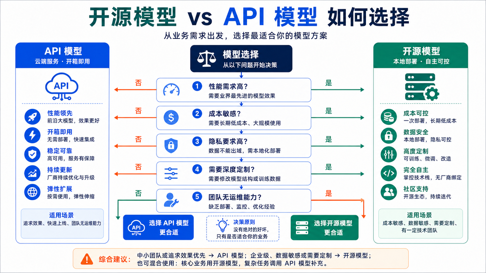

## 知识点讲解



### 1. 核心概念

开源模型（Llama 3.x、Qwen 2.5+、DeepSeek-V3、Mistral 等）和 API 模型（GPT-4o/o1/o3、Claude 3.5+、Gemini 2.x 等）是目前 LLM 使用的两条路径，本质上是在几个维度上做权衡：**能力上限 vs 可控性、即用性 vs 定制性、成本结构 vs 数据安全**。

需要先纠正一个常见误解：**开源 ≠ 落后**。2024 年之后 Llama 3.1 405B、DeepSeek-V3、Qwen 2.5-Max 在不少 benchmark 上已经追平甚至反超 GPT-4o，特别是 coding 和数学推理。真正还有明显差距的是**超长上下文（200K+）、多模态（图/音/视频）、最新一代推理模型（o1/o3 / DeepSeek-R1 这种 test-time compute 路线）**——这几块 API 阵营暂时领先。

没有哪个选择是绝对更好的，只有在当前约束下最合适的那个。

### 2. 技术细节

#### 2.1 核心维度对比

| 维度 | 开源模型 | API 模型 |
| --- | --- | --- |
| 通用能力上限 | 已与 API 模型基本持平（Llama 3.1 405B / DeepSeek-V3 / Qwen 2.5-Max） | 仍领先于：超长上下文、多模态、最新推理模型（o1/o3） |
| 数据隐私 | 高（完全自部署） | 低（数据上传第三方） |
| 定制化 | 高（可 fine-tune / LoRA） | 低（黑盒，只能 prompt 调整） |
| 运维门槛 | 高（GPU 集群、推理服务） | 低（调 API 就行） |
| 成本结构 | 基础设施固定成本（GPU 月租） | 按 Token 计费（用量变动） |
| 更新速度 | 社区节奏，每 3-6 月一波大版本 | 官方持续更新（OpenAI/Anthropic 季度迭代） |

#### 2.2 开源模型不等于"免费"

这是最常见的误解。开源模型的硬件成本是真实的：

- 7B 模型：至少 1 张 A100/H100（约 $2/小时），才能跑合理速度
- 70B 模型：需要 4-8 张 A100，组 tensor parallel
- 上线后还需要：推理框架（vLLM、TGI）、负载均衡、监控、运维工程师

中小公司如果没有 ML Infra 团队，算下来开源模型的总成本可能不比 API 便宜。

#### 2.3 选择决策树

实际决策可以按这个顺序走：

1. **有没有数据隐私硬要求？** → 有就必须开源自部署
2. **有没有深度定制需求？** → 需要微调特定领域，选开源
3. **团队有没有 ML Infra 能力？** → 没有就选 API，开源运维成本会超预期
4. **成本预算是否充裕？** → 预算紧、量不大，先用 API；量大算 BreakEven
5. **对延迟有没有极端要求？** → 本地部署延迟可控，API 受网络和限流影响

#### 2.4 混合策略

很多生产场景的实际选择是混合：

- **简单任务 + 高频**：开源小模型（Llama-7B / Mistral-7B）降成本
- **复杂推理 / 长上下文**：API 模型保质量
- **敏感数据**：必须走开源自部署
- **原型验证**：先 API 快速验证，成本可接受再考虑开源替换

## 代码示例

```python
# 统一接口封装，让切换开源/API 代价最小
from abc import ABC, abstractmethod
from dataclasses import dataclass

@dataclass
class LLMResponse:
    text: str
    input_tokens:  int
    output_tokens: int
    latency_ms:    float

class BaseLLM(ABC):
    @abstractmethod
    def generate(self, prompt: str, **kwargs) -> LLMResponse:
        ...

# --- API 模型（以 OpenAI 为例）---
class OpenAILLM(BaseLLM):
    def __init__(self, model: str = "gpt-4o"):
        import openai
        self.client = openai.OpenAI()
        self.model  = model

    def generate(self, prompt: str, temperature: float = 0.7, **kwargs) -> LLMResponse:
        import time
        start = time.time()
        resp  = self.client.chat.completions.create(
            model=self.model,
            messages=[{"role": "user", "content": prompt}],
            temperature=temperature,
        )
        return LLMResponse(
            text          = resp.choices[0].message.content,
            input_tokens  = resp.usage.prompt_tokens,
            output_tokens = resp.usage.completion_tokens,
            latency_ms    = (time.time() - start) * 1000,
        )

# --- 开源模型（以 vLLM 本地服务为例）---
class OpenSourceLLM(BaseLLM):
    def __init__(self, base_url: str = "http://localhost:8000"):
        import openai
        # vLLM 兼容 OpenAI 格式
        self.client = openai.OpenAI(api_key="EMPTY", base_url=base_url)

    def generate(self, prompt: str, temperature: float = 0.7, **kwargs) -> LLMResponse:
        import time
        start = time.time()
        resp  = self.client.chat.completions.create(
            model="meta-llama/Llama-3.1-8B-Instruct",
            messages=[{"role": "user", "content": prompt}],
            temperature=temperature,
        )
        return LLMResponse(
            text          = resp.choices[0].message.content,
            input_tokens  = resp.usage.prompt_tokens,
            output_tokens = resp.usage.completion_tokens,
            latency_ms    = (time.time() - start) * 1000,
        )

# --- 成本估算工具 ---
def estimate_monthly_cost(
    daily_requests: int,
    avg_input_tokens: int,
    avg_output_tokens: int,
    strategy: str = "api"    # "api" | "opensource"
) -> dict:
    monthly_requests = daily_requests * 30

    if strategy == "api":
        # 价格仅示例，以官网最新报价为准
        # 这里用 gpt-4o 当前价位作示例：input $2.5/1M, output $10/1M
        input_cost  = monthly_requests * avg_input_tokens  * 2.5 / 1_000_000
        output_cost = monthly_requests * avg_output_tokens * 10  / 1_000_000
        infra_cost  = 0
        total = input_cost + output_cost
    else:
        # 2× A100 GPU 服务器（估算）
        infra_cost  = 2 * 2.0 * 24 * 30   # $2/hr per GPU
        input_cost  = 0
        output_cost = 0
        total = infra_cost

    return {
        "strategy":     strategy,
        "monthly_cost": f"${total:.0f}",
        "infra_cost":   f"${infra_cost:.0f}",
        "token_cost":   f"${input_cost + output_cost:.0f}",
    }

# 示例：每天 1000 次请求，平均 1K input + 500 output tokens
print(estimate_monthly_cost(1000, 1000, 500, strategy="api"))
print(estimate_monthly_cost(1000, 1000, 500, strategy="opensource"))
```

## 面试怎么答

开源和 API 的核心权衡是：**能力和即用性 vs 可控性和定制性**。API 模型（GPT-4、Claude）目前能力上限仍然更高，上手极快，但数据要上传第三方、黑盒无法定制；开源模型（Llama、Mistral、Qwen）可以完全自部署、可以微调，但运维成本是真实的，不是"免费"。

决策顺序：先问数据隐私——有隐私硬约束，必须开源自部署；再问团队能力——没有 ML Infra 能力，开源运维成本会超预期，先用 API；再算量——量大用开源算 BreakEven，量小用 API 更灵活。

实际生产里很多团队用混合策略：简单高频任务用开源小模型控成本，复杂推理用 API 保质量，敏感数据走本地。这也是我比较推荐的起手策略。

## 高频追问 & 加分点

- **Q1：开源模型和 API 模型的性能差距还大吗？**  
    到 2026 年初，**通用能力已经基本持平甚至开源反超**。Llama 3.1 405B、DeepSeek-V3、Qwen 2.5-Max 在 MMLU、HumanEval、MATH 这些主流 benchmark 上和 GPT-4o 是同一档。**真正还有差距的有三块**：① 超长上下文（200K+ tokens 稳定）；② 多模态（图/音/视频原生融合）；③ 最新一代推理模型（o1/o3、DeepSeek-R1 这种 test-time compute 路线刚刚开始有开源版）。回答时区分清楚"哪类任务还有差距"是大厂面试官最在意的。
- **Q2：开源模型微调成本大概是多少？**  
    全量微调 7B 模型大概需要 2-4 张 A100，跑 1-3 天，云上成本大概 500-2000。用 LoRA / QLoRA 可以大幅降低：单张 A100 或消费级 GPU 就够，成本降到 100 以内。对于垂直领域适配，LoRA 通常已经够用。
- **Q3：vLLM 是什么，为什么部署开源模型都用它？**  
    vLLM 是一个高性能 LLM 推理框架，核心优化是 PagedAttention——用操作系统内存分页的思路管理 KV-Cache，大幅提升 GPU 利用率和并发吞吐。对比 HuggingFace 原生推理，vLLM 在生产级并发场景下通常快 10-30 倍，而且兼容 OpenAI API 格式，迁移成本低。
- **Q4：如果已经在用 API，怎么评估要不要换开源？**  
    算三件事：① 现在的月均 token 成本；② 开源替换的硬件成本（设备 / 云 GPU）+ 工程成本（搭推理服务、维护）；③ 性能对比（跑业务测试集，不要只信通用基准）。BreakEven 点大概在月均 API 成本超 $3000-5000 之后，换开源才划算。
