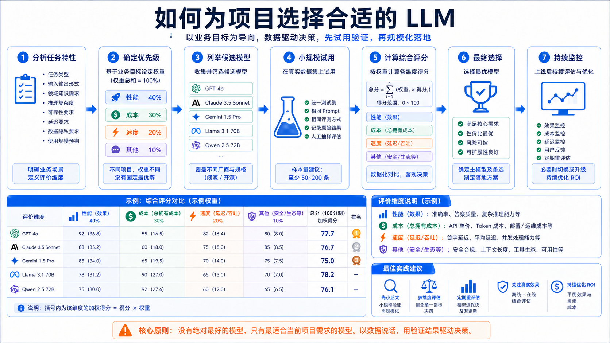

## 知识点讲解



### 1. 核心概念

为项目选 LLM，不是"哪个模型评测分最高就选哪个"，而是在**性能、成本、延迟、隐私、可控性**这几个维度上找到当前项目最匹配的那个。

实践里的选择流程通常是这样：**明确需求 → 排除不符合的 → 小规模验证 → A/B 对比 → 上线后持续监控**。第一次选择通常不是最终答案，随着项目规模变化和模型进步，需要周期性重新评估。

### 2. 技术细节

#### 2.1 核心决策维度

**① 任务类型与模型能力匹配**

不同模型有各自的强项：

| 场景 | 推荐方向（2026 年初格局） | 理由 |
| --- | --- | --- |
| 中文理解/生成 | Qwen 2.5+、DeepSeek-V3、GLM-4 | 中文训练数据更多，开源强 |
| 代码生成 | Claude 3.5/3.7 Sonnet、DeepSeek-Coder-V2、GPT-4o | 代码专项训练 + 长链路理解 |
| 长上下文（>200K） | Claude 3.5+（200K）、Gemini 1.5/2.x（1M+） | 长文档/全代码库处理 |
| 低延迟对话 | Claude 3.5 Haiku、GPT-4o-mini、Mistral 7B 本地 | 速度快、成本低 |
| **深度推理（数学/逻辑/规划）** | **o1 / o3-mini / DeepSeek-R1 / Claude 3.7 Sonnet (extended thinking)** | **专门的 test-time compute / 思维链原生模型** |
| 通用复杂任务 | GPT-4o、Claude 3.5/3.7 Sonnet、Llama 3.1 405B | 综合能力强 |
| 多模态（图/音/视频） | Gemini 2.x、GPT-4o、Claude 3.5+ | 原生多模态训练 |

**② 成本结构**

- API 模型：按 Token 计费，量小时灵活，量大时贵
- 开源模型：固定基础设施成本，量大时性价比更高

**③ 延迟要求**

- 实时对话（&lt;3 秒）：小模型本地部署，或 Claude Haiku / GPT-4o-mini 这类小参数 API 模型
- 后台批处理（无延迟限制）：大模型 + Batch API（通常便宜 50%）
- **注意推理模型的延迟坑**：o1/o3/DeepSeek-R1 这类是 test-time compute 路线，单次 latency 可能 10-30s，不能用在实时交互场景

**④ 隐私与合规**

医疗、金融、政务场景的数据不能出境 / 上传第三方 → 强制本地部署开源模型

**⑤ 上下文窗口**

| 需求 | 最低要求 |
| --- | --- |
| 普通对话 | 4K 够用 |
| 长文档摘要 | 16K-32K |
| 全文档分析 | 128K+ |
| 全代码库分析 | 200K+ |

#### 2.2 快速筛选框架

```
有数据隐私约束？
  → 是：只考虑开源模型（Llama/Mistral/Qwen）
  → 否：API + 开源都可以考虑

对延迟极敏感（<1s）？
  → 是：本地小模型或 GPT-3.5-Turbo 级别 API
  → 否：继续

深度推理（数学/规划/agentic 长链路）？
  → 是：o1 / o3-mini / DeepSeek-R1 / Claude 3.7 Sonnet (extended thinking)
  → 否，但要复杂推理 / 长上下文：GPT-4o / Claude 3.5 Sonnet / Llama 3.1 405B
  → 简单任务：中小模型（Claude Haiku / GPT-4o-mini / 开源 8B Instruct）

月 Token 成本 > $3000？
  → 考虑开源替换
  → 否：先用 API，节省运维成本
```

### 3. 对比与拓展

选错了怎么办？其实切换成本不高——如果架构做好了，LLM 调用是封装的，换模型只需改一个配置。所以**初期选择不用太焦虑，快速验证比完美决策更重要**。

建议：先用 API 快速跑通 MVP，验证产品方向；产品稳定、量上来之后，再根据成本和性能数据评估是否迁移开源。

## 代码示例

```python
from dataclasses import dataclass, field
from typing import Callable

@dataclass
class ProjectRequirements:
    task_type: str            # "chat" | "code" | "rag" | "summarize" | "analysis"
    daily_requests: int
    avg_tokens_per_req: int
    max_latency_ms: int       # 最大可接受延迟
    data_privacy: bool        # 是否有隐私/合规约束
    budget_monthly_usd: float
    context_window_needed: int = 4096
    chinese_dominant: bool = False   # 中文为主


@dataclass
class ModelCandidate:
    name: str
    context_window: int
    avg_latency_ms: int
    price_per_1k_input:  float   # API 模式
    price_per_1k_output: float
    supports_local: bool
    chinese_quality: str   # "excellent" | "good" | "fair"
    reasoning_quality: str # "excellent" | "good" | "fair"


def select_llm(req: ProjectRequirements, candidates: list[ModelCandidate]) -> list[dict]:
    """根据项目需求对候选模型打分排序"""
    scored = []

    for model in candidates:
        score = 0.0
        reasons = []
        disqualified = False

        # 硬性约束
        if req.data_privacy and not model.supports_local:
            disqualified = True
            reasons.append("❌ 不支持本地部署，不满足隐私要求")

        if model.context_window < req.context_window_needed:
            disqualified = True
            reasons.append(f"❌ 上下文窗口 {model.context_window} < 需要的 {req.context_window_needed}")

        if model.avg_latency_ms > req.max_latency_ms:
            disqualified = True
            reasons.append(f"❌ 延迟 {model.avg_latency_ms}ms 超过限制 {req.max_latency_ms}ms")

        if disqualified:
            scored.append({"model": model.name, "score": -1, "reasons": reasons})
            continue

        # 成本评分（30%权重）
        monthly_cost = (req.daily_requests * 30 * req.avg_tokens_per_req *
                        (model.price_per_1k_input + model.price_per_1k_output) / 1000)
        if monthly_cost <= req.budget_monthly_usd:
            score += 30 * (1 - monthly_cost / req.budget_monthly_usd)
            reasons.append(f"✅ 月成本 ${monthly_cost:.0f} 在预算内")
        else:
            score -= 20
            reasons.append(f"⚠️ 月成本 ${monthly_cost:.0f} 超出预算 ${req.budget_monthly_usd}")

        # 中文质量（20%）
        if req.chinese_dominant:
            quality_map = {"excellent": 20, "good": 10, "fair": 0}
            score += quality_map.get(model.chinese_quality, 0)

        # 推理质量（30%）
        if req.task_type in ["analysis", "code", "rag"]:
            quality_map = {"excellent": 30, "good": 15, "fair": 5}
            score += quality_map.get(model.reasoning_quality, 0)

        scored.append({"model": model.name, "score": score, "reasons": reasons})

    scored.sort(key=lambda x: x["score"], reverse=True)
    return scored


# 使用示例
req = ProjectRequirements(
    task_type="rag", daily_requests=500, avg_tokens_per_req=2000,
    max_latency_ms=3000, data_privacy=False,
    budget_monthly_usd=1000, context_window_needed=16000,
    chinese_dominant=True
)

candidates = [
    ModelCandidate("gpt-4o",           128000, 800,  0.005, 0.015, False, "good",      "excellent"),
    ModelCandidate("claude-3-haiku",   200000, 500,  0.00025, 0.00125, False, "good", "good"),
    ModelCandidate("qwen-72b-local",   32000,  1500, 0.0,   0.0,   True,  "excellent", "good"),
    ModelCandidate("llama-3.1-8b",     128000, 200,  0.0,   0.0,   True,  "fair",      "fair"),
]

results = select_llm(req, candidates)
for r in results:
    print(f"{r['model']:25s} score={r['score']:.1f}")
    for reason in r["reasons"]:
        print(f"  {reason}")
```

## 面试怎么答

为项目选 LLM 不是看谁评测分最高，而是在几个关键维度上找最匹配的：任务类型、成本、延迟、隐私合规、上下文窗口、中文质量。

我自己的选择顺序是：先排除硬性约束（隐私要求 → 必须开源自部署；上下文不够 → 排除；延迟不够 → 排除小模型以外的）；然后在剩余候选里按成本效益打分；最后一定要用自己业务的测试集实际跑一遍对比，通用基准只是参考。

初期选择不要追求完美，快速验证更重要。API 先跑通 MVP，量上来之后再评估是否迁移开源。而且这个决策需要定期重新评估，半年前最好的选择，现在未必是。

## 高频追问 & 加分点

- **Q1：如何快速搭建自己业务的评估集？**  
    从真实用户请求里采样 100-200 条（保护隐私后脱敏），加上边界 case、容易出错的场景、你最关心的能力点。用 LLM-as-Judge 跑候选模型对比，3-5 天就能得出有参考价值的结论。不要只跑通用基准。
- **Q2：Batch API 是什么，什么时候用？**  
    OpenAI 和 Anthropic 都提供 Batch API，把大量请求打包处理，通常 24 小时内返回结果，价格是实时 API 的 50%。适合离线场景：数据标注、批量摘要、非实时分析。对延迟不敏感的任务，Batch API 能降一半成本。
- **Q3：怎么评估模型切换的工程成本？**  
    关键是在架构上是否做了抽象层。如果 LLM 调用是通过统一接口封装的（比如 LangChain 的 ChatModel 或自定义 BaseLLM），切换模型只需改配置，工程成本接近零。如果模型调用是散落在各处的，切换成本就很高。所以早期就要把 LLM 调用抽象出来。
- **Q4：大模型和小模型怎么分工？**  
    一个常见的成本优化模式是路由：简单任务（分类、摘要、格式转换）路由到小模型（7B 本地或 Claude Haiku），复杂任务（多步推理、长文档分析）路由到大模型。路由器本身可以用一个规则集或者轻量分类器。这种分层路由通常能在不明显降低质量的前提下把成本降 30-60%。
