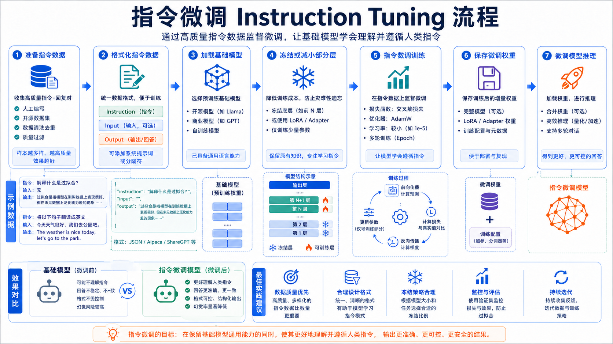

## 知识点讲解



### 1. 核心概念

指令微调（Instruction Tuning，也叫 SFT，Supervised Fine-Tuning）是让 LLM 从"文本补全器"变成"任务执行器"的关键步骤。

预训练结束的模型只会"续写文本"——你给它"中国的首都是"，它会给你"中国的首都是北京，位于……"。它不会按指令做事，也不会遵循特定格式。

指令微调在`{指令 → 期望回答}`对上继续训练，让模型学会理解自然语言指令并执行。完成之后，你说"把这段话翻译成英文"，模型就真的翻译，不是续写。

### 2. 技术细节

#### 2.1 指令微调的核心机制

**数据格式**：每条数据包含指令（instruction）、可选的输入（input）、期望输出（output）。

**训练目标**：和预训练一样，最小化交叉熵 loss——但只在 output 部分计算 loss，instruction 和 input 部分的 loss 被 mask 掉。

为什么只算 output 的 loss？因为我们想让模型学的是"怎么回答"，不是"怎么复述指令"。

**数据量**：质量比数量重要得多。LIMA 论文（2023）用 1000 条精心筛选的指令数据，效果超过了数万条低质量数据的微调结果。

#### 2.2 指令微调 vs 预训练 vs RLHF

| 维度 | 预训练 | 指令微调（SFT） | RLHF |
| --- | --- | --- | --- |
| 数据类型 | 无标签文本 | 指令-回答对 | 人类偏好对比 |
| 数据量 | TB 级 | 1K-100K 条 | 数万条 |
| 训练时间 | 数月 | 数小时-数天 | 数小时 |
| 目标 | 学语言规律 | 学指令遵循 | 学人类偏好 |
| 成本 | 极高 | 低 | 中 |

#### 2.3 高效微调：LoRA

全量微调需要更新所有参数，显存和算力要求很高。LoRA（Low-Rank Adaptation）的思路是：在原始权重旁边加一个低秩矩阵 `W = W₀ + ΔW`，`ΔW = A×B`（A 和 B 是小矩阵），只训练 A 和 B，原始参数冻结。

效果：参数量只有全量的 1-10%，显存降低 3-10 倍，效果接近全量微调。现在开源社区的微调基本都用 LoRA 或 QLoRA（4-bit 量化 + LoRA）。

#### 2.4 什么时候需要微调，什么时候 Prompt 够用

| 情况 | 推荐方案 |
| --- | --- |
| 特定输出格式 | 先试 prompt（Few-shot），不行再微调 |
| 特定写作风格 | 微调（prompt 难以稳定复现风格） |
| 垂直领域知识 | RAG 优先，不够再微调 |
| 极低延迟要求 | 微调小模型，比用大模型 prompt 快 |
| 大量重复格式任务 | 微调（省 prompt token 成本） |

## 代码示例

```python
from transformers import AutoModelForCausalLM, AutoTokenizer, TrainingArguments
from peft import LoraConfig, get_peft_model, TaskType
from datasets import Dataset
import torch

# --- 准备指令数据 ---
raw_data = [
    {
        "instruction": "将以下句子翻译成英文",
        "input": "今天天气很好，适合出去走走。",
        "output": "The weather is great today, perfect for a walk."
    },
    {
        "instruction": "提取以下文本中的人名",
        "input": "张三和李四是同学，他们都认识王五。",
        "output": "张三、李四、王五"
    },
    # ... 更多数据
]

def format_instruction(example: dict) -> str:
    """把数据格式化成模型训练用的文本"""
    if example.get("input"):
        return (f"### 指令：\n{example['instruction']}\n\n"
                f"### 输入：\n{example['input']}\n\n"
                f"### 回答：\n{example['output']}")
    return (f"### 指令：\n{example['instruction']}\n\n"
            f"### 回答：\n{example['output']}")


# --- LoRA 配置 ---
def create_lora_model(base_model_name: str = "meta-llama/Llama-2-7b-hf"):
    model     = AutoModelForCausalLM.from_pretrained(base_model_name, torch_dtype=torch.float16)
    tokenizer = AutoTokenizer.from_pretrained(base_model_name)
    tokenizer.pad_token = tokenizer.eos_token

    lora_config = LoraConfig(
        task_type   = TaskType.CAUSAL_LM,
        r           = 16,         # LoRA rank，越大效果越接近全量，显存也越大
        lora_alpha  = 32,         # 缩放因子
        target_modules = ["q_proj", "v_proj"],  # 对哪些层加 LoRA
        lora_dropout   = 0.05,
        bias           = "none",
    )
    model = get_peft_model(model, lora_config)
    model.print_trainable_parameters()
    # 输出大概：trainable params: 4,194,304 || all params: 6,742,609,920 || trainable%: 0.062
    return model, tokenizer


# --- 训练时只在回答部分计算 loss ---
def tokenize_with_output_mask(example: dict, tokenizer, max_length: int = 512):
    full_text  = format_instruction(example)
    input_text = format_instruction({**example, "output": ""})  # 没有回答的部分

    full_ids  = tokenizer(full_text, max_length=max_length, truncation=True)["input_ids"]
    input_len = len(tokenizer(input_text)["input_ids"])

    labels = full_ids.copy()
    labels[:input_len] = [-100] * input_len  # 指令部分 loss 设 -100（忽略）

    return {"input_ids": full_ids, "labels": labels}


# --- 推理：使用微调后的模型 ---
def inference(model, tokenizer, instruction: str, input_text: str = "") -> str:
    prompt = (f"### 指令：\n{instruction}\n\n"
              + (f"### 输入：\n{input_text}\n\n" if input_text else "")
              + "### 回答：\n")

    input_ids = tokenizer(prompt, return_tensors="pt").input_ids
    with torch.no_grad():
        output_ids = model.generate(input_ids, max_new_tokens=200, temperature=0.1)

    new_ids = output_ids[0, input_ids.shape[1]:]
    return tokenizer.decode(new_ids, skip_special_tokens=True)
```

## 面试怎么答

指令微调（SFT）是让 LLM 从"文本补全"变成"遵循指令执行任务"的关键步骤。方式是在高质量的指令-回答对数据上继续训练，而且只在回答部分计算 loss，指令部分 mask 掉——因为我们想让模型学"怎么回答"，不是"怎么复述指令"。

数据质量远比数量重要。LIMA 用 1000 条精心筛选的数据，效果超过了大量低质量数据微调的模型。这说明精挑细选的示例，比随便堆数量有效得多。

工程上全量微调门槛高，现在基本都用 LoRA——只训练插入的低秩矩阵，可训练参数只有全量的 1-10%，显存降低 3-10 倍，效果接近全量。什么时候微调？当 prompt 优化的效果达不到要求，或者需要稳定的特定风格和格式，或者微调小模型来替换昂贵的 API，这时候才值得投入。

## 高频追问 & 加分点

- **Q1：LoRA 为什么有效？直觉上怎么理解？**  
    直觉是：微调时参数的更新量 ΔW 通常是低秩的（大多数方向的变化很小，只有少数方向变化大）。LoRA 就直接用两个小矩阵的乘积来近似这个低秩更新，极大地减少了训练参数。在实验上证明这个假设基本成立——对大多数任务，低秩更新就够了。
- **Q2：微调后模型会不会遗忘原来的能力？**  
    会，叫"灾难性遗忘"。主要原因是学习率太高或者数据分布和预训练差异太大。缓解方式：用低学习率（1e-5 量级）、LoRA（只改少量参数，原始权重不动）、保持微调数据多样性（不只有一个任务的数据）。
- **Q3：指令数据怎么来？**  
    三个来源：① 人工标注（质量最高，成本最贵）；② 用强 LLM（GPT-4）生成（Self-Instruct 方法，Alpaca 就是这么做的，成本低，质量中等）；③ 从已有数据集整理（比如把 StackOverflow 的 Q&A 整理成指令格式）。实践里通常混合用。
- **Q4：什么情况下选 LoRA 而不是全量微调？**  
    几乎总是先选 LoRA：显存要求低（单卡可以微调 7B 甚至 13B 模型）、速度快、部署方便（LoRA 权重文件很小，基础模型共享）。只有需要极致性能、或者目标任务和基础模型分布差距很大时，才考虑全量微调。
