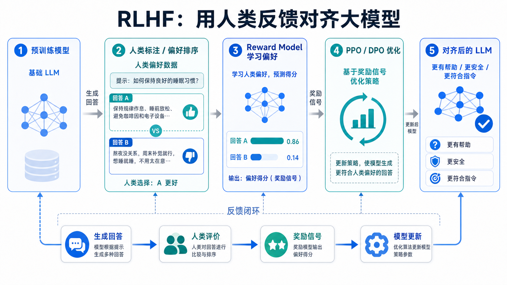

## 知识点讲解



### 1. 核心概念

RLHF（Reinforcement Learning from Human Feedback，人类反馈强化学习）解决的是 SFT 之后的"质量上限"问题。

SFT 训练的是"把指令格式的文本续写正确"，但"正确"本身是多维度的——有帮助、安全、诚实、不啰嗦……这些维度在人工标注的答案里都混在一起，SFT 很难精确区分哪些维度对哪些场景更重要。

RLHF 换了一个思路：不给模型一个"标准答案"，而是给它"人类更喜欢哪个回答"的比较信号，让模型向着"人类喜欢"的方向优化。这就是 ChatGPT 等模型表现出"人性化"的核心原因。

### 2. 技术细节

#### 2.1 RLHF 的三个阶段

**阶段一：SFT（监督微调）**  
在指令-回答对上微调，得到一个"基础能力对"的模型，作为 RLHF 的起点。

**阶段二：训练奖励模型（Reward Model）**

- 让 SFT 模型对同一个问题生成多个不同的回答
- 人类标注员对这些回答排名（哪个更好）
- 用这些偏好数据训练一个"奖励模型"——它的输入是问题+回答，输出是一个分数

**阶段三：PPO 策略优化**

- 用当前 LLM 生成回答
- 奖励模型给这个回答打分
- PPO 算法更新 LLM 参数，让它生成"奖励更高的回答"
- 同时用 KL 散度约束，防止 LLM 偏离 SFT 基础版本太远

#### 2.2 RLHF 的价值

| 能力 | SFT 后 | RLHF 后 |
| --- | --- | --- |
| 有帮助性 | 中 | 高 |
| 安全性（拒绝有害请求） | 低 | 高 |
| 格式一致性 | 中 | 高 |
| 减少幻觉 | 低 | 中 |
| 对齐人类价值观 | 低 | 中高 |

#### 2.3 RLHF 的主要问题与替代方案

**奖励 Hacking**：PPO 可能找到让奖励模型打高分但实际质量差的策略（比如说废话把答案拉长，因为奖励模型对长答案有偏好）。解决：定期更新奖励模型，加强 KL 约束。

**人工标注成本高**：每条偏好数据都需要人工比较，费时费钱。替代方案：RLAIF（用另一个 LLM 代替人类标注偏好）。

**PPO 训练不稳定**：超参数多，容易振荡。替代方案：

- **DPO（Direct Preference Optimization）**：跳过单独训练奖励模型，直接在偏好数据上优化 LLM，训练更稳定、实现更简单，效果相当
- **ORPO / SimPO**：更进一步简化 DPO 的变体

## 代码示例

下面展示 RLHF 三个阶段的核心逻辑，以及 DPO 的对比实现。

```python
import torch
import torch.nn.functional as F
from typing import Callable

# --- 阶段二：奖励模型训练 ---
class RewardModel(torch.nn.Module):
    """
    奖励模型：输入 (question, response)，输出标量分数。
    通常在 SFT 模型基础上加一个线性头。
    """
    def __init__(self, base_model, hidden_size: int = 4096):
        super().__init__()
        self.base  = base_model
        self.score = torch.nn.Linear(hidden_size, 1, bias=False)

    def forward(self, input_ids, attention_mask=None):
        hidden = self.base(input_ids, attention_mask=attention_mask).last_hidden_state
        # 取最后一个 token 的表示作为序列级别的分数
        return self.score(hidden[:, -1, :]).squeeze(-1)

def train_reward_model(reward_model, chosen_ids, rejected_ids, optimizer):
    """
    偏好学习：让 chosen 的分数 > rejected 的分数。
    使用 BradleyTerry 模型：loss = -log(sigmoid(score_chosen - score_rejected))
    """
    score_chosen   = reward_model(chosen_ids)
    score_rejected = reward_model(rejected_ids)
    loss = -F.logsigmoid(score_chosen - score_rejected).mean()

    optimizer.zero_grad()
    loss.backward()
    optimizer.step()
    return loss.item()


# --- 阶段三：PPO 核心逻辑（骨架）---
def ppo_step(
    policy_model,
    ref_model,        # SFT 基础模型，frozen
    reward_model,
    prompt_ids: torch.Tensor,
    optimizer,
    kl_coef: float = 0.1,
):
    """
    PPO 单步更新：最大化奖励，同时用 KL 散度约束不偏离参考模型太远。
    """
    # 1. 生成回答
    with torch.no_grad():
        response_ids = policy_model.generate(prompt_ids, max_new_tokens=128)

    # 2. 奖励模型打分
    reward = reward_model(response_ids)

    # 3. 计算 KL 散度（policy vs ref）
    log_prob_policy = policy_model.log_prob(prompt_ids, response_ids)
    log_prob_ref    = ref_model.log_prob(prompt_ids, response_ids)
    kl_penalty = (log_prob_policy - log_prob_ref).mean()

    # 4. PPO 目标 = 奖励 - KL 惩罚
    loss = -(reward.mean() - kl_coef * kl_penalty)

    optimizer.zero_grad()
    loss.backward()
    optimizer.step()
    return {"reward": reward.mean().item(), "kl": kl_penalty.item()}


# --- DPO：更简单的替代方案 ---
def dpo_loss(
    policy_model,
    ref_model,      # frozen
    prompt_ids: torch.Tensor,
    chosen_ids: torch.Tensor,
    rejected_ids: torch.Tensor,
    beta: float = 0.1,
) -> torch.Tensor:
    """
    DPO 不需要奖励模型，直接在偏好对上优化 policy。
    原理：隐式地把奖励建模成 log(policy/ref) 的比值。
    """
    def log_probs(model, prompt, response):
        full = torch.cat([prompt, response], dim=1)
        logits = model(full).logits
        # 只取 response 部分的 log prob
        shift_logits = logits[:, prompt.shape[1]-1:-1, :]
        shift_labels = response
        return -F.cross_entropy(
            shift_logits.reshape(-1, shift_logits.shape[-1]),
            shift_labels.reshape(-1),
            reduction="mean"
        )

    with torch.no_grad():
        ref_chosen_logp   = log_probs(ref_model, prompt_ids, chosen_ids)
        ref_rejected_logp = log_probs(ref_model, prompt_ids, rejected_ids)

    pol_chosen_logp   = log_probs(policy_model, prompt_ids, chosen_ids)
    pol_rejected_logp = log_probs(policy_model, prompt_ids, rejected_ids)

    # DPO 核心：比较 (policy - ref) 的差值
    chosen_reward   = beta * (pol_chosen_logp - ref_chosen_logp)
    rejected_reward = beta * (pol_rejected_logp - ref_rejected_logp)

    loss = -F.logsigmoid(chosen_reward - rejected_reward).mean()
    return loss
```

## 面试怎么答

RLHF 的核心作用是让 LLM 从"会遵循指令"进化到"输出符合人类期望"。SFT 训练的是格式对不对，RLHF 训练的是质量好不好、安全不安全、对不对人类口味。

三个阶段：SFT 打基础 → 用人类偏好数据训练奖励模型（学会打分）→ PPO 优化 LLM，让它生成奖励更高的输出，同时 KL 散度约束防止偏得太远。

现在更流行的是 DPO——跳过单独训练奖励模型，直接在偏好数据上优化 LLM，把奖励隐式建模为 policy 和 ref model 的 log prob 比值。实现更简单、训练更稳定，效果和 PPO 相当。大部分开源模型的对齐现在都走 DPO 路线。

## 高频追问 & 加分点

- **Q1：RLHF 和 SFT 的核心区别是什么？**  
    SFT 给的是"正确答案"，让模型学会产生那个答案；RLHF 给的是"哪个更好"的比较信号，让模型向"更好"的方向优化。前者是有监督学习，后者是强化学习框架。差别在于 RLHF 能捕捉 SFT 数据里没有显式表示的复杂偏好，比如"聪明但不傲慢"这种难以量化的质量。
- **Q2：DPO 为什么比 PPO 更受欢迎？**  
    PPO 的问题：① 需要单独训练奖励模型；② 训练不稳定，超参数多；③ 在线采样计算量大。DPO 简化成一个普通的监督学习问题——在偏好数据上跑梯度下降，不需要 RL 算法，训练稳定，实现简单，效果相当。代价是需要高质量的偏好数据，但数据质量的重要性在两者里是一样的。
- **Q3：奖励 Hacking 是什么，怎么发现？**  
    PPO 优化到极端时，模型可能发现一些让奖励模型打高分但实际质量差的技巧，比如回答越来越长（奖励模型倾向于给长答案高分）、说大量废话、回答中插入人类认为"正面"的套话。发现方式：定期做人工评估，看奖励分数和人工评估分数是否出现背离。
- **Q4：Constitutional AI 是什么？**  
    Anthropic 提出的改进 RLHF 的方法：不用人类一条条标注偏好，而是给定一组"宪法"原则（比如"诚实"、"无害"、"有帮助"），让 LLM 自己根据原则对自己的输出做评价和修改，再用这些自动生成的偏好数据做 RLAIF。大幅降低人工标注成本，而且原则可以显式修改和审查，比纯人工偏好更透明。
