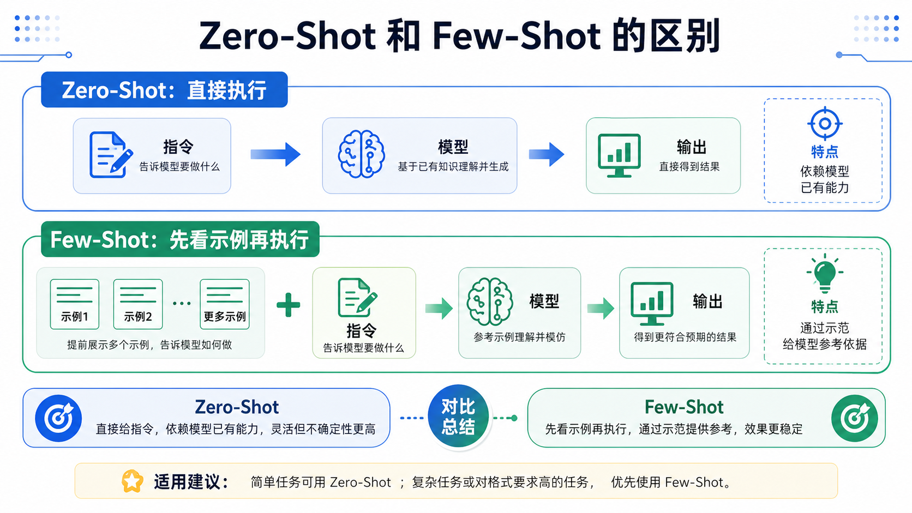

## 知识点讲解



### 1. 核心概念

**Zero-Shot**：只给指令，不提供示例，直接让模型完成任务。靠的是模型在预训练和微调阶段学到的通用能力。

**Few-Shot**：提供 1-5 个输入-输出示例，让模型从中学习"你要的是这种风格和格式"，然后类推到新的输入。

两者的本质差别：Zero-shot 让模型"理解指令"，Few-shot 让模型"看懂例子"。对于格式复杂、风格特殊、或者模型不熟悉的任务，Few-shot 效果通常好得多。

### 2. 技术细节

#### 2.1 对比表

| 维度 | Zero-Shot | Few-Shot |
| --- | --- | --- |
| 示例数 | 0 | 1-5 个 |
| Token 消耗 | 少 | 多（每个示例都要占 Token） |
| 适用场景 | 通用任务、清晰指令 | 特定格式、复杂逻辑、风格对齐 |
| 一致性 | 中（依赖模型理解） | 高（有示例锚定） |
| 实现难度 | 低 | 中（需要精心选择示例） |

#### 2.2 Few-Shot 示例质量比数量重要

- 3 个精心挑选的示例 > 10 个随便选的示例
- 示例要覆盖不同情况（边界 case、典型 case）
- 示例顺序有影响，最接近当前任务的示例放在最后

#### 2.3 动态 Few-Shot

高阶用法：根据用户的实际输入，从示例库中检索最相似的示例，动态组合成 prompt。效果比固定示例好，但实现复杂度更高。这块和 RAG 的思路是一样的。

## 代码示例

```python
from openai import OpenAI

client = OpenAI()

# ===== Zero-Shot =====
zero_shot_prompt = """将以下用户评论分类为：正面、负面、中性。

评论：这款手机拍照效果一般，但续航很棒。
分类："""

# ===== Few-Shot =====
few_shot_prompt = """将用户评论分类为：正面、负面、中性。

示例 1：
评论：这款手机非常好用，拍照清晰，性价比超高！
分类：正面

示例 2：
评论：质量很差，买了两周就坏了，客服态度也很差。
分类：负面

示例 3：
评论：功能还可以，就是价格稍微有点贵，适合预算充足的用户。
分类：中性

现在请分类：
评论：这款手机拍照效果一般，但续航很棒。
分类："""

# ===== Chain-of-Thought Few-Shot（推理任务更有效）=====
cot_few_shot_prompt = """判断以下逻辑推理是否成立，请给出推理过程。

示例：
问题：所有猫都是动物。汤姆是猫。所以汤姆是动物。这个推论成立吗？
推理：前提1："所有猫都是动物"。前提2："汤姆是猫"。按照三段论规则，汤姆属于猫，猫属于动物，因此汤姆属于动物。
结论：成立。

现在判断：
问题：所有鸟都会飞。企鹅是鸟。所以企鹅会飞。这个推论成立吗？
推理："""

def compare_strategies(prompt_zs: str, prompt_fs: str):
    """对比 Zero-Shot 和 Few-Shot 的效果"""
    for label, prompt in [("Zero-Shot", prompt_zs), ("Few-Shot", prompt_fs)]:
        response = client.chat.completions.create(
            model="gpt-4",
            messages=[{"role": "user", "content": prompt}],
            temperature=0.1,
            max_tokens=50,
        )
        print(f"{label}: {response.choices[0].message.content.strip()}")
        print(f"  Tokens 消耗: {response.usage.total_tokens}")

compare_strategies(zero_shot_prompt, few_shot_prompt)
```

## 面试怎么答

Zero-Shot 是只给指令、不给示例，让模型用通用能力完成任务；Few-Shot 是给 1-5 个示例，让模型从示例里理解"你要的是这种输出风格"。

两者的实用选择原则：简单通用任务先试 Zero-Shot，快速且省 Token；如果输出格式有特定要求、任务比较特殊，或者模型对任务不太熟，就上 Few-Shot——示例能提供一个"锚点"，大幅提升一致性。

Few-Shot 有个重要细节：质量远比数量重要。3 个精心挑选的示例通常比 10 个随便加的效果好。示例要覆盖典型 case 和边界 case，顺序上把最接近当前输入的示例放最后。

## 高频追问 & 加分点

- **Q1：Few-Shot 示例数多多益善吗？**  
    不是。通常 3-5 个就能覆盖大多数情况，超过 10 个通常是边际效益递减的。而且示例越多 Token 越贵，还会压缩模型能关注实际问题的注意力。
- **Q2：Few-Shot 示例的顺序重要吗？**  
    有影响。研究表明，最后一个示例对模型的影响最大（注意力机制的近因偏向）。所以最典型、最接近当前任务的示例应该放在最后。
- **Q3：什么是动态 Few-Shot，有用吗？**  
    从示例库里根据用户输入向量相似度检索最相关的示例组合成 Prompt，而不是固定几个。对需要处理多种风格和类型的任务效果明显。实现上就是向量数据库 + embedding 检索，和 RAG 思路一样。
- **Q4：One-Shot 和 Few-Shot 有区别吗？**  
    One-Shot 是 Few-Shot 的特例，只提供一个示例。对格式要求不复杂的任务，One-Shot 通常就够了，省 Token 也省设计时间。判断标准：如果一个示例能覆盖任务的核心模式，就不需要多个。
