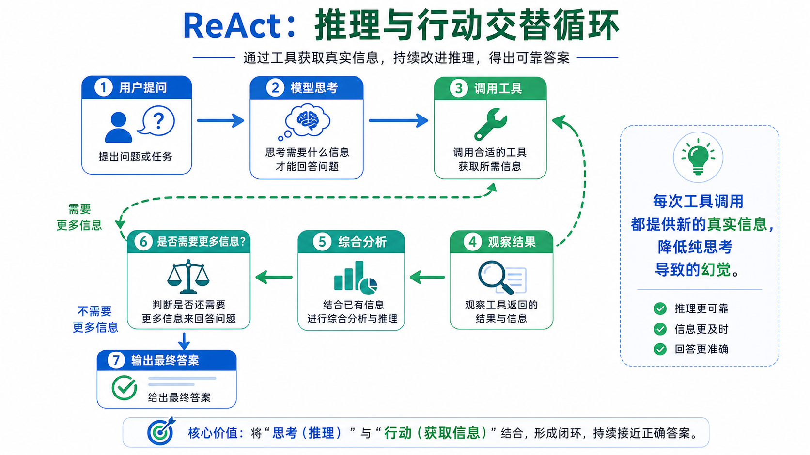

## 知识点讲解



### 1. 核心概念

ReAct（Reasoning + Acting）是一种将推理和工具调用交替进行的提示策略，形成"思考 → 行动 → 观察 → 再思考"的循环。

纯 CoT 推理的问题：模型只能用自己的"记忆"推理，遇到需要实时信息或精确计算的任务，容易幻觉。ReAct 解决的就是这个问题——每次行动从外部获取真实信息，让推理建立在事实上，而不是模型的猜测上。

ReAct 是几乎所有现代 Agent 框架的核心循环。LangChain Agent、AutoGPT 的思考循环，本质都是 ReAct。

### 2. 技术细节

#### 2.1 ReAct 的执行格式

每轮循环输出三个部分：

```
Thought: [模型的推理过程——当前知道什么、下一步该做什么]
Action: [具体工具调用——工具名 + 参数]
Observation: [工具返回的结果——由系统填写，不是模型生成]
```

循环直到：

- 模型输出 `Final Answer: [答案]`
- 达到最大步数限制

#### 2.2 工具定义的重要性

ReAct 效果好坏，工具定义质量至关重要：

- 工具名要语义明确（`search_web` 比 `tool1` 好）
- 参数要清晰定义（类型、是否必需、示例值）
- 工具描述要说明"什么时候用"——模型根据这个决定选哪个工具

#### 2.3 ReAct vs 纯推理

| 维度 | 纯 CoT | ReAct |
| --- | --- | --- |
| 信息来源 | 只有模型参数 | 参数 + 实时工具结果 |
| 幻觉风险 | 高（冷知识、新信息） | 低（工具结果是真实的） |
| 适用场景 | 推理、数学 | 需要外部信息的任务 |
| 成本 | 低（无工具调用） | 高（多次工具调用） |

## 代码示例

```python
from openai import OpenAI
import json

client = OpenAI()

# 定义工具（这是模型"看到"的工具描述）
TOOLS = [
    {
        "type": "function",
        "function": {
            "name": "search_web",
            "description": "搜索网络获取实时信息。适合需要最新数据、事实核查的场景。",
            "parameters": {
                "type": "object",
                "properties": {
                    "query": {"type": "string", "description": "搜索关键词"}
                },
                "required": ["query"]
            }
        }
    },
    {
        "type": "function",
        "function": {
            "name": "calculate",
            "description": "执行数学计算，返回精确结果。适合需要精确计算的场景。",
            "parameters": {
                "type": "object",
                "properties": {
                    "expression": {"type": "string", "description": "Python 数学表达式，如 '2 ** 10 + 5'"}
                },
                "required": ["expression"]
            }
        }
    }
]

def execute_tool(tool_name: str, args: dict) -> str:
    """执行工具调用（真实场景里对接真实服务）"""
    if tool_name == "search_web":
        # 模拟搜索结果
        return f"搜索'{args['query']}'的结果：[模拟返回当前相关数据]"
    elif tool_name == "calculate":
        try:
            # 注意：生产环境需要沙箱执行
            result = eval(args["expression"])
            return f"计算结果：{result}"
        except Exception as e:
            return f"计算错误：{str(e)}"
    return f"未知工具：{tool_name}"

def react_agent(user_query: str, max_steps: int = 6) -> str:
    """
    ReAct Agent 主循环：思考 → 工具调用 → 观察 → 再思考
    """
    messages = [
        {
            "role": "system",
            "content": """你是一个 ReAct 风格的助手。
解决问题时：
1. 先分析需要什么信息
2. 调用合适的工具获取信息
3. 根据工具结果继续推理
4. 当有足够信息时，给出最终答案

要诚实：如果信息不足，继续查；不要凭空猜测。"""
        },
        {"role": "user", "content": user_query}
    ]

    print(f"用户问题：{user_query}\n{'='*50}")

    for step in range(max_steps):
        resp = client.chat.completions.create(
            model="gpt-4",
            messages=messages,
            tools=TOOLS,
            tool_choice="auto",
            temperature=0.1,
        )

        msg = resp.choices[0].message

        # 如果模型选择直接回答（无工具调用）
        if not msg.tool_calls:
            print(f"\n最终答案：{msg.content}")
            return msg.content

        # 有工具调用
        messages.append({"role": "assistant", "content": msg.content, "tool_calls": msg.tool_calls})

        for tool_call in msg.tool_calls:
            tool_name = tool_call.function.name
            args      = json.loads(tool_call.function.arguments)

            print(f"\n[步骤 {step+1}] Thought: {msg.content or '准备调用工具'}")
            print(f"  Action: {tool_name}({args})")

            observation = execute_tool(tool_name, args)
            print(f"  Observation: {observation}")

            messages.append({
                "role": "tool",
                "tool_call_id": tool_call.id,
                "content": observation
            })

    return "达到最大步数限制，请查看上面的过程。"

# 运行测试
react_agent("今天比特币的价格是多少？如果我有 2.5 个比特币，按当前价格值多少人民币？")
```

## 面试怎么答

ReAct 是把推理（Reasoning）和工具调用（Acting）交替进行的提示策略。每轮循环：模型先 Thought（分析当前情况和下一步计划）→ Action（调用工具）→ 系统返回 Observation（工具结果）→ 模型再 Thought，循环直到有最终答案。

它解决了纯 CoT 的核心问题：纯推理只能依赖模型参数里的知识，遇到新信息、精确计算、实时数据就会幻觉。ReAct 把外部工具结果拉进推理循环，让每一步推理都建立在真实信息上。

现代 LLM 的 Function Calling 是 ReAct 的标准化实现——模型输出结构化的工具调用请求，系统执行后把结果作为 Observation 返回。几乎所有 Agent 框架（LangChain、AutoGen）的核心循环都是这个模式。

## 高频追问 & 加分点

- **Q1：ReAct 和 Function Calling 什么关系？**  
    ReAct 是提示策略/设计模式，Function Calling 是 OpenAI 等厂商的原生实现。早期 ReAct 靠 prompt 让模型输出固定格式的文本再解析；Function Calling 把工具调用做成原生能力，更可靠、格式更规范。但本质是一回事。
- **Q2：ReAct 无限循环怎么办？**  
    必须有 max_steps 硬限制。另外可以在 prompt 里明确"如果超过 X 步还没找到答案，报告无法完成而不是继续猜测"。监控上，每轮都记录日志，异常的长循环要有告警。
- **Q3：工具调用失败（报错）怎么处理？**  
    把错误信息完整地作为 Observation 返回给模型。好的模型会根据错误信息调整策略（换参数重试、换工具、或者告诉用户无法完成）。重要的是不要直接抛异常终止，让模型看到错误然后自己决定怎么处理。
- **Q4：多 Agent 场景里每个 Agent 都跑 ReAct 吗？**  
    通常是的。在多 Agent 架构里，每个 Worker Agent 独立跑自己的 ReAct 循环；Orchestrator Agent 的"工具"是"调用某个 Worker Agent"。这样保持了层次化——高层只管任务分配，低层负责具体执行。
