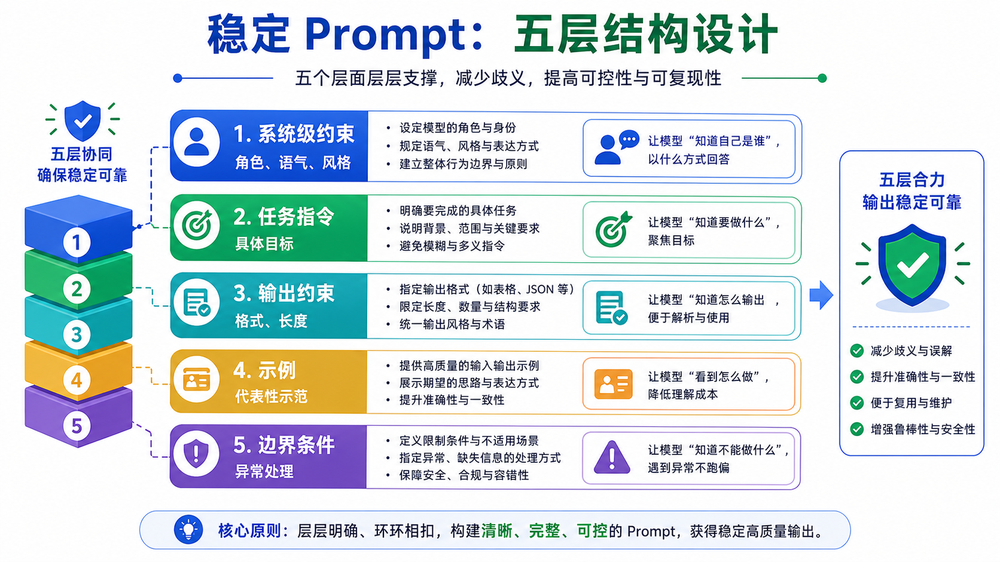

## 知识点讲解



### 1. 核心概念

稳定可靠的 Prompt 指的是：**同一输入多次调用，输出结构和质量一致；面对输入变化，仍能正确处理，不会因为细节差异就完全崩掉**。

这是把提示词工程从"碰运气"变成"工程实践"的关键。

稳定性有三个层次：

1. **格式稳定**：每次输出的结构一致，可以被解析
2. **语义稳定**：同样的问题得到实质相同的答案
3. **边界稳定**：异常输入不会导致模型崩掉或输出垃圾

### 2. 技术细节

#### 2.1 影响稳定性的关键因素

**① 指令清晰度**  
模糊指令 → 模型解读空间大 → 输出方差高。命令式的明确指令比"请试着..."这类表达稳定得多。

**② 输出格式显式约束**  
没有格式约束的 prompt，模型每次可能输出不同结构。明确指定格式（JSON Schema、Markdown 结构）是最有效的稳定手段。

**③ Few-shot 示例**  
示例是最有效的"锚点"，让模型的输出向示例风格收敛。

**④ Temperature**  
降低 Temperature 直接降低随机性。稳定性要求高的任务通常用 0.1-0.3。

**⑤ 错误处理声明**  
在 prompt 里告诉模型"无法完成时怎么办"，防止它乱编答案。

#### 2.2 稳定性测试方法

- **一致性测试**：同一 prompt 运行 10 次，计算输出相似度
- **输入敏感性测试**：对 prompt 做微小变化，观察输出是否剧变
- **边界测试**：输入空值、极端值、格式错误的输入，看模型怎么处理

## 代码示例

```python
from openai import OpenAI
import json

client = OpenAI()

# ===== 不稳定的 Prompt =====
UNSTABLE_PROMPT = """总结这篇文章"""

# ===== 稳定的 Prompt =====
STABLE_PROMPT_TEMPLATE = """你是一个专业内容编辑。请对给定文本进行结构化摘要。

输出格式（必须严格遵守，返回合法 JSON）：
{{
  "main_point": "核心观点，1 句话，不超过 30 字",
  "key_points": ["要点1", "要点2", "要点3"],
  "conclusion": "结论或建议，1-2 句话"
}}

规则：
- 只返回 JSON，不要有任何其他文字
- key_points 恰好 3 条，每条不超过 20 字
- 如果文本太短无法提取 3 个要点，key_points 中填写 "N/A"

示例输入：
"深度学习在图像识别领域取得了突破性进展，特别是 CNN 架构的引入。这不仅提升了准确率，也降低了人工特征工程的需求。"

示例输出：
{{"main_point": "深度学习革新了图像识别", "key_points": ["CNN 架构带来突破", "识别准确率大幅提升", "减少人工特征工程"], "conclusion": "深度学习已成为图像识别的主流方法。"}}

现在请处理：
{text}"""

def stable_summarize(text: str) -> dict:
    """稳定的摘要函数，含格式验证和重试"""
    for attempt in range(3):
        resp = client.chat.completions.create(
            model="gpt-4",
            messages=[{"role": "user", "content": STABLE_PROMPT_TEMPLATE.format(text=text)}],
            temperature=0.1,   # 低温提升稳定性
        )
        raw = resp.choices[0].message.content.strip()

        try:
            result = json.loads(raw)
            # 验证必要字段
            assert "main_point" in result
            assert len(result.get("key_points", [])) == 3
            assert "conclusion" in result
            return result
        except (json.JSONDecodeError, AssertionError) as e:
            print(f"  第 {attempt+1} 次尝试格式不符: {e}，重试...")

    return {"error": "多次重试后仍无法获得符合格式的输出"}

# 测试稳定性：同一文本运行 3 次，结果应该基本一致
test_text = """
人工智能正在改变各行各业。从医疗诊断到自动驾驶，AI 的应用越来越广泛。
但与此同时，数据隐私、算法偏见、就业冲击等问题也日益凸显。
如何在拥抱 AI 红利的同时规避风险，是当前最重要的课题。
"""

print("稳定性测试（同一输入运行 3 次）：")
for i in range(3):
    result = stable_summarize(test_text)
    print(f"\n第 {i+1} 次:\n{json.dumps(result, ensure_ascii=False, indent=2)}")
```

## 面试怎么答

设计稳定可靠的 prompt 有几个核心要点：指令要清晰（用命令式而不是"请试试"），输出格式要显式约束（JSON Schema 或 Markdown 结构），加 Few-shot 示例作为锚点，告诉模型"不能完成时怎么办"（防止乱编），然后把 temperature 降低。

工程上我习惯做三层测试：一致性测试（同一 prompt 跑 10 次，看输出有多稳定）、输入敏感性测试（微小改动看有没有剧烈变化）、边界测试（空值、异常格式的输入）。稳定性不是主观感觉，要量化。

还有一点：在应用层做格式验证 + 重试。prompt 再好，偶尔也会格式出错，不能假设模型 100% 遵守约束。有了验证层，失败了重试一次，整体可靠性就高很多。

## 高频追问 & 加分点

- **Q1：Temperature=0 是不是最稳定？**  
    是，但不一定最优。Temperature=0 退化成贪心搜索，输出最确定，但对于需要一点语言多样性的任务（比如写摘要），效果可能反而死板。通常 0.1-0.2 是稳定性和自然度的平衡点。
- **Q2：JSON 格式约束可靠吗？**  
    不是 100%。模型偶尔会在 JSON 前后加多余文字，或者忽略某些字段。最稳定的方式是用支持 Structured Output 的 API（OpenAI 的 `response_format={"type":"json_object"}`），或者用 function calling——这两种方式在模型层面就保证格式，不依赖 prompt 约束。
- **Q3：Prompt 版本怎么管理？**  
    像代码一样：用 git 管版本、有 changelog、每次改动都跑测试集对比效果。如果 prompt 是产品的核心，更应该有专门的评估框架，而不是主观判断"感觉好了一点"。
- **Q4：同一 prompt 在不同时间结果差很多是为什么？**  
    几个可能原因：模型版本更新（API 背后的模型偷偷升级了）、采样随机性（temperature 不够低）、prompt 有歧义（模型可以用不同方式解读）。前两个靠固定模型版本 + 低温解决，第三个要回到 prompt 设计本身。
