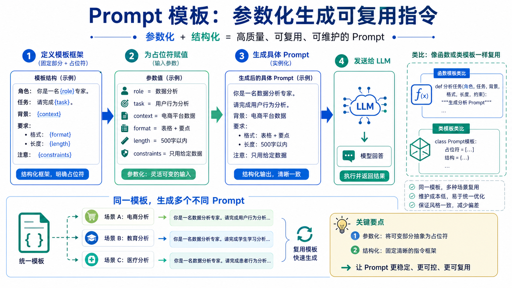

## 知识点讲解



### 1. 核心概念

Prompt 模板是把 prompt 里的固定部分和可变部分分离的工程实践。固定部分（角色定义、格式约束、示例）写进模板；可变部分（用户输入、具体数据）用占位符表示，运行时填入。

好处很直接：可以复用、方便维护、容易迭代、降低每次写 prompt 的认知成本。

高质量的模板不只是"把指令写进去"，而是经过测试、有版本管理、能处理边界情况的可靠组件。

### 2. 技术细节

#### 2.1 模板的标准结构

一个完整的 prompt 模板通常包含这几部分：

```
[角色定义]   → 告诉模型它是谁
[任务目标]   → 明确要做什么
[约束条件]   → 格式、长度、语气
[示例]       → 1-3 个输入-输出对
[变量占位]   → {user_input}、{context} 等
[输出格式]   → 精确的格式说明
[边界处理]   → 无法完成时的回退
```

#### 2.2 占位符设计原则

- 命名语义清晰（`{user_question}` 比 `{q}` 好）
- 为每个占位符写说明文档（类型、示例、限制）
- 区分必填和可选占位符
- 考虑占位符内容可能影响 prompt 解析的边缘情况（比如用户输入里有 `{}`）

#### 2.3 模板版本管理

模板改动要留版本记录，不然：

- 不知道哪个版本效果好
- 出了问题无法回滚
- 多人协作容易冲突

## 代码示例

```python
from dataclasses import dataclass, field
from typing import Any
from openai import OpenAI
import json

client = OpenAI()

@dataclass
class TemplateParam:
    description: str
    type:     str   = "string"
    required: bool  = True
    example:  Any   = None

@dataclass
class PromptTemplate:
    """可管理的 Prompt 模板"""
    name:        str
    version:     str
    description: str
    template:    str
    params:      dict[str, TemplateParam] = field(default_factory=dict)

    def render(self, **kwargs) -> str:
        """渲染模板：填入变量，验证必填参数"""
        # 检查必填参数
        for name, param in self.params.items():
            if param.required and name not in kwargs:
                raise ValueError(f"缺少必填参数: {name}（{param.description}）")
        # 替换占位符
        try:
            return self.template.format(**kwargs)
        except KeyError as e:
            raise ValueError(f"模板变量 {e} 未在参数中定义")

    def to_dict(self) -> dict:
        return {"name": self.name, "version": self.version, "description": self.description}

# ===== 定义高质量模板 =====
sentiment_template = PromptTemplate(
    name="sentiment_analysis_v2",
    version="2.1",
    description="用户评论情感分析，输出结构化 JSON",
    template="""你是一个专业的用户评论分析师。

任务：分析用户评论的情感倾向，提取关键信息。

输出格式（必须是合法 JSON，不含任何其他文字）：
{{
  "sentiment": "正面" | "负面" | "中性",
  "score": 1-5,
  "key_points": ["要点1", "要点2"],
  "aspects": {{"产品": "正面/负面/中性", "服务": "正面/负面/中性"}}
}}

规则：
- score: 1=极差, 2=较差, 3=一般, 4=较好, 5=很好
- key_points: 最多 3 条，每条不超过 20 字
- 只分析评论中提到的 aspects，未提到的不要猜测

示例：
评论："屏幕很清晰，响应速度快。就是电池不耐用，一天要充两次电，有点烦。"
输出：{{"sentiment": "中性", "score": 3, "key_points": ["屏幕清晰响应快", "电池续航差需频繁充电"], "aspects": {{"产品": "中性"}}}}

产品领域：{product_domain}
评论内容：{comment}""",
    params={
        "product_domain": TemplateParam("产品领域，如'手机'、'耳机'", example="手机"),
        "comment": TemplateParam("用户评论原文", example="这款手机性价比很高"),
    }
)

rag_qa_template = PromptTemplate(
    name="rag_qa_v1",
    version="1.0",
    description="基于检索文档的问答，防止幻觉",
    template="""你是一个严格基于文档回答问题的助手。

规则：
- 只根据<documents>中的内容回答
- 如果文档中没有答案，直接说"根据现有文档，无法回答此问题"
- 不要使用文档以外的知识
- 引用时注明来自哪个文档（"根据文档X..."）

<documents>
{retrieved_docs}
</documents>

用户问题：{user_question}

回答：""",
    params={
        "retrieved_docs": TemplateParam("检索到的相关文档内容"),
        "user_question":  TemplateParam("用户的问题"),
    }
)

# ===== 模板管理器 =====
class TemplateRegistry:
    """模板注册和管理"""
    def __init__(self):
        self._templates: dict[str, PromptTemplate] = {}

    def register(self, template: PromptTemplate):
        self._templates[template.name] = template
        print(f"注册模板: {template.name} v{template.version}")

    def get(self, name: str) -> PromptTemplate:
        if name not in self._templates:
            raise KeyError(f"模板不存在: {name}")
        return self._templates[name]

    def list_templates(self) -> list[dict]:
        return [t.to_dict() for t in self._templates.values()]

registry = TemplateRegistry()
registry.register(sentiment_template)
registry.register(rag_qa_template)

# ===== 使用模板 =====
def analyze_comment(comment: str, domain: str) -> dict:
    template = registry.get("sentiment_analysis_v2")
    prompt   = template.render(product_domain=domain, comment=comment)

    resp = client.chat.completions.create(
        model="gpt-4",
        messages=[{"role": "user", "content": prompt}],
        temperature=0.1,
    )
    try:
        return json.loads(resp.choices[0].message.content)
    except json.JSONDecodeError:
        return {"error": "输出格式异常"}

result = analyze_comment("屏幕很好，但电池不耐用，价格偏贵", domain="手机")
print(json.dumps(result, ensure_ascii=False, indent=2))
```

## 面试怎么答

Prompt 模板是把固定部分（角色、约束、示例）和可变部分（用户输入）分离的工程实践。高质量的模板有几个要素：结构清晰（角色 → 任务 → 约束 → 示例 → 占位符 → 格式）、占位符命名语义化、有边界处理（告诉模型无法完成时怎么办）、有版本管理。

模板的核心价值是可复用和可维护。把 prompt 逻辑集中在模板里，而不是散落在代码各处，改一处就全部生效，也方便做 A/B 测试和效果追踪。

工程上我自己习惯把模板当代码对待——用 git 管版本、有 changelog、每次改动都跑测试集对比，不靠主观感觉判断好坏。

## 高频追问 & 加分点

- **Q1：模板里的示例应该怎么选？**  
    选最能覆盖"边界情况"的示例：典型正常输入、边界情况（空值、极端值）、可能让模型困惑的歧义输入。不要只选最简单的"理想情况"示例——那种模型本来就会处理，加了也没太大帮助。
- **Q2：如何做模板的 A/B 测试？**  
    固定测试集（100-200 条有标注的样本），两个版本的模板各跑一遍，用量化指标（格式合规率、评分准确率）对比。关键是测试集要有代表性，不能只测"理想输入"。
- **Q3：Prompt Caching 和模板有什么关系？**  
    Prompt Caching（Anthropic、OpenAI 都支持）会把 prompt 固定部分（System Prompt、Few-shot 示例）的 KV-Cache 缓存在服务端。模板里的固定部分越长、越稳定，Caching 命中率越高，成本越低。这也是把固定内容集中在模板固定部分的另一个理由。
- **Q4：不同场景的模板应该完全独立还是有继承关系？**  
    视规模而定。规模小：独立模板就够了，简单清晰。规模大（几十上百个模板）：可以设计基础模板（base template），包含通用角色和约束，特化模板继承并扩展。但不要过度工程化——模板系统本身的复杂度应该远小于它解决的问题。
