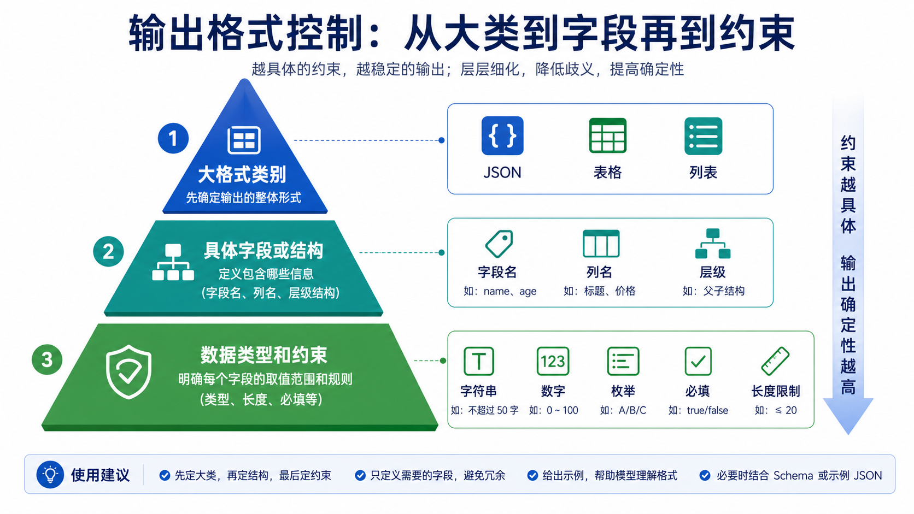

## 知识点讲解



### 1. 核心概念

控制 LLM 的输出格式，说白了就是一件事：**不要让模型自由发挥结构，告诉它你要什么样子的内容**。

为什么这件事重要？因为下游代码要解析模型的输出。如果模型这次返回 JSON、下次返回自然语言段落，解析代码要么崩，要么跑得一团糟。格式不稳定，整个系统就不稳定。

常见的输出格式分三类：

- **结构化数据**：JSON、YAML、CSV，供程序直接解析
- **可视化文本**：Markdown 表格、有序/无序列表，供人阅读
- **半结构化**：带固定标题的段落，用正则或分隔符提取

### 2. 技术细节

#### 2.1 格式约束有效性排序

同样是"要 JSON 输出"，不同的写法效果差距很大：

| 写法 | 有效性 | 说明 |
| --- | --- | --- |
| 自然语言描述格式 | 低 | "请用 JSON 格式返回"，模型理解各异 |
| 给出 Schema | 中 | 列出字段名和类型，更明确 |
| 给出示例 | 高 | 直接展示输入输出对，最直接 |
| Function Calling / Structured Output | 最高 | 模型层面的格式保证，不靠 prompt |

#### 2.2 三种场景的格式设计

**JSON 格式**：明确字段名、类型、必填/可选，给一个完整的示例输出。模板里用 `{{}}` 转义大括号。

**表格格式**：给出表头，说明行数约束，指定列的含义。Markdown 表格对模型来说遵守率很高。

**列表格式**：说清楚有序还是无序、条数限制、每条的结构（比如"每条不超过 20 字"）。

#### 2.3 格式验证不可缺

就算 prompt 写得很好，模型偶尔还是会格式出错——比如 JSON 前多一句"以下是结果："，或者字段名拼错了。应用层必须做格式验证，失败就重试，不能假设模型 100% 遵守。

## 代码示例

```python
from openai import OpenAI
import json
import re

client = OpenAI()

# ===== 场景 1：JSON 格式约束 =====
def extract_entities_json(text: str) -> dict:
    """从文本中提取实体，强制 JSON 输出"""
    prompt = f"""你是一个命名实体识别专家。

从以下文本中提取人名、地点和组织名。

输出格式（只返回 JSON，不加任何解释文字）：
{{
  "persons": ["人名1", "人名2"],
  "locations": ["地点1", "地点2"],
  "organizations": ["组织名1"]
}}

规则：
- 如果某类实体不存在，对应数组为空列表 []
- 人名只取姓名本身，不加职位

示例输入：张伟在北京的阿里巴巴完成了融资。
示例输出：{{"persons": ["张伟"], "locations": ["北京"], "organizations": ["阿里巴巴"]}}

文本：{text}"""

    for attempt in range(3):
        resp = client.chat.completions.create(
            model="gpt-4",
            messages=[{"role": "user", "content": prompt}],
            temperature=0.1,
        )
        raw = resp.choices[0].message.content.strip()
        try:
            # 处理模型在 JSON 前后加了多余文字的情况
            json_match = re.search(r'\{.*\}', raw, re.DOTALL)
            if json_match:
                return json.loads(json_match.group())
        except json.JSONDecodeError:
            pass
    return {"error": "多次重试后仍无法获得有效 JSON"}


# ===== 场景 2：Markdown 表格格式 =====
def summarize_as_table(items: list[str]) -> str:
    """把多个选项做成比较表格"""
    items_text = "\n".join(f"- {item}" for item in items)
    prompt = f"""请对以下选项做一个比较表格。

选项：
{items_text}

输出格式（Markdown 表格）：
| 选项 | 核心优势 | 核心劣势 | 适用场景 |
|---|---|---|---|
| ... | ... | ... | ... |

要求：
- 每行对应一个选项
- 每格不超过 20 字
- 只输出表格，不加前后文字"""

    resp = client.chat.completions.create(
        model="gpt-4",
        messages=[{"role": "user", "content": prompt}],
        temperature=0.2,
    )
    return resp.choices[0].message.content


# ===== 场景 3：有序列表格式 =====
def generate_checklist(task: str) -> str:
    """生成检查清单，格式严格约束"""
    prompt = f"""为以下任务生成一个执行检查清单：{task}

输出格式（有序列表）：
1. [检查项] — [30 字以内的说明]
2. [检查项] — [30 字以内的说明]
...

要求：
- 恰好 6 条，不多不少
- 按执行优先级排序
- 只输出列表，不加前言和总结"""

    resp = client.chat.completions.create(
        model="gpt-4",
        messages=[{"role": "user", "content": prompt}],
        temperature=0.2,
    )
    return resp.choices[0].message.content


# ===== 最稳：用 Function Calling 锁死格式 =====
def extract_with_function_calling(text: str) -> dict:
    """用 Function Calling 保证格式，不靠 prompt 约束"""
    tools = [{
        "type": "function",
        "function": {
            "name": "extract_entities",
            "description": "提取文本中的命名实体",
            "parameters": {
                "type": "object",
                "properties": {
                    "persons":       {"type": "array", "items": {"type": "string"}, "description": "人名列表"},
                    "locations":     {"type": "array", "items": {"type": "string"}, "description": "地点列表"},
                    "organizations": {"type": "array", "items": {"type": "string"}, "description": "组织名列表"},
                },
                "required": ["persons", "locations", "organizations"],
            },
        },
    }]

    resp = client.chat.completions.create(
        model="gpt-4",
        messages=[{"role": "user", "content": f"提取以下文本中的实体：{text}"}],
        tools=tools,
        tool_choice={"type": "function", "function": {"name": "extract_entities"}},
    )

    tool_call = resp.choices[0].message.tool_calls[0]
    return json.loads(tool_call.function.arguments)


# 测试
text = "马云在杭州创立了阿里巴巴，后来李彦宏在北京成立了百度。"
print("JSON 格式提取:", json.dumps(extract_entities_json(text), ensure_ascii=False))
print("Function Calling 提取:", json.dumps(extract_with_function_calling(text), ensure_ascii=False))
```

## 面试怎么答

控制输出格式的核心手段有三层，有效性依次递增：prompt 里描述格式、prompt 里给示例、用 Function Calling 或 Structured Output 在模型层面锁死格式。

实际工程里，我习惯把格式约束拆成两部分：prompt 里给示例（解决大多数情况），应用层做格式验证 + 重试（兜底）。不能假设模型永远遵守，哪怕 prompt 写得再好，偶尔还是会在 JSON 前面多一句废话，或者字段名用了中文而不是英文。

对格式要求极高的场景——比如输出要直接写数据库、要被前端 JSON.parse——我会优先用 Function Calling，这是模型层面的保证，稳定性比 prompt 约束高一个档次。

## 高频追问 & 加分点

- **Q1：JSON 格式约束和 Function Calling 该怎么选？**  
    看场景。格式复杂、对稳定性要求高 → 用 Function Calling，它在模型层面保证输出能被解析，失败率接近 0。格式简单、或者需要嵌套层次比较灵活 → prompt 里给示例加验证层就够了。Function Calling 的代价是调用方式稍复杂，格式必须预先定义死。
- **Q2：模型在 JSON 前后加了多余文字怎么处理？**  
    两个方向：① 在 prompt 里加"只输出 JSON，不加任何解释"这种明确声明；② 应用层用正则 `\{.*\}` 从输出里抽取 JSON 部分再解析，容错性更强。两个方式可以叠加。
- **Q3：不同格式对 Token 消耗有影响吗？**  
    有。JSON 的 key 名和引号占了不少 Token，YAML 稍省一点，CSV 最省。表格格式因为每行都要重复列分隔符，Token 也不少。如果调用量大，格式设计要考虑 Token 效率，能用数组就别用对象的键值对，能缩写 key 名就缩写。
- **Q4：Structured Output（OpenAI 的 response_format）和 Function Calling 有什么区别？**  
    Structured Output 是直接把 `response_format` 设为 `json_schema`，模型输出的就是符合该 Schema 的 JSON，不需要定义一个"函数"。Function Calling 本质上是让模型"调用一个函数"，参数是结构化数据。两者格式保证能力接近，Structured Output 语义更直接，Function Calling 更适合需要模型选择"是否调用"的场景。
