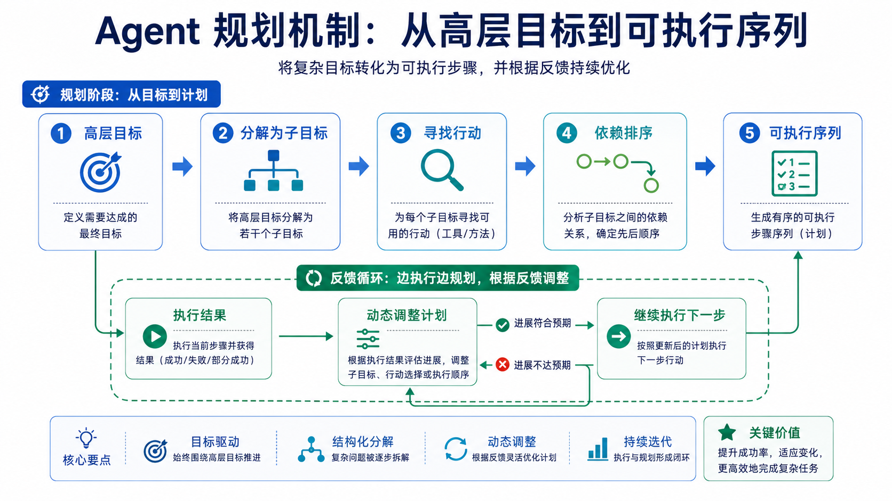

## 知识点讲解



### 1. 核心概念

**规划（Planning）**就是 Agent 把"知道目标"转成"知道怎么做"的那一步。输入是一个高层目标，输出是一串可执行的动作（或者一棵动作树）。

Agent 为什么必须有规划？因为 LLM 单步生成的动作是**短视的**——只看下一步好不好，看不到三步以后会不会撞墙。规划干的事，就是给 Agent 装上"前瞻"，让它在动手前先把整条路径想清楚。

规划本身可以拆成四个维度看：

| 维度 | 选项 | 含义 |
| --- | --- | --- |
| 时机 | 静态 / 动态 | 一次出全图 vs 边走边补 |
| 结构 | 线性 / 树状 / 图状 | 顺序执行 vs 多路探索 |
| 粒度 | 单层 / 分层 | 扁平动作 vs 高层目标 → 子目标 → 原子动作 |
| 控制权 | LLM / 符号规划器 / 混合 | 谁来决定下一步 |

这四个维度的不同组合，就是不同的规划范式。

### 2. 技术细节

#### 2.1 主流规划范式

业界目前最常见的五种，按 LLM 介入程度从低到高排：

**① 经典符号规划（HTN / GOAP / PDDL）**

来自传统 AI Planning。把世界状态、动作的前置条件和效果都形式化描述好，由规划器（比如 Fast Downward）搜索从初始状态到目标状态的动作序列。

- 优点：可解释、可验证、确定性
- 缺点：知识库要人工维护，开放领域基本没法用
- 现状：很少独立用，但思想（precondition/effect）被很多 LLM-based Planner 借鉴

**② ReAct（Reasoning + Acting）**

最主流的"边想边做"范式。LLM 每一步交替输出 `Thought → Action → Observation`，没有提前的全局计划，每一步都是局部决策。

- 优点：实现简单、对环境变化适应性强
- 缺点：短视、容易绕弯路、长任务上 token 烧得猛
- 适合：短任务、强环境交互（搜索、问答）

**③ Plan-and-Execute（先规划再执行）**

LLM 先生成完整计划（一串子任务），然后**逐个执行**，执行器可以换成另一个更便宜的模型。LangChain 的 `PlanAndExecute`、AutoGPT 早期都是这个套路。

- 优点：全局视角；Planner 用大模型、Executor 用小模型，省钱
- 缺点：计划在中途失效要 replan，replan 策略很关键
- 适合：中长任务、子步骤相对独立

**④ ReWOO（Reasoning WithOut Observation）**

Plan-and-Execute 的升级版。一次性规划出**带变量引用**的工作流（比如 `#E2 = Search[#E1.topic]`），再统一并行执行，最后一次性 Solver 汇总。规划阶段不接触 observation，所以规划阶段只调 LLM 一次。

- 优点：调用次数少、可并行、token 省（论文里比 ReAct 省 64%）
- 缺点：对环境完全无反馈，遇到执行失败回滚成本高

**⑤ Tree of Thoughts / LATS（树搜索类）**

把规划当成树搜索来做：每个节点是一个状态，LLM 生成多个候选动作展开子节点，再由评估器（LLM 或外部信号）打分，用 BFS / DFS / MCTS 选最优路径。LATS = ToT + 反思 + 价值估计。

- 优点：能处理需要回溯的复杂任务（代码、数学、24 点）
- 缺点：节点爆炸，token 烧得真的猛
- 适合：高难度推理、可验证答案的任务

#### 2.2 规划必须解决的四个工程问题

光选范式还不够，落地时还得回答四个问题：

1. **目标分解的粒度**：分太细 → 子任务依赖爆炸；太粗 → 子任务里还得再规划。我自己的经验值是**单个子任务能用 1-3 个工具调用搞定**比较合适。
2. **依赖管理**：子任务之间是顺序、并行、还是有条件依赖？需要的是一个 DAG，不是一个 list。
3. **失败处理**：单步失败 → 重试 / 跳过 / 局部 replan / 整体 replan，哪种触发哪种？通常按"失败次数 + 失败类型"分级。
4. **终止条件**：靠 LLM 自己判断"finish"风险很高（要么提前结束、要么永不结束），通常要 max_steps + LLM 自评 + 外部 verifier 三重保险。

#### 2.3 动态 vs 静态规划怎么选

判据其实就一个：**任务的可预测性**。

- 环境稳定、子任务清晰（写报告、跑数据 pipeline）→ 静态规划（Plan-and-Execute / ReWOO）
- 环境多变、需要边探索边决定（浏览器、Agentic search）→ 动态规划（ReAct）
- 任务难、需要回溯（代码 debug、数学）→ 树搜索类（ToT / LATS）
- 大多数生产场景 → **混合**：主干用 Plan-and-Execute，关键节点内部嵌一个 ReAct

## 代码示例

下面三段是骨架，对应三种主流范式的核心控制流。**重点看流程，不是 API**。

**① ReAct 循环**

```python
def react_agent(goal, llm, tools, max_steps=10):
    history = []
    for step in range(max_steps):
        prompt = build_react_prompt(goal, history)
        # LLM 一次输出 Thought + Action
        thought, action = llm.generate(prompt)

        if action.name == "finish":
            return action.args["answer"]

        observation = tools[action.name](**action.args)
        history.append((thought, action, observation))

    return "max_steps reached"
```

关键点：**没有提前规划**，每一步靠 history 重新决策。

**② Plan-and-Execute**

```python
def plan_and_execute(goal, planner_llm, executor_llm, tools):
    # 1. 一次性规划
    plan = planner_llm.generate_plan(goal)  # -> [step1, step2, ...]
    results = {}

    for i, step in enumerate(plan):
        try:
            results[i] = executor_llm.execute(step, tools, context=results)
        except StepFailed:
            # 2. 失败局部 replan
            new_plan = planner_llm.replan(goal, plan, results, failed_at=i)
            plan = plan[:i] + new_plan
            results[i] = executor_llm.execute(plan[i], tools, context=results)

    return summarize(results)
```

关键点：Planner 和 Executor 解耦，Executor 可以用更便宜的模型；replan 策略是工程重点。

**③ ReWOO（带变量引用的并行规划）**

```python
def rewoo(goal, planner_llm, solver_llm, tools):
    # 1. 一次性产出带变量的工作流
    # plan 形如：[{id: "E1", tool: "Search", args: {q: goal}},
    #            {id: "E2", tool: "LLM", args: {prompt: "总结 #E1"}}]
    plan = planner_llm.generate_workflow(goal)

    # 2. 按依赖拓扑序执行，无依赖的可并行
    evidences = {}
    for node in topological_sort(plan):
        args = resolve_refs(node.args, evidences)  # 把 #E1 替换成实际值
        evidences[node.id] = tools[node.tool](**args)

    # 3. Solver 汇总
    return solver_llm.solve(goal, evidences)
```

关键点：规划阶段**不依赖 observation**，所以 LLM 只调一次（规划）+ 一次（汇总），中间全是工具调用。

## 面试怎么答

Agent 的规划机制，简单说就是把一个高层目标转成可执行动作序列的过程。它存在的理由是 LLM 单步决策太短视——只看下一步、看不到几步之后；规划相当于给 Agent 装上"前瞻"。

业界目前主流有五种范式：经典符号规划（HTN/PDDL）现在基本只在学术里用了；**ReAct** 是边想边做、每步局部决策，适合短任务和强环境交互；**Plan-and-Execute** 是先出完整计划再逐步执行，Planner 用大模型、Executor 用小模型，省成本；**ReWOO** 是 Plan-and-Execute 的升级，一次性产出带变量引用的工作流然后并行执行，论文里比 ReAct 省 64% token；**Tree of Thoughts 和 LATS** 走树搜索路线，能回溯，适合代码、数学这种需要试错的任务，但 token 真的很烧。

怎么选？看任务的可预测性：环境稳定就静态、环境多变就 ReAct、需要回溯就树搜索。**生产环境我一般用混合方案**——主干用 Plan-and-Execute 出大框架，关键决策节点内部嵌一个 ReAct 循环。

落地时光选范式不够，还得解决四个工程问题：分解粒度（我习惯每个子任务控制在 1-3 次工具调用）、依赖管理（要 DAG 不要 list）、失败处理（按失败次数和类型分级触发重试/局部 replan/整体 replan）、终止条件（max_steps + LLM 自评 + 外部 verifier 三重保险，不能只信 LLM 自己说 finish）。

## 高频追问 & 加分点

- **Q1：ReAct 和 Plan-and-Execute 怎么选？**  
    看任务长度和环境稳定性。短任务（≤5 步）、强环境交互（每步都依赖上一步的 observation）→ ReAct。中长任务（5-20 步）、子任务相对独立、想省成本 → Plan-and-Execute。20 步以上的任务通常单层规划就不够了，得分层。
- **Q2：计划在执行中途失效怎么办？**  
    分四级处理：①单步小故障 → 重试（最多 2-3 次）；②单步彻底失败 → 局部 replan（只重新规划失败点之后的步骤）；③多个步骤连续失败 → 整体 replan（说明初始计划方向就错了）；④replan 还无效 → 升级到 Human-in-the-Loop。**关键是别一失败就整体 replan**，token 成本扛不住。
- **Q3：怎么避免 Agent 无限循环？**  
    三重保险一个都不能少：①硬上限（max_steps、max_tokens、max_cost）；②LLM 自评（每 N 步问一次"是否在向目标推进"）；③外部 verifier（用规则或另一个模型判断是否真的完成）。只信 LLM 自己说 finish 是工业事故现场。
- **Q4：多 Agent 怎么协调规划？**  
    两种主流模式。**中央规划**（Orchestrator-Worker，类似 AutoGen 的 GroupChatManager）：一个主 Agent 出全局计划并分派；适合任务边界清晰的场景。**去中心化规划**（黑板模式 / 合同网协议）：各 Agent 看共享状态自主决定接什么任务；适合任务动态、Agent 异构。生产里前者用得多，后者更学术。
- **Q5：分层规划具体怎么做？**  
    典型三层：**Mission（目标层）→ Task（任务层）→ Action（动作层）**。每层用不同的 Planner，高层用强模型管全局，低层用弱模型管细节。比如做"分析 Q3 财报"——Mission 层规划"取数 → 分析 → 出报告"，Task 层把"取数"展开成"查数据库 → 调外部接口"，Action 层才是具体的 SQL / HTTP 调用。**好处是每层只关心自己粒度的状态，不至于一个 prompt 塞进所有上下文**。
- **Q6：规划质量怎么评估？**  
    三个核心指标：①**成功率**（任务最终是否完成）；②**步数效率**（实际步数 / 最优步数，理想是 1.0，>2.0 说明在绕弯路）；③**replan 率**（多少任务触发了 replan，过高说明初始规划质量差）。生产里再加上**单任务平均 token 成本**——这是老板最关心的指标。
