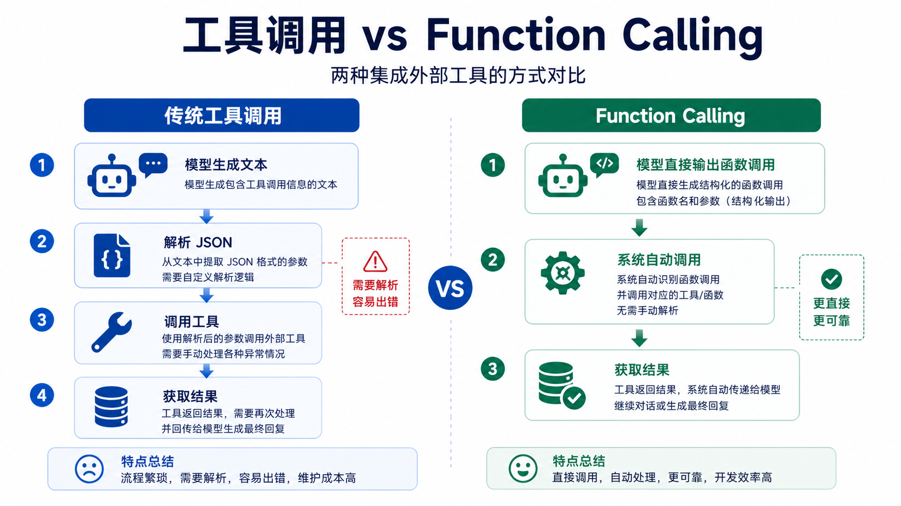

## 知识点讲解



### 1. 核心概念

这两个词经常被混用，但它们的层次是不一样的。

**工具调用（Tool Calling）** 是广义概念——Agent 通过任何方式去调用外部能力：搜索引擎、计算器、数据库、邮件接口……不管用什么机制把调用发出去，都叫工具调用。

**函数调用（Function Calling）** 是狭义实现——OpenAI 和 Anthropic 等厂商在 LLM 层原生支持的一种结构化输出机制。模型在生成文本的同时，能直接输出"我要调用哪个函数、参数是什么"，由框架侧自动执行，再把结果喂回模型。

说白了：Function Calling 是实现 Tool Calling 的一种方式，而且是目前最可靠的方式。

两者的核心差异：

| 维度 | Tool Calling（广义） | Function Calling（原生） |
| --- | --- | --- |
| 调用发起方式 | Prompt 解析、JSON 提取等 | 模型原生输出结构化调用 |
| 可靠性 | 中等（依赖文本解析） | 高（结构化、有 schema 约束） |
| 模型要求 | 任意模型 | 需要模型支持 |
| 参数格式 | 自定义 | 标准 JSON Schema |
| 并行调用 | 需要框架支持 | 原生支持 parallel tool calls |

### 2. 技术细节

#### 2.1 基于 Prompt 的传统工具调用

早期 Agent（ReAct 原始论文那套）是这样玩的：

```latex
[Prompt]
可用工具：search(query), calculate(expr)
当你需要用工具时，输出：ACTION: tool_name(args)

[模型输出]
我需要查一下天气
ACTION: search("北京今日天气")

[框架解析]
→ 正则提取 → 执行 search → 结果喂回
```

问题显而易见：解析不稳定，格式稍微偏一点就失败。

#### 2.2 Function Calling 的工作机制

现代 API（OpenAI、Anthropic Tool Use）的做法是把工具定义单独作为参数传进去，模型输出的工具调用是结构化 JSON，不混在文本里：

```latex
请求：messages + tools_schema → LLM

响应（stop_reason = "tool_use"）：
{
  "type": "tool_use",
  "name": "get_weather",
  "input": {"location": "北京", "unit": "celsius"}
}

→ 框架执行工具 → 结果作为 tool_result 消息追加
→ 再次调用 LLM → 最终回答
```

#### 2.3 工具 Schema 长什么样

以 Anthropic 格式为例：

```python
tools = [
    {
        "name": "get_weather",
        "description": "获取指定城市的实时天气。只在用户明确询问天气时调用。",
        "input_schema": {
            "type": "object",
            "properties": {
                "location": {
                    "type": "string",
                    "description": "城市名称，如 '北京'、'上海'"
                },
                "unit": {
                    "type": "string",
                    "enum": ["celsius", "fahrenheit"],
                    "description": "温度单位，默认 celsius"
                }
            },
            "required": ["location"]
        }
    }
]
```

`description` 写好是关键，模型靠这个判断要不要调、怎么填参数。

## 代码示例

**Function Calling 完整调用循环（OpenAI 风格）**

```python
import json
from openai import OpenAI

client = OpenAI()

tools = [
    {
        "type": "function",
        "function": {
            "name": "search_web",
            "description": "搜索网络获取实时信息",
            "parameters": {
                "type": "object",
                "properties": {
                    "query": {"type": "string", "description": "搜索关键词"}
                },
                "required": ["query"]
            }
        }
    }
]

def execute_tool(name: str, args: dict) -> str:
    if name == "search_web":
        # 实际调用搜索 API
        return f"搜索结果：关于 {args['query']} 的信息..."
    return "工具不存在"

def run_with_tools(user_message: str) -> str:
    messages = [{"role": "user", "content": user_message}]

    while True:
        response = client.chat.completions.create(
            model="gpt-4o",
            messages=messages,
            tools=tools,
            tool_choice="auto"
        )
        choice = response.choices[0]

        if choice.finish_reason == "tool_calls":
            # 把模型的工具调用请求追加到历史
            messages.append(choice.message)

            # 执行每个工具调用，把结果追回去
            for tool_call in choice.message.tool_calls:
                args = json.loads(tool_call.function.arguments)
                result = execute_tool(tool_call.function.name, args)
                messages.append({
                    "role": "tool",
                    "tool_call_id": tool_call.id,
                    "content": result
                })
        else:
            # finish_reason == "stop"，最终回答
            return choice.message.content
```

关键点：循环里每次调用结束后，**把工具调用 + 结果都追加到 messages**，这样模型才有完整上下文继续推理。

**Anthropic Tool Use 格式对比**

```python
import anthropic

client = anthropic.Anthropic()

# Anthropic 用 tool_result 消息类型
def handle_anthropic_tools(user_message: str) -> str:
    messages = [{"role": "user", "content": user_message}]

    while True:
        response = client.messages.create(
            model="claude-opus-4-5",
            max_tokens=1024,
            tools=tools,  # 同样是 schema 列表
            messages=messages
        )

        if response.stop_reason == "tool_use":
            tool_results = []
            for block in response.content:
                if block.type == "tool_use":
                    result = execute_tool(block.name, block.input)
                    tool_results.append({
                        "type": "tool_result",
                        "tool_use_id": block.id,
                        "content": result
                    })

            messages.append({"role": "assistant", "content": response.content})
            messages.append({"role": "user", "content": tool_results})
        else:
            # stop_reason == "end_turn"
            return response.content[0].text
```

## 面试怎么答

Tool Calling 和 Function Calling 的关系，我理解是父子关系：工具调用是目的，函数调用是一种实现方式。传统做法是通过 Prompt 让模型输出特定格式的文本，框架再解析——这是最早的工具调用形态，灵活但不稳定。Function Calling 是 OpenAI 从 GPT-3.5-turbo-0613 开始原生支持的机制，Anthropic 叫 Tool Use，本质一样：模型不把工具调用混在文本里，而是通过独立的结构化字段输出，框架侧解析和执行都更可靠。

工作流程是：把工具定义（JSON Schema）随请求发给模型 → 模型决定是否调用、输出结构化调用意图 → 框架执行工具拿到结果 → 把结果追加回对话 → 模型继续推理直到给出最终答案。这个循环可能跑多轮，直到 stop_reason 是 end_turn 而不是 tool_use。

面试里容易被问到的细节：description 字段写得好不好直接影响模型的工具选择质量；parallel tool calls 支持一次请求里调多个工具并行执行；工具执行结果要原样追回对话，否则模型下一步缺上下文。

## 高频追问 & 加分点

- **Q1：Function Calling 和 ReAct Prompting 怎么选？**  
    两者解决同一个问题，但适用场景不同。ReAct 是纯 Prompt 方式，任何模型都能用，灵活但解析不稳定；Function Calling 需要模型原生支持，但更可靠、structured output 更好做后处理。现在有 API 的项目我一般直接用 Function Calling，ReAct 更多见于研究论文或低端模型兜底。
- **Q2：一次可以调用多个工具吗？**  
    可以。OpenAI 和 Anthropic 都支持 parallel tool calls——模型在一次响应里可以输出多个工具调用意图，框架并行执行后把所有结果一起追回去。这对需要同时查多个信息的场景效率提升明显。
- **Q3：工具调用失败了怎么处理？**  
    把错误信息作为 tool_result 返回给模型，让模型决定是重试、换参数还是放弃。不要在框架层吞掉错误——模型看不到错误就无法做出合理判断。
- **Q4：tool description 怎么写才好？**  
    三个要点：①说清楚工具做什么、不做什么（边界很重要）；②说明什么情况下应该调用；③参数里每个字段都要说明格式和约束。description 是模型唯一能参考的"工具说明书"，写模糊了模型就乱调。
- **Q5：如何防止模型过度调用工具？**  
    除了 description 写清楚以外，可以加系统 Prompt 说明"非必要不调工具"；或者在工具数量很多时用工具分组、动态注入（不是所有工具一次全给），减少模型的选择干扰。
