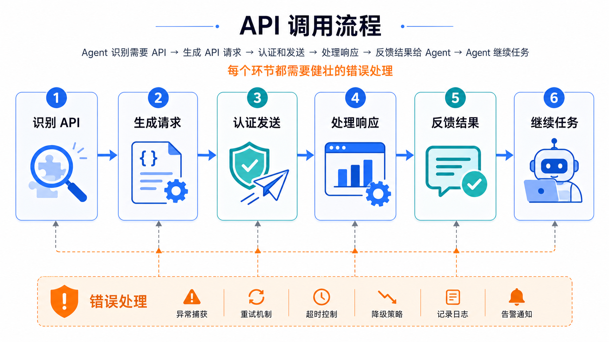

## 知识点讲解



### 1. 核心概念

Agent 调用外部 API 和人手动调 API 本质没区别，难点在于**谁来决定调什么、参数怎么填、结果怎么用**——这三件事都交给了 LLM。

整条链路可以拆成五步：

```latex
注册 API Schema → 模型决策是否调用 → 框架构造 HTTP 请求
    → 执行并等待响应 → 结果结构化后喂回模型
```

和本地工具调用比，外部 API 额外要处理三个问题：**认证**（凭证从哪来）、**网络不稳定**（超时、限流）、**成本追踪**（谁调的、调了多少）。

### 2. 技术细节

#### 2.1 API 注册与声明

把外部 API 包装成工具 Schema，告诉模型"这个 API 存在、做什么用、参数是什么"。关键是 description 要说清楚**什么时候应该调**，不然模型容易乱用。

```python
api_tool_schema = {
    "name": "query_crm",
    "description": "查询 CRM 系统获取客户信息。仅在需要查客户账户、订单状态时调用。",
    "input_schema": {
        "type": "object",
        "properties": {
            "customer_id": {"type": "string", "description": "客户唯一 ID"},
            "fields": {
                "type": "array",
                "items": {"type": "string"},
                "description": "需要返回的字段，如 ['name', 'email', 'orders']"
            }
        },
        "required": ["customer_id"]
    }
}
```

#### 2.2 认证管理

凭证绝对不能硬编码在代码里，也不能进 prompt。标准做法：环境变量存储 + 调用时注入 header，模型侧完全不知道 token 长什么样。

#### 2.3 错误分类与处理策略

| 错误类型 | 状态码 | 处理策略 |
| --- | --- | --- |
| 认证失败 | 401/403 | 不重试，直接上报 |
| 资源不存在 | 404 | 不重试，告知模型 |
| 限流 | 429 | 退避重试，指数 backoff |
| 服务器错误 | 5xx | 重试 2-3 次，超限放弃 |
| 网络超时 | timeout | 重试一次，仍超时放弃 |

## 代码示例

**API 执行层（带重试和认证）**

```python
import httpx
import os
import time
from typing import Any

class ExternalAPIClient:
    def __init__(self, base_url: str, api_key_env: str, timeout: float = 10.0):
        self.base_url = base_url
        # 凭证从环境变量读，不进代码和 prompt
        self.api_key = os.getenv(api_key_env, "")
        self.timeout = timeout

    def call(
        self,
        endpoint: str,
        method: str = "GET",
        params: dict = None,
        body: dict = None,
        max_retries: int = 3,
    ) -> dict:
        url = f"{self.base_url}/{endpoint}"
        headers = {
            "Authorization": f"Bearer {self.api_key}",
            "Content-Type": "application/json",
        }

        for attempt in range(max_retries):
            try:
                with httpx.Client(timeout=self.timeout) as client:
                    resp = client.request(
                        method=method,
                        url=url,
                        params=params,
                        json=body,
                        headers=headers,
                    )
                # 认证/权限类错误不重试
                if resp.status_code in (401, 403, 404):
                    return {
                        "ok": False,
                        "error_type": "auth_or_not_found",
                        "status": resp.status_code,
                        "detail": resp.text,
                    }
                resp.raise_for_status()
                return {"ok": True, "data": resp.json()}

            except httpx.TimeoutException:
                if attempt == max_retries - 1:
                    return {"ok": False, "error_type": "timeout"}
                time.sleep(2 ** attempt)  # 指数退避

            except httpx.HTTPStatusError as e:
                if e.response.status_code == 429:
                    # 限流：退避后重试
                    time.sleep(2 ** (attempt + 1))
                elif attempt == max_retries - 1:
                    return {"ok": False, "error_type": "server_error", "detail": str(e)}

        return {"ok": False, "error_type": "max_retries_exceeded"}
```

**Agent 侧：把 API 结果喂回模型**

```python
def agent_loop_with_api(user_task: str, llm, api_client: ExternalAPIClient) -> str:
    messages = [{"role": "user", "content": user_task}]

    while True:
        response = llm.call(messages=messages, tools=[api_tool_schema])

        if response.stop_reason == "tool_use":
            tool_call = response.tool_use
            raw_result = api_client.call(
                endpoint=tool_call.input.get("endpoint", ""),
                params=tool_call.input.get("params"),
            )

            # 把 API 结果（含错误信息）原样追回对话
            # 让模型自己决定怎么处理
            messages.append({"role": "assistant", "content": response.content})
            messages.append({
                "role": "user",
                "content": [{
                    "type": "tool_result",
                    "tool_use_id": tool_call.id,
                    # 成功或失败信息都给模型看
                    "content": str(raw_result),
                }]
            })
        else:
            return response.content[0].text
```

关键点：**把错误信息原样给模型**，不要在框架层悄悄吞掉。模型拿到"认证失败"和"限流"是完全不同的处理方向，信息丢了它就瞎猜。

**成本追踪中间件**

```python
class APIUsageTracker:
    def __init__(self):
        self.log: list[dict] = []

    def wrap(self, client: ExternalAPIClient, user_id: str):
        original_call = client.call

        def tracked_call(*args, **kwargs):
            start = time.time()
            result = original_call(*args, **kwargs)
            self.log.append({
                "user_id": user_id,
                "endpoint": args[0] if args else kwargs.get("endpoint"),
                "latency_ms": round((time.time() - start) * 1000),
                "ok": result.get("ok"),
            })
            return result

        client.call = tracked_call
        return client
```

## 面试怎么答

Agent 调用外部 API 的整个链路是：把 API 的能力定义成工具 Schema → LLM 决定什么时候调、参数怎么填 → 框架层构造认证请求并执行 → 结果追回对话让模型继续推理。这和手动调 API 没本质区别，区别是调用决策权在 LLM。

工程上最容易踩坑的三点：第一是认证，凭证绝对不能进 prompt，从环境变量注入、在 HTTP header 里传，模型侧完全不感知；第二是错误处理，401/403/404 不重试直接告知模型，5xx 和限流才退避重试，策略要按错误类型分；第三是把错误信息原样给模型，不要在框架层吞掉，模型需要知道到底发生了什么才能做后续决策。

另外一个容易被问的是成本追踪。生产里每次 API 调用都要记下来：是谁触发的、调了什么、延迟多少、成功没有。这不只是审计需要，出了问题也能快速定位是 Agent 在滥用某个接口还是接口本身不稳定。

## 高频追问 & 加分点

- **Q1：如何处理 API 限流？**  
    429 状态码拿到就退避，不能立刻重试。指数 backoff 是标配——第一次等 2s，第二次等 4s，第三次等 8s。如果 API 响应头里有 `Retry-After`，直接用那个值更准确。超过最大重试次数就放弃，告诉模型"暂时不可用"。
- **Q2：超时怎么设？**  
    没有统一答案，取决于接口类型。搜索类 API 一般 5-10s；重量级处理（OCR、语音转文字）可以放宽到 30-60s。关键是设了之后要在重试逻辑里区分"超时"和"服务器错误"，处理方式不同。
- **Q3：API key 怎么管理才安全？**  
    环境变量是最低要求，生产里更规范的是 Secret Manager（AWS Secrets Manager、GCP Secret Manager）。代码里只写读取逻辑，key 值在部署时注入，绝对不进 Git 仓库和 prompt。
- **Q4：Agent 滥用 API 怎么控制？**  
    两个方向：一是工具 description 写清楚"什么情况下才调"；二是在框架层加硬性限制——单次任务的 API 调用次数上限、每种 API 的每日配额。这两条要同时有，只靠 prompt 约束不可靠。
- **Q5：多个 API 之间有依赖关系怎么处理？**  
    依赖关系最好通过规划阶段解决——先出一个有序的子任务计划，再按顺序执行。如果是动态依赖（B 的入参依赖 A 的返回值），就必须串行；没有依赖的可以并行发出去，用 async/await 或线程池并发处理。
