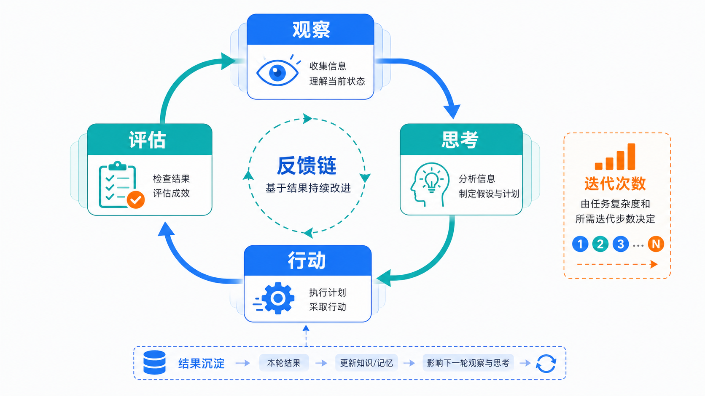

## 知识点讲解



### 1. 核心概念

执行循环（Execution Loop）是 Agent 能够自主运作的根本机制。没有它，Agent 就退化成"带工具的单次 LLM 调用"；有了它，Agent 才能在目标没完成前持续行动、根据观察不断调整方向。

最简的执行循环就四步：

```latex
观察（Observe） → 思考/决策（Think） → 行动（Act） → 再次观察
       ↑                                                    │
       └──────────────── 直到完成或放弃 ───────────────────┘
```

这里有一个容易忽略的要点：**"是否继续"这个判断权在 Agent 自己**，不是流程图里写死的出口条件。这就是执行循环区别于普通 pipeline 的地方。

### 2. 技术细节

#### 2.1 循环的四个阶段

**① 观察（Observe）**：感知当前状态。包括用户的原始目标、上一步的工具执行结果、对话历史、可用工具列表。本质是"把当前世界的快照打包成 context"。

**② 思考/决策（Think）**：LLM 基于观察做推理，决定下一步是什么。ReAct 范式里会先输出 `Thought`（显式推理），再输出 `Action`（具体操作）。

**③ 行动（Act）**：执行决策。可以是工具调用、API 请求、代码执行，也可以是"直接回答"（此时循环终止）。

**④ 终止判断（Evaluate）**：Agent 判断目标是否达成。通常三种结果：`SUCCESS`（完成）、`FAILED`（失败放弃）、`CONTINUE`（继续循环）。

#### 2.2 终止条件的设计

只靠 LLM 自己说"我完成了"，在生产里是会出问题的——它可能提前结束，也可能永远不停。我习惯用三重保险：

| 终止条件 | 类型 | 说明 |
| --- | --- | --- |
| `max_steps` | 硬限制 | 超过步数强制停止 |
| `max_tokens` | 硬限制 | 超过 token 预算停止 |
| LLM 自评 | 软判断 | 模型输出 `FINISH` 信号 |
| 外部验证 | 外部验证 | 另一个模型/规则判断是否真的完成 |

#### 2.3 执行循环 vs Pipeline

判断标准就一条：**"是否继续"由谁决定**。

- Pipeline：走到哪一步、下一步是什么，在代码里写死了
- Execution Loop：模型在每步结束后自己决定继续还是结束、下一步做什么

## 代码示例

**基础执行循环（带终止控制）**

```python
from enum import Enum
from dataclasses import dataclass, field
from typing import Any

class LoopStatus(Enum):
    RUNNING = "running"
    SUCCESS = "success"
    FAILED  = "failed"
    TIMEOUT = "timeout"

@dataclass
class LoopState:
    goal: str
    history: list = field(default_factory=list)
    step: int = 0
    status: LoopStatus = LoopStatus.RUNNING

def execution_loop(
    goal: str,
    llm,
    tools: dict,
    max_steps: int = 15,
    max_tokens: int = 20_000,
) -> dict:
    state = LoopState(goal=goal)
    total_tokens = 0

    while state.status == LoopStatus.RUNNING:
        # 硬终止：步数 & token 上限
        if state.step >= max_steps:
            state.status = LoopStatus.TIMEOUT
            break
        if total_tokens >= max_tokens:
            state.status = LoopStatus.TIMEOUT
            break

        # 观察：把当前快照打包成 prompt 上下文
        context = build_context(state.goal, state.history)

        # 思考 + 决策：LLM 一次调用
        decision, tokens_used = llm.decide(context)
        total_tokens += tokens_used

        if decision.action == "finish":
            state.status = LoopStatus.SUCCESS
            state.history.append({"step": state.step, "result": decision.answer})
            break

        # 行动：执行工具
        tool_fn = tools.get(decision.action)
        if tool_fn is None:
            observation = {"error": f"工具 {decision.action} 不存在"}
        else:
            try:
                observation = tool_fn(**decision.args)
            except Exception as e:
                observation = {"error": str(e)}

        state.history.append({
            "step": state.step,
            "thought": decision.thought,
            "action": decision.action,
            "args": decision.args,
            "observation": observation,
        })
        state.step += 1

    return {
        "status": state.status.value,
        "steps": state.step,
        "tokens": total_tokens,
        "history": state.history,
    }
```

**循环检测（防止重复行动）**

```python
def detect_loop(history: list, window: int = 3) -> bool:
    """检测最近 window 步是否在重复同一个动作"""
    if len(history) < window:
        return False
    recent = history[-window:]
    actions = [(h["action"], str(h["args"])) for h in recent]
    # 所有步骤都一样 → 卡死了
    return len(set(actions)) == 1
```

**在主循环里加循环检测**

```python
# 在 while 循环里，行动执行后加一行
if detect_loop(state.history):
    state.status = LoopStatus.FAILED
    break
```

## 面试怎么答

执行循环是 Agent 区别于普通 LLM 调用的核心机制。简单说就是"观察 → 思考 → 行动 → 再观察"这个循环不断跑，直到目标完成或放弃。关键在于每一步结束后，**是否继续由 Agent 自己判断**，不是外部流程图写死的——这一点就是它和传统 pipeline 的本质区别。

落地时最容易出问题的是终止条件。只靠 LLM 说"我完成了"会有两个毛病：提前结束（任务没做完就停），或者无限循环（烧 token）。我习惯三重保险：硬上限（max_steps + max_tokens）、LLM 自评（输出 FINISH 信号）、可选的外部验证（另一个模型或规则判断结果是否有效）。

另一个坑是循环卡死——Agent 在重复同一个动作出不来。解法是在历史里滑窗检测：最近 N 步如果行动和参数完全一样，强制终止并标记 FAILED，让上层决定是重试还是人工介入。

## 高频追问 & 加分点

- **Q1：max_steps 设多少合适？**  
    取决于任务复杂度。简单问答类 5-8 步够了；中等任务（数据分析、写报告）10-20 步；复杂的 Agentic 任务可以到 30-50 步，但超过 30 步通常说明规划有问题或者任务本身不适合单 Agent 完成，应该考虑分层或多 Agent。
- **Q2：执行循环如何支持暂停和恢复？**  
    把循环状态（goal、history、step、status）序列化到数据库，中断时保存，恢复时加载。history 必须完整，不然 LLM 下次推理会缺失上下文。Human-in-the-Loop 场景下，暂停等人工确认就是靠这个机制实现的。
- **Q3：多个任务并行时如何管理多个循环？**  
    每个任务开一个独立的循环实例，各自维护自己的 state。资源层面用异步（asyncio）或线程池并发执行；如果循环之间有数据依赖，用消息队列或共享状态协调。
- **Q4：循环里 token 消耗怎么控制？**  
    三个方向：一是 history 截断（超过 N 步只保留摘要 + 最近 K 步完整记录）；二是选合适的模型（思考步骤用便宜模型，关键决策用强模型）；三是减少不必要的工具调用——description 写好、工具数量别太多，减少模型"乱试"的概率。
- **Q5：执行循环失败如何上报？**  
    `FAILED` 和 `TIMEOUT` 要区分对待。TIMEOUT 说明资源耗尽，可以重试（调大上限）；FAILED 说明逻辑卡死，重试意义不大，需要人工分析 history 找根因。生产里这两种都要记到可观测性系统，便于后续优化。
