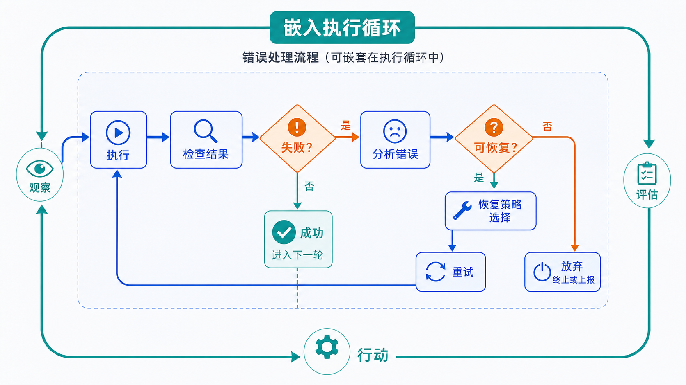

## 知识点讲解



### 1. 核心概念

在真实环境里运行的 Agent，失败是常态，不是异常。工具超时、API 限流、LLM 输出格式乱了、任务本身就走不通——每种失败的处理方式完全不同。

区分失败类型是错误处理的第一步：

| 失败类型 | 典型例子 | 可恢复性 |
| --- | --- | --- |
| 暂时性故障 | 网络超时、限流 429 | 退避重试 |
| 参数错误 | 工具入参格式不对 | 修改参数重试 |
| 逻辑错误 | 规划方向就错了 | 局部/全局 replan |
| 环境变化 | 数据库记录被删了 | 换策略或放弃 |
| 权限/合规错误 | 401、403 | 不重试，立即上报 |

**核心原则：失败不是一刀切，策略要按类型分级触发。**

### 2. 技术细节

#### 2.1 重试策略的四个层级

我习惯把重试分四级，从轻到重：

1. **原样重试**：暂时性错误（超时、5xx），等一等再试同样的请求
2. **修改参数重试**：工具调用返回格式错误，让 LLM 重新生成参数
3. **局部 replan**：某个子任务失败，只重新规划失败点之后的步骤
4. **整体 replan + Human-in-the-Loop**：多次失败，说明初始计划方向有问题

别一失败就整体 replan，token 成本扛不住。

#### 2.2 指数退避（Exponential Backoff）

```
等待时间 = base_delay × 2^attempt + random_jitter
```

加 jitter（随机抖动）是关键，防止大量 Agent 同时失败后同时重试把服务打崩。

#### 2.3 错误上报与终止

有些错误不应该重试——重试只会浪费资源：

- 401/403：认证问题，重试无意义，立即上报
- 404：资源不存在，换策略而不是重试
- 任务本身不可能完成（LLM 判断）：主动放弃并说明原因

## 代码示例

**分级重试策略**

```python
import time
import random
from enum import Enum
from typing import Callable, Any

class ErrorLevel(Enum):
    TRANSIENT = "transient"      # 暂时性，退避重试
    PARAM_ERROR = "param_error"  # 参数错，修改后重试
    LOGIC_ERROR = "logic_error"  # 逻辑错，局部 replan
    FATAL = "fatal"              # 致命，不重试

def classify_error(error: Exception, response: dict = None) -> ErrorLevel:
    """根据错误类型分类"""
    if isinstance(error, TimeoutError):
        return ErrorLevel.TRANSIENT
    if response:
        status = response.get("status_code", 0)
        if status == 429:
            return ErrorLevel.TRANSIENT
        if status in (401, 403):
            return ErrorLevel.FATAL
        if status == 422:  # 参数校验失败
            return ErrorLevel.PARAM_ERROR
    return ErrorLevel.LOGIC_ERROR

def exponential_backoff(attempt: int, base: float = 1.0, cap: float = 60.0) -> float:
    """指数退避 + jitter，防止同步重试"""
    delay = min(base * (2 ** attempt), cap)
    jitter = random.uniform(0, delay * 0.1)
    return delay + jitter

def retry_with_policy(
    fn: Callable,
    classify_fn: Callable,
    max_transient_retries: int = 3,
    on_param_error: Callable = None,
) -> Any:
    """带分级策略的重试执行器"""
    attempt = 0

    while True:
        try:
            result = fn()
            # 工具返回了错误字段（非 exception 的软性失败）
            if isinstance(result, dict) and not result.get("ok", True):
                level = classify_fn(None, result)
            else:
                return result  # 成功

        except Exception as e:
            result = None
            level = classify_fn(e)

        if level == ErrorLevel.FATAL:
            raise RuntimeError("致命错误，不重试")

        if level == ErrorLevel.TRANSIENT:
            if attempt >= max_transient_retries:
                raise RuntimeError("重试次数耗尽")
            wait = exponential_backoff(attempt)
            time.sleep(wait)
            attempt += 1
            continue

        if level == ErrorLevel.PARAM_ERROR and on_param_error:
            # 交给上层修改参数后重新调用
            fn = on_param_error(result)
            attempt = 0
            continue

        # LOGIC_ERROR：交给上层 replan
        raise ValueError("逻辑错误，需要 replan")
```

**Agent 侧的 replan 逻辑**

```python
def agent_with_recovery(goal: str, llm, tools: dict, max_replans: int = 2) -> str:
    plan = llm.make_plan(goal)
    replan_count = 0

    i = 0
    results = {}

    while i < len(plan):
        step = plan[i]
        try:
            results[i] = execute_step(step, tools, context=results)
            i += 1
        except ValueError:
            # 逻辑错误触发局部 replan
            if replan_count >= max_replans:
                return "任务无法完成，已达最大 replan 次数"
            # 只重规划失败点往后的部分，不动已成功的步骤
            new_tail = llm.replan(
                goal=goal,
                completed=plan[:i],
                completed_results=results,
                failed_step=step,
            )
            plan = plan[:i] + new_tail
            replan_count += 1
            # 不递增 i，继续从当前位置执行新计划

    return llm.summarize(goal, results)
```

关键设计：`plan[:i]` 保留已完成的结果，replan 只针对后半段，不浪费前面的工作。

## 面试怎么答

Agent 的错误处理，核心思路是"按类型分级"，不是一刀切的无脑重试。我把错误分四类：暂时性（超时、限流）、参数错误、逻辑错误、致命错误。前三类可以恢复，最后一类直接上报。

重试策略也对应四级：暂时性故障就退避重试（指数退避 + jitter，防止同步打崩服务）；参数错误就让 LLM 重新生成参数再试；逻辑错误触发局部 replan（只重新规划失败点之后的步骤，已完成的不动）；多次失败说明初始方向有问题，升级到全局 replan 或 Human-in-the-Loop。

最后一点很重要：错误信息要原样给模型看，不能在框架层吞掉。模型拿到"429 限流"和"404 不存在"会做完全不同的决策，你给它的信息越准确，它恢复的可能性越高。

## 高频追问 & 加分点

- **Q1：重试次数怎么设？**  
    暂时性故障通常 3 次够了，超过 3 次说明不是暂时性问题。具体上限要结合任务的时间预算——如果整个任务有 30s 超时，单个工具最多重试 2 次、每次等 2-4s，数学上说得过去就行。
- **Q2：如何区分临时故障和永久故障？**  
    看 HTTP 状态码是最直接的。429 是临时、5xx 通常是临时、401/403/404 是永久。如果是 LLM 输出格式问题（软性失败），需要靠校验逻辑判断——工具返回了 schema 不对的数据，就是参数错误，可以让 LLM 重新生成。
- **Q3：replan 的成本很高怎么办？**  
    局部 replan 是关键——只重规划失败步骤之后的部分，不动已完成的。已完成的结果作为上下文传进去，replan prompt 只需要说"前 N 步已完成、结果如下，现在从第 N+1 步开始重新规划"。这比整体 replan 省大约 60-70% 的 token。
- **Q4：如何防止错误恢复本身带来的副作用？**  
    有些工具调用是有副作用的（发邮件、写数据库），重试会导致重复执行。解决方法是幂等设计：工具带唯一请求 ID，服务端检测到重复 ID 直接返回上次结果，不重复执行。或者在 Agent 侧把有副作用的工具标记为"不可重试"，失败直接走 Human-in-the-Loop。
- **Q5：Human-in-the-Loop 怎么触发？**  
    三种触发条件：①达到最大 replan 次数；②遇到高风险动作（删数据、转账）；③LLM 主动判断"我不够确定，需要确认"。触发后暂停执行循环，把当前状态和问题序列化，等人工响应后恢复。
