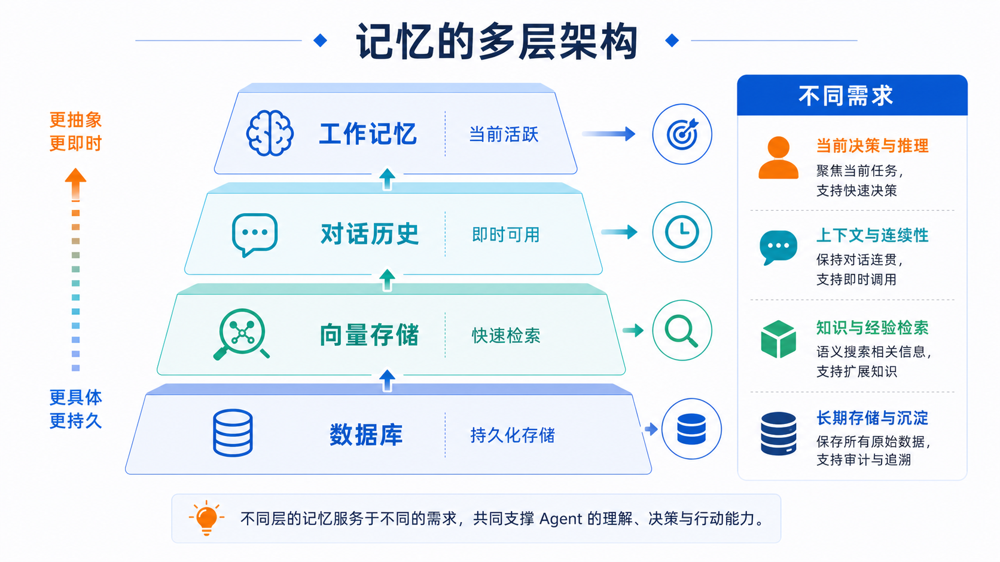

## 知识点讲解



### 1. 核心概念

Agent 的记忆系统要解决一个根本矛盾：LLM 的上下文窗口是有限的，但任务需要的信息可能是无限的。记忆系统的价值，就是在这两者之间做好搬运和取舍。

记忆可以按**生命周期**拆成三层：

| 层次 | 别名 | 生命周期 | 存储形式 |
| --- | --- | --- | --- |
| 短期记忆 | Working Memory | 当前对话/任务 | LLM 上下文 window |
| 情节记忆 | Episodic Memory | 当前任务会话 | 内存或 session 存储 |
| 长期记忆 | Long-term Memory | 跨任务持久化 | 向量库 + 数据库 |

### 2. 技术细节

#### 2.1 五种常见设计模式

**① 对话历史（Conversation Buffer）**

最简单的模式——直接把所有消息堆进 context。优点是实现零成本，缺点是 token 用量随对话长度线性增长，长任务直接超窗。

**② 滑窗记忆（Sliding Window）**

只保留最近 N 条消息。节省 token，但早期的关键信息会丢。适合短平快的场景。

**③ 摘要记忆（Summarization Memory）**

超出窗口的历史不丢弃，而是压缩成摘要再追加进 context。保留了重要信息，但摘要质量依赖 LLM 的压缩能力，细节会有损失。

**④ 向量记忆（Vector Memory / RAG-style）**

把历史信息 embedding 后存向量库，每步检索与当前任务最相关的片段注入 context。容量几乎无限，但引入了检索延迟，检索质量决定记忆质量。

**⑤ 知识图谱记忆（Knowledge Graph Memory）**

把记忆结构化成实体 + 关系图谱，适合需要多跳推理的场景（"A 和 B 的关系是什么，影响 C 吗"）。维护成本高，通常只在复杂领域 Agent 里用。

#### 2.2 分层组合是主流实践

生产里通常不单用一种，而是分层组合：

```latex
短期上下文（最近 K 步）
  + 摘要（更早的压缩历史）
  + 向量检索（与当前任务最相关的长期记忆）
= 最终注入 context 的内容
```

三层加起来控制在 context window 的 60-70%，留余量给工具结果和模型输出。

## 代码示例

**摘要 + 向量的混合记忆管理器**

```python
from collections import deque
from typing import Optional

class HybridMemoryManager:
    def __init__(
        self,
        short_term_capacity: int = 10,   # 短期保留最近 N 步
        summary_interval: int = 5,        # 每 5 步压缩一次历史
    ):
        self.short_term: deque = deque(maxlen=short_term_capacity)
        self.summaries: list[str] = []
        self.vector_store: list[dict] = []  # 简化：实际用 Chroma/Pinecone 等
        self.step_count = 0
        self.summary_interval = summary_interval

    def add_interaction(self, role: str, content: str, metadata: dict = None):
        entry = {"role": role, "content": content, "step": self.step_count}
        self.short_term.append(entry)
        self.step_count += 1

        # 到达阈值，把最老的部分压缩成摘要
        if self.step_count % self.summary_interval == 0:
            self._compress_to_summary()

    def _compress_to_summary(self):
        """把短期记忆最老的一半压缩成摘要"""
        items = list(self.short_term)
        old_items = items[:len(items) // 2]
        if not old_items:
            return
        # 实际调用 LLM 压缩
        summary_text = self._llm_summarize(old_items)
        self.summaries.append(summary_text)
        # 同时存到向量库供后续检索
        self.vector_store.append({
            "text": summary_text,
            "embedding": self._embed(summary_text),
            "step_range": (old_items[0]["step"], old_items[-1]["step"]),
        })

    def get_context(self, query: str, max_tokens: int = 3000) -> str:
        """组装注入 context 的记忆"""
        parts = []

        # 1. 向量检索最相关的长期记忆
        relevant = self._retrieve_relevant(query, top_k=2)
        if relevant:
            parts.append("【相关历史记忆】\n" + "\n".join(relevant))

        # 2. 最近的摘要（如果有）
        if self.summaries:
            parts.append("【近期摘要】\n" + self.summaries[-1])

        # 3. 短期记忆（最近 K 步完整记录）
        recent = [f"{e['role']}: {e['content']}" for e in self.short_term]
        parts.append("【当前对话】\n" + "\n".join(recent))

        return "\n\n".join(parts)

    def _retrieve_relevant(self, query: str, top_k: int = 2) -> list[str]:
        """向量检索（示意）"""
        if not self.vector_store:
            return []
        query_emb = self._embed(query)
        scored = [
            (item["text"], self._cosine_sim(query_emb, item["embedding"]))
            for item in self.vector_store
        ]
        scored.sort(key=lambda x: x[1], reverse=True)
        return [text for text, _ in scored[:top_k]]

    def _llm_summarize(self, items: list[dict]) -> str:
        # 实际调用 LLM，这里示意
        # ...
        return f"摘要：{len(items)} 步历史"

    def _embed(self, text: str) -> list[float]:
        # 实际调用 embedding 模型
        # ...
        return [0.0] * 768

    @staticmethod
    def _cosine_sim(a: list[float], b: list[float]) -> float:
        dot = sum(x * y for x, y in zip(a, b))
        norm_a = sum(x ** 2 for x in a) ** 0.5
        norm_b = sum(x ** 2 for x in b) ** 0.5
        return dot / (norm_a * norm_b + 1e-9)
```

**使用示意**

```python
memory = HybridMemoryManager(short_term_capacity=10, summary_interval=5)

# Agent 执行循环里每步调用
memory.add_interaction("user", "帮我分析 Q3 销售数据")
memory.add_interaction("assistant", "好的，我先查数据库...")

# 每步推理前获取注入 context 的记忆
context = memory.get_context(query="Q3 销售数据分析")
# → 拿到：相关历史摘要 + 最近对话，塞进 LLM prompt
```

## 面试怎么答

Agent 记忆系统的核心矛盾是：上下文窗口有限，任务需要的历史可能很长。解决方法是分层设计——不同层用不同策略处理不同生命周期的信息。

五种常见模式：对话历史（最简单，token 烧得猛）、滑窗（最近 N 步，简单高效但会丢早期信息）、摘要记忆（超出窗口的压缩成摘要，保留重点）、向量记忆（embedding 后存库、检索时注入，容量无限但有检索延迟）、知识图谱（结构化的实体关系，适合多跳推理）。

生产里我一般用混合方案：短期保留最近 K 步完整记录 + 更早历史用 LLM 压缩成摘要 + 向量检索拿最相关的长期记忆。三层加起来控制在 context window 的 60-70%，给工具结果和模型输出留余量。摘要是有损压缩，向量检索质量依赖 embedding 模型，两者各有缺陷，组合起来才比较稳。

## 高频追问 & 加分点

- **Q1：什么信息该进长期记忆、什么不用？**  
    一个粗略判据：对未来任务有复用价值的才进。用户偏好、领域知识、任务完成的最佳路径——这些值得持久化。当前任务的中间状态、一次性的工具结果——任务完成就扔。记忆系统写多了比写少了问题更大，检索时噪声会增加。
- **Q2：摘要记忆的质量怎么保证？**  
    摘要 prompt 要明确告诉 LLM"保留哪类信息"——比如"保留用户偏好、任务决策路径、关键发现，不需要保留工具调用的原始参数"。另外可以做两步摘要：先让 LLM 打标（哪些是关键信息），再压缩，质量会好一点。
- **Q3：向量检索出来的记忆和当前任务不相关怎么办？**  
    加一步相关性过滤：检索出 top-K 后，用 LLM 或规则判断"这条记忆和当前任务有关吗"，过滤掉不相关的。也可以结合元数据过滤（时间、任务类型），缩小检索范围再做向量搜索。
- **Q4：多用户场景下记忆怎么隔离？**  
    按 user_id 做命名空间隔离，不同用户的记忆在向量库里物理分开（不同 collection 或者过滤字段）。不能共享的是用户个人信息和操作历史；可以共享的是公共领域知识（产品文档、FAQ）。
- **Q5：记忆系统怎么评估效果？**  
    两个核心指标：①记忆命中率（模型用到了注入的历史信息的比例）；②上下文浪费率（注入进去但没被用到的 token 比例）。前者低说明检索质量差，后者高说明注入了太多噪声。用户满意度是最终指标，但两个内部指标有助于快速定位问题。
