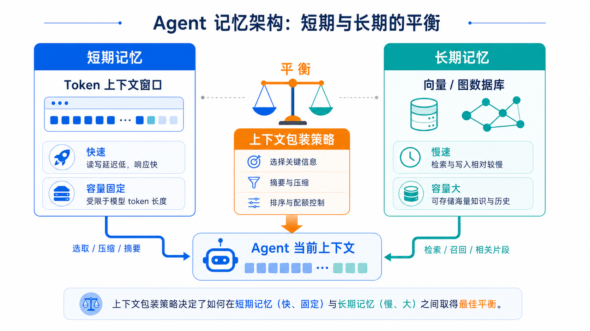

## 知识点讲解



### 1. 核心概念

短期记忆和长期记忆的区别，不在"重不重要"，在**访问方式和生命周期**。

**短期记忆**：就是 LLM 的上下文窗口。Agent 正在处理的对话、当前步骤的工具结果、最近的推理过程——这些都在短期记忆里。访问零延迟（模型直接"看到"），但容量有上限（4K~128K tokens，用完就得丢）。

**长期记忆**：在上下文窗口外部持久化的信息。向量库、数据库、文件系统都是长期记忆的载体。容量几乎没限制，但访问要查询（有延迟），且必须主动检索，模型不会自动看到。

关键区别一句话：**短期是"模型看到的"，长期是"模型需要去拿的"**。

### 2. 技术细节

#### 2.1 短期记忆的管理策略

上下文窗口是有限资源，得省着用。三种常见的管理方法：

**① 固定窗口**：只保留最近 N 条消息，超出直接丢弃。简单，但早期重要信息会丢。

**② 摘要压缩**：超出窗口的历史让 LLM 压缩成摘要，摘要追加在 context 头部。保留了重要信息，但有信息损失。

**③ 重要性加权**：给每条记录打分（相关性 + 重要性），按分数决定保留哪些。最灵活，但需要额外的评分调用。

短期记忆一般分配 context window 的 40-60%，剩下留给 system prompt、工具定义、工具结果。

#### 2.2 长期记忆的实现方式

| 技术 | 适合存什么 | 检索方式 | 主要缺点 |
| --- | --- | --- | --- |
| 向量数据库 | 文本、对话片段、知识 | 语义相似度 | 有检索延迟 |
| 关系数据库 | 结构化数据、用户信息 | SQL 精确查询 | 不支持模糊语义搜索 |
| 知识图谱 | 实体关系、多跳推理 | 图遍历 | 构建和维护成本高 |
| 文件系统 | 长文档、代码、报告 | 路径 + 关键词 | 无语义理解 |

#### 2.3 记忆的存档与检索流程

```latex
每步执行后：
  → 新交互追加短期记忆
  → 短期满了 → 压缩 → 存档到长期记忆（向量库）

每步推理前：
  → 用当前任务做向量检索
  → 拿回最相关的长期记忆片段
  → 组合成 context 注入给 LLM
```

## 代码示例

**短期记忆的上下文窗口管理**

```python
from collections import deque

class ContextWindowManager:
    """管理短期记忆的 token 预算"""

    def __init__(self, max_tokens: int = 4096, reserve_for_output: int = 1024):
        self.budget = max_tokens - reserve_for_output  # 留给输出的空间
        self.messages: deque = deque()
        self.used_tokens = 0

    def add_message(self, role: str, content: str):
        tokens = self._estimate_tokens(content)

        # 如果加进去超预算，从最早的消息开始丢（保留 system 消息）
        while self.used_tokens + tokens > self.budget and len(self.messages) > 1:
            oldest = self.messages.popleft()
            self.used_tokens -= self._estimate_tokens(oldest["content"])

        self.messages.append({"role": role, "content": content})
        self.used_tokens += tokens

    def get_messages(self) -> list[dict]:
        return list(self.messages)

    @staticmethod
    def _estimate_tokens(text: str) -> int:
        return len(text) // 4  # 粗估，生产里用 tiktoken
```

**长期记忆的存档与检索**

```python
import time

class LongTermMemory:
    """基于向量的长期记忆（示意实现，生产替换 Chroma/Pinecone）"""

    def __init__(self, embed_fn, similarity_fn):
        self.store: list[dict] = []
        self.embed = embed_fn
        self.similarity = similarity_fn

    def archive(self, text: str, metadata: dict = None):
        """把内容存档到长期记忆"""
        self.store.append({
            "text": text,
            "embedding": self.embed(text),
            "metadata": metadata or {},
            "archived_at": time.time(),
        })

    def retrieve(self, query: str, top_k: int = 3, threshold: float = 0.7) -> list[str]:
        """检索最相关的长期记忆"""
        if not self.store:
            return []
        query_emb = self.embed(query)
        scored = [
            (item["text"], self.similarity(query_emb, item["embedding"]))
            for item in self.store
        ]
        # 过滤低相关度结果
        filtered = [(t, s) for t, s in scored if s >= threshold]
        filtered.sort(key=lambda x: x[1], reverse=True)
        return [text for text, _ in filtered[:top_k]]
```

**Agent 的记忆系统集成**

```python
class AgentMemorySystem:
    """短期 + 长期记忆的统一接口"""

    def __init__(
        self,
        short_term_tokens: int = 4096,
        archive_threshold: int = 8,  # 短期满 N 步后存档
    ):
        self.short_term = ContextWindowManager(max_tokens=short_term_tokens)
        self.long_term = LongTermMemory(embed_fn=_embed, similarity_fn=_cosine)
        self.step_count = 0
        self.archive_threshold = archive_threshold

    def record(self, role: str, content: str):
        """记录一步交互"""
        self.short_term.add_message(role, content)
        self.step_count += 1

        # 达到阈值，把最近一批存档到长期记忆
        if self.step_count % self.archive_threshold == 0:
            recent_text = self._flatten(self.short_term.get_messages()[-self.archive_threshold:])
            self.long_term.archive(recent_text, metadata={"step": self.step_count})

    def get_context_for(self, current_task: str) -> list[dict]:
        """为当前推理步骤组装 context"""
        # 拉取相关长期记忆
        relevant = self.long_term.retrieve(current_task, top_k=2)

        messages = []
        if relevant:
            # 把长期记忆作为 system 级上下文注入
            messages.append({
                "role": "system",
                "content": "以下是可能相关的历史记忆：\n" + "\n---\n".join(relevant)
            })
        messages.extend(self.short_term.get_messages())
        return messages

    @staticmethod
    def _flatten(messages: list[dict]) -> str:
        return "\n".join(f"{m['role']}: {m['content']}" for m in messages)
```

## 面试怎么答

短期记忆和长期记忆的核心区别是访问方式：短期记忆就是 LLM 的上下文窗口，模型"直接看到"，零延迟；长期记忆在窗口外部持久化，需要主动检索才能拿到。容量上短期有上限（受 context window 限制），长期几乎无限制。

短期记忆的管理重点是 token 预算——context 里不是只放消息，还有 system prompt、工具定义、工具结果，所以消息历史通常只能占 40-60%，超出就要靠滑窗、摘要或重要性过滤来裁剪。长期记忆主要靠向量库，按语义相似度检索；结构化数据走关系数据库精确查询；两者通常组合用。

实际工程里我的做法是：短期记忆管好 context window，每 N 步把一批历史压缩存档到向量库；推理前用当前任务做检索，把相关的长期记忆注入 context 头部。关键是检索门槛要设（相似度低于阈值的不注入），否则注入的噪声比没有还糟。

## 高频追问 & 加分点

- **Q1：短期记忆满了优先丢哪些？**  
    通常丢最老的，但 system prompt 和工具定义要保留——模型没有这些就不知道自己能做什么。如果历史里有"重要决策点"（比如用户纠正了 Agent 的方向），这种也要保留。有条件的话用重要性评分来决定丢哪些，比单纯按时间顺序丢更好。
- **Q2：向量检索的延迟会影响 Agent 的响应速度吗？**  
    会，但量级上通常可以接受（几十毫秒到几百毫秒）。如果任务对延迟敏感，可以把检索改成异步：上一步执行工具的同时，预取下一步可能需要的记忆。另外 top_k 不要设太大，3-5 条通常够，检索再多了 context 里也用不完。
- **Q3：长期记忆里的信息过时了怎么处理？**  
    加时间戳和 TTL（存活时间），定期清理过期记忆。对于知识类记忆，更新时打版本号而不是直接覆盖——这样可以追溯，也能在新旧信息之间做对比。
- **Q4：多 Agent 能共享长期记忆吗？**  
    可以，向量库天然支持多 Agent 共享。关键是读写权限要分清——有些记忆是某个 Agent 私有的，有些是团队共享的，用命名空间或 metadata 过滤隔离。写冲突可以用乐观锁或最后写入生效策略。
- **Q5：怎么评估长期记忆的检索质量？**  
    看两个指标：检索命中率（LLM 是否实际用到了检索回来的信息）和无关注入率（检索回来的里面有多少跟当前任务没关系）。可以在 LLM 输出里加一步"是否使用了提供的历史记忆"的判断，用 LLM-as-judge 方式批量评估。
