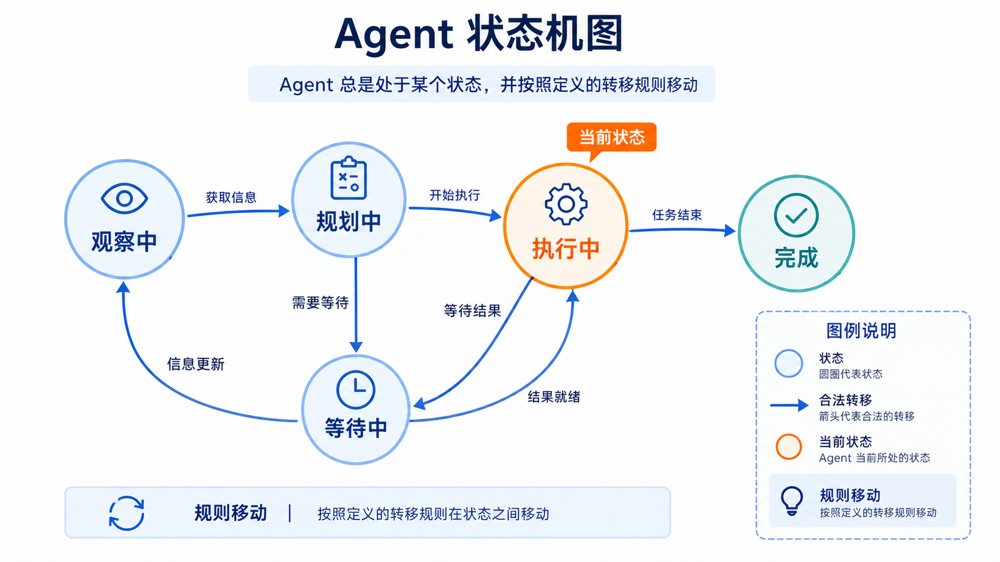

## 知识点讲解



### 1. 核心概念

Agent 的状态管理解决一个问题：**在多步执行过程中，系统在任何时刻都能知道自己在哪、下一步该做什么、出错了怎么恢复**。

没有状态管理的 Agent 是脆弱的——中途崩溃就啥都没了，也没法支持暂停/恢复、并发控制和可观测性。

Agent 的状态通常包含两类信息：

**执行状态**（Agent 处于什么阶段）：

```
IDLE → PLANNING → EXECUTING → REFLECTING → COMPLETED
                    ↓ 失败
                  FAILED
```

**任务状态**（当前任务的数据快照）：目标、计划、已完成步骤、中间结果、错误记录。

### 2. 技术细节

#### 2.1 状态机的核心设计要点

**定义合法的状态转移**：不是所有状态之间都能跳转。`IDLE → EXECUTING` 是非法的（必须先规划），在代码里显式约束比事后 debug 容易得多。

**状态数据结构**：每个状态不只是一个枚举值，还要带上进入时间、相关上下文、错误信息等——这些是中断恢复和问题排查的关键。

**持久化**：Agent 的状态要序列化到外部存储（Redis、数据库），不能只在内存里。一旦进程崩溃，状态从存储恢复，不需要从头开始。

#### 2.2 状态持久化的触发时机

不是每步都需要持久化（写太频繁），但有几个关键节点必须持久化：

- 状态转移发生时
- 完成一个子任务时
- 调用高风险工具前后（方便回滚）
- 任何人工确认点前

## 代码示例

**状态机实现**

```python
from enum import Enum
from dataclasses import dataclass, field, asdict
from datetime import datetime
from typing import Optional
import json

class AgentState(Enum):
    IDLE       = "idle"
    PLANNING   = "planning"
    EXECUTING  = "executing"
    REFLECTING = "reflecting"
    COMPLETED  = "completed"
    FAILED     = "failed"

# 合法的状态转移表
VALID_TRANSITIONS: dict[AgentState, list[AgentState]] = {
    AgentState.IDLE:       [AgentState.PLANNING],
    AgentState.PLANNING:   [AgentState.EXECUTING, AgentState.FAILED],
    AgentState.EXECUTING:  [AgentState.REFLECTING, AgentState.FAILED],
    AgentState.REFLECTING: [AgentState.COMPLETED, AgentState.IDLE],
    AgentState.COMPLETED:  [AgentState.IDLE],
    AgentState.FAILED:     [AgentState.IDLE],
}

@dataclass
class TaskState:
    goal: str
    plan: list = field(default_factory=list)
    current_step: int = 0
    results: dict = field(default_factory=dict)
    error: Optional[str] = None
    created_at: str = field(default_factory=lambda: datetime.utcnow().isoformat())
    updated_at: str = field(default_factory=lambda: datetime.utcnow().isoformat())

class AgentStateMachine:
    def __init__(self, task_id: str, store=None):
        self.task_id = task_id
        self._state = AgentState.IDLE
        self.task: Optional[TaskState] = None
        self.history: list[dict] = []
        self.store = store  # 外部持久化（Redis / DB）

    @property
    def state(self) -> AgentState:
        return self._state

    def transition(self, new_state: AgentState, context: dict = None):
        """转移状态，自动校验合法性并持久化"""
        allowed = VALID_TRANSITIONS.get(self._state, [])
        if new_state not in allowed:
            raise ValueError(
                f"非法转移：{self._state.value} → {new_state.value}，"
                f"允许的目标状态：{[s.value for s in allowed]}"
            )

        self.history.append({
            "from": self._state.value,
            "to": new_state.value,
            "at": datetime.utcnow().isoformat(),
            "context": context or {},
        })

        self._state = new_state
        if self.task:
            self.task.updated_at = datetime.utcnow().isoformat()

        # 关键时机持久化
        self._persist()

    def init_task(self, goal: str):
        self.task = TaskState(goal=goal)
        self.transition(AgentState.PLANNING)

    def set_plan(self, plan: list):
        if self.task:
            self.task.plan = plan
        self.transition(AgentState.EXECUTING)

    def record_step_result(self, step_idx: int, result):
        if self.task:
            self.task.results[step_idx] = result
            self.task.current_step = step_idx + 1
        # 每完成一步持久化
        self._persist()

    def mark_failed(self, error: str):
        if self.task:
            self.task.error = error
        self.transition(AgentState.FAILED, {"error": error})

    def _persist(self):
        """序列化状态到外部存储"""
        if self.store is None:
            return
        snapshot = {
            "task_id": self.task_id,
            "state": self._state.value,
            "task": asdict(self.task) if self.task else None,
            "history": self.history,
        }
        self.store.set(self.task_id, json.dumps(snapshot))

    @classmethod
    def restore(cls, task_id: str, store) -> "AgentStateMachine":
        """从存储恢复状态"""
        raw = store.get(task_id)
        if not raw:
            raise KeyError(f"任务 {task_id} 不存在")
        snapshot = json.loads(raw)
        sm = cls(task_id=task_id, store=store)
        sm._state = AgentState(snapshot["state"])
        if snapshot["task"]:
            sm.task = TaskState(**snapshot["task"])
        sm.history = snapshot["history"]
        return sm
```

**在 Agent 执行循环里使用**

```python
def run_agent_with_state(goal: str, llm, tools: dict, store=None) -> str:
    task_id = f"task_{int(datetime.utcnow().timestamp())}"
    sm = AgentStateMachine(task_id=task_id, store=store)

    sm.init_task(goal)
    plan = llm.make_plan(goal)
    sm.set_plan(plan)

    for i, step in enumerate(plan):
        try:
            result = execute_step(step, tools)
            sm.record_step_result(i, result)
        except Exception as e:
            sm.mark_failed(str(e))
            return f"任务失败：{e}（可通过 task_id={task_id} 恢复）"

    sm.transition(AgentState.REFLECTING)
    summary = llm.reflect(sm.task.results)
    sm.transition(AgentState.COMPLETED)
    return summary
```

## 面试怎么答

Agent 的状态管理，我理解有两个层面：执行状态（Agent 处于什么阶段）和任务状态（当前任务的数据快照）。前者通常用状态机实现——定义清晰的状态集合和合法的转移路径，代码层面直接约束，避免非法跳转；后者用数据结构记录目标、计划、中间结果和错误信息。

做好状态管理最重要的两点：一是**持久化**，状态不能只在内存，进程崩了要能从外部存储恢复；二是**关键时机持久化**，不是每步都写（太贵），但状态转移、子任务完成、高风险操作前后这几个节点必须写。这样万一中途失败，不需要从头来，从断点继续就行。

状态转移的合法性检查也很重要——明确定义哪些转移是允许的，在 `transition()` 方法里校验，比出了问题再找 bug 省很多时间。

## 高频追问 & 加分点

- **Q1：状态持久化用什么技术？**  
    取决于需求。单机 + 快速恢复用 Redis（速度快，适合短生命周期任务）；需要长期保存、可审计用关系数据库；如果任务状态很复杂（嵌套结构），可以用 JSON 列或文档数据库。关键是序列化格式要稳定，schema 变了要做迁移，不然老状态恢复不了。
- **Q2：并发多个任务时状态怎么隔离？**  
    每个任务用唯一的 `task_id` 做 key，状态完全隔离。如果多个 Agent 实例处理同一个任务（分布式），需要分布式锁防止状态被多个实例同时写——乐观锁（CAS）或悲观锁（Redis SETNX）都行。
- **Q3：失败状态怎么恢复？**  
    `FAILED` 状态要保留足够的错误上下文（哪步失败、错误内容、已完成的结果）。恢复时可以从 `FAILED` 直接跳回 `IDLE` 重试，或者在 `EXECUTING` 阶段的某个检查点重启——后者效率更高，因为不需要重新执行已经成功的步骤。
- **Q4：如何监控 Agent 的状态？**  
    把状态转移事件发送到消息队列或监控系统（如 Prometheus + Grafana）。关注几个指标：各状态的平均停留时长（EXECUTING 太长说明卡住了）、FAILED 率、从 FAILED 恢复的成功率。IDLE 状态长时间不动也是异常信号。
- **Q5：分层规划里多层状态怎么管理？**  
    每层维护独立的状态机。Mission 层状态机管理整体目标的生命周期，Task 层状态机管理每个子任务，Action 层管理原子操作。父层状态机监听子层的完成/失败信号，决定整体的下一步。层之间通过事件或回调通信，不直接耦合。
