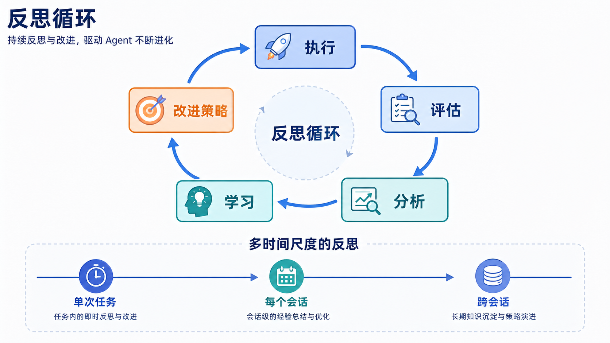

## 知识点讲解



### 1. 核心概念

Agent 的自我反思（Reflection）是指在执行任务之后，系统评估"做得怎么样"，提取经验，并用来改进后续决策的过程。

没有反思的 Agent 每次都从零开始——犯过的错下次还会犯，找到的好方法也不会被复用。有了反思，Agent 才能在多次任务中积累。

反思的目的不是"写总结"，而是**影响下一步的行为**：改进 prompt、更新策略、存档成功案例、标记高风险动作。

反思可以发生在三个时机：

- **步后反思（Step-level）**：每步执行完立刻评估，发现问题立刻纠偏
- **任务后反思（Task-level）**：整个任务完成后的系统性总结
- **定期反思（Periodic）**：每 N 个任务做一次批量回顾，识别模式性问题

### 2. 技术细节

#### 2.1 反思的内容维度

好的反思不是泛泛而谈，要聚焦在几个具体维度：

| 维度 | 评估问题 | 输出 |
| --- | --- | --- |
| 目标对齐 | 最终结果和用户目标一致吗？ | 偏差描述 |
| 步骤效率 | 有没有绕弯路、重复步骤？ | 可优化路径 |
| 工具选择 | 选的工具是最合适的吗？ | 工具推荐更新 |
| 错误模式 | 这次失败的根因是什么？ | 规避规则 |
| 成本效率 | 用了多少 token？值不值？ | 成本优化建议 |

#### 2.2 反思结果如何影响后续行为

反思的价值取决于"结论有没有被用上"。常见的三种应用方式：

1. **更新系统 Prompt**：把反思得到的规则追加进 system prompt（比如"当 API 返回 404 时，不要重试，直接换策略"）
2. **存档到记忆库**：把成功案例的执行路径向量化存档，下次相似任务时检索参考
3. **调整规划策略**：反思发现规划粒度太粗，下次任务规划时自动细化

#### 2.3 内部反思 vs 外部评估

Agent 自己的反思（内部）是有偏的——它有可能"不知道自己错在哪"。高质量的反思系统通常包含外部验证：

- **另一个 LLM 实例**作为批评者（critic）
- **规则引擎**检查是否违反约束
- **人工抽检**提供真实的质量反馈

## 代码示例

**步后反思（ReAct 风格）**

```python
def reflect_on_step(step_record: dict, llm) -> dict:
    """每步执行后评估"""
    prompt = f"""
你是一个任务审查员。评估以下 Agent 执行步骤：

目标：{step_record['goal']}
执行的动作：{step_record['action']}
动作参数：{step_record['args']}
执行结果：{step_record['result']}

请回答：
1. 这步执行是否推进了目标？（yes/no/partial）
2. 有没有更好的做法？（如果有，说明）
3. 是否发现潜在风险？（如果有，说明）
"""
    evaluation = llm.call(prompt)
    return {
        "step": step_record["step"],
        "progress": evaluation.get("progress"),
        "improvement": evaluation.get("improvement"),
        "risk": evaluation.get("risk"),
    }
```

**任务后反思模块**

```python
class ReflectionModule:
    def __init__(self, llm, memory_store=None):
        self.llm = llm
        self.memory = memory_store  # 可选：把反思结果存长期记忆

    def reflect_on_task(self, task_record: dict) -> dict:
        """任务完成后的系统性反思"""
        success = task_record.get("status") == "success"

        if success:
            insights = self._extract_success_pattern(task_record)
        else:
            insights = self._diagnose_failure(task_record)

        # 存档到长期记忆（供下次相似任务参考）
        if self.memory and insights.get("reusable"):
            self.memory.archive(
                text=insights["summary"],
                metadata={"type": "reflection", "task_type": task_record.get("type")},
            )

        return insights

    def _extract_success_pattern(self, record: dict) -> dict:
        """从成功案例提取可复用模式"""
        prompt = f"""
任务已成功完成：
- 目标：{record['goal']}
- 执行步骤：{record['steps']}
- 最终结果：{record['result']}

请提取：
1. 哪些决策最关键（成功的核心因素）
2. 这个执行路径是否可以模板化（下次相似任务直接复用）
3. 有哪些步骤其实可以省略
"""
        return self.llm.call(prompt, response_format="json")

    def _diagnose_failure(self, record: dict) -> dict:
        """诊断失败根因"""
        prompt = f"""
任务执行失败：
- 目标：{record['goal']}
- 执行步骤：{record['steps']}
- 失败点：{record.get('error', '未知')}
- 已完成的步骤结果：{record.get('partial_results', {})}

请分析：
1. 失败的根本原因（planning 问题 / 工具选择 / 参数错误 / 环境问题）
2. 如果重试，应该在哪里改变策略
3. 这类失败以后如何提前识别
"""
        return self.llm.call(prompt, response_format="json")

    def update_system_prompt(self, base_prompt: str, insights: list[dict]) -> str:
        """把反思结论注入系统 Prompt"""
        rules = []
        for ins in insights:
            if ins.get("avoidance_rule"):
                rules.append(f"- {ins['avoidance_rule']}")

        if not rules:
            return base_prompt

        return base_prompt + "\n\n【历史经验】\n" + "\n".join(rules)
```

**批评者模式（双 LLM 反思）**

```python
def critic_reflect(actor_output: str, goal: str, critic_llm) -> dict:
    """用独立的 LLM 实例作为批评者，减少自我反思的盲区"""
    prompt = f"""
你是一个严格的质检员。
用户的目标：{goal}
Agent 的输出：{actor_output}

评估要求：
1. 输出是否完全回应了目标？（0-10 分）
2. 有哪些明显的遗漏或错误？
3. 如果满分是 10，至少要做什么改进才能达到 8 分？
"""
    return critic_llm.call(prompt, response_format="json")
```

## 面试怎么答

Agent 自我反思的核心价值是让系统从执行经验中学习——不只是完成任务，还能知道"这次做得好不好、为什么、下次怎么改"。没有反思的 Agent 每次都是"全新开始"，有反思才能积累。

反思可以发生在三个粒度：步后（每步执行完立刻评估，发现问题立刻纠偏）、任务后（整体复盘，提取模式）、定期批量（每 N 个任务识别系统性问题）。反思的结果要真正影响行为才有意义——常见的三种用法：更新系统 Prompt 加规避规则、把成功案例存档到记忆库、调整下次任务的规划策略。

一个实践细节：Agent 自己的反思有盲区——它不知道自己不知道什么。所以高质量的反思系统通常加一个"批评者"（critic），用另一个 LLM 实例或规则引擎独立评估，两个视角互相补充。

## 高频追问 & 加分点

- **Q1：反思会增加 token 成本，怎么权衡？**  
    步后反思可以用轻量模型（便宜）；任务后反思用强模型（质量优先）；不是每次都反思，低于某个复杂度阈值的简单任务跳过。老实讲，反思的 token 成本通常不到整个任务的 10%，但它带来的后续任务效率提升可以覆盖这个成本。
- **Q2：反思结果如何持久化和复用？**  
    把反思得到的"规避规则"和"成功模式"存向量库，下次相似任务时通过 RAG 检索注入。相似度判断用任务描述做 embedding，不同类型的任务应该有独立的反思模式库，避免跨域污染。
- **Q3：如何保证反思的质量不受 LLM 幻觉影响？**  
    三个手段：①用规则引擎做基础校验（时间、步数、API 调用次数等客观指标不依赖 LLM）；②批评者模式（另一个模型独立评估）；③周期性人工抽检，校准 LLM 的反思偏差。
- **Q4：反思和强化学习有什么关系？**  
    反思可以看作"手动的 RL 信号"。LLM-based 反思生成的"什么做对了/什么做错了"本质上就是 reward 信号，只是不直接用来更新模型参数。如果有足够的反思数据，可以进一步用来做偏好微调（如 RLHF/DPO），让模型在参数层面内化这些经验。
- **Q5：多 Agent 系统里反思怎么协作？**  
    每个 Agent 有自己的局部反思，但需要一个 Coordinator 做全局视角的反思——比如"多个 Agent 协作的哪个环节出现了信息断层"。全局反思的结论会影响任务分配策略，局部反思的结论只影响单个 Agent 自己的行为。
