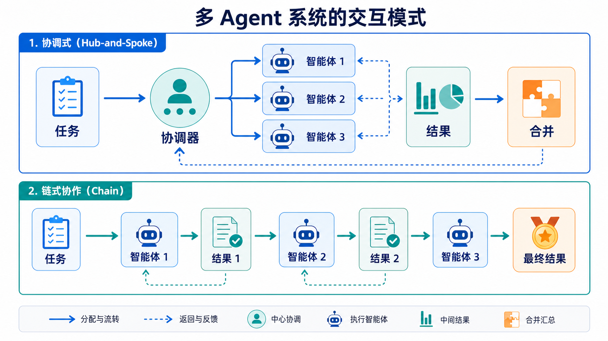

## 知识点讲解



### 1. 核心概念

单个 Agent 有两个硬伤：**能力上限**（一个 LLM 的知识和工具是有限的）和**并发上限**（单线程执行复杂任务很慢）。多 Agent 协作的意义就在这——用专业分工 + 并行执行来突破单 Agent 的瓶颈。

多 Agent 协作的核心挑战不是"怎么让 Agent 并行跑"，而是：

- 任务怎么拆分并分配给合适的 Agent
- Agent 之间的信息怎么流转
- 出现冲突或失败怎么协调

### 2. 技术细节

#### 2.1 两种主流架构

**① 集中式（Orchestrator-Worker）**

一个 Orchestrator Agent 负责任务分解和分配，Worker Agent 专注执行。Orchestrator 收集各 Worker 的结果，汇总输出。

```latex
用户目标
    ↓
Orchestrator（规划 + 分配 + 汇总）
    ├── Worker A（研究员）→ 搜索 + 整理信息
    ├── Worker B（分析师）→ 数据分析
    └── Worker C（写作者）→ 生成报告
```

优点：控制权集中，容易保证一致性，容易 debug。  
缺点：Orchestrator 成为瓶颈，它失败整个系统就停了。

**② 去中心化（P2P / 黑板模式）**

Agent 之间直接通信，或者通过共享的"黑板"（shared state）协调。没有单点控制，各 Agent 自主决定接什么任务。

优点：可扩展性好，无单点故障。  
缺点：一致性难保证，任务重复/遗漏的风险更高。

**实践中集中式用得多，去中心化更多在研究里。**

#### 2.2 通信方式

| 方式 | 场景 | 特点 |
| --- | --- | --- |
| 直接消息传递 | Agent 之间直接调用 | 低延迟，耦合较高 |
| 消息队列 | 异步协作 | 解耦，支持重试 |
| 共享状态（黑板） | 多 Agent 协同 | 所有 Agent 都能读写 |
| 事件总线 | 松耦合广播 | 发布/订阅模式 |

#### 2.3 避免常见问题

**任务重复执行**：Orchestrator 维护任务状态表，分配出去的任务标记"进行中"，完成后标记"已完成"。  
**死锁**：A 等 B，B 等 A。设超时强制终止，或者 Orchestrator 检测循环依赖。  
**结果冲突**：多个 Agent 给出矛盾结论时，由 Orchestrator 用 LLM 做裁决，或者按权重投票。

## 代码示例

**集中式 Orchestrator-Worker 骨架**

```python
from dataclasses import dataclass, field
from enum import Enum
import asyncio

class TaskStatus(Enum):
    PENDING   = "pending"
    RUNNING   = "running"
    DONE      = "done"
    FAILED    = "failed"

@dataclass
class SubTask:
    id: str
    description: str
    assigned_to: str = ""
    status: TaskStatus = TaskStatus.PENDING
    result: str = ""

class WorkerAgent:
    def __init__(self, name: str, role: str, llm, tools: dict):
        self.name = name
        self.role = role
        self.llm = llm
        self.tools = tools

    async def execute(self, task: SubTask) -> str:
        """Worker 执行子任务"""
        system_prompt = f"你是一名{self.role}，负责完成以下子任务。"
        result = await self.llm.agenerate(
            system=system_prompt,
            user=task.description,
            tools=self.tools,
        )
        return result

class Orchestrator:
    def __init__(self, llm, workers: list[WorkerAgent]):
        self.llm = llm
        self.workers = {w.name: w for w in workers}
        self.task_registry: dict[str, SubTask] = {}

    def decompose(self, goal: str) -> list[SubTask]:
        """用 LLM 把总目标拆成子任务并分配给对应 Worker"""
        prompt = f"""
把以下目标拆分成子任务，每个子任务分配给最合适的 Worker。
可用 Worker：{[f"{w.name}（{w.role}）" for w in self.workers.values()]}
目标：{goal}
输出 JSON 列表，每项包含 id、description、assigned_to。
"""
        subtasks_data = self.llm.call(prompt, response_format="json")
        subtasks = [SubTask(**d) for d in subtasks_data]
        for st in subtasks:
            self.task_registry[st.id] = st
        return subtasks

    async def run(self, goal: str) -> str:
        subtasks = self.decompose(goal)

        # 可以并行的任务并发执行
        async def run_task(st: SubTask) -> tuple[str, str]:
            st.status = TaskStatus.RUNNING
            worker = self.workers.get(st.assigned_to)
            if not worker:
                st.status = TaskStatus.FAILED
                return st.id, f"Worker {st.assigned_to} 不存在"
            try:
                result = await worker.execute(st)
                st.status = TaskStatus.DONE
                st.result = result
                return st.id, result
            except Exception as e:
                st.status = TaskStatus.FAILED
                return st.id, f"执行失败：{e}"

        results = await asyncio.gather(*[run_task(st) for st in subtasks])
        results_dict = dict(results)

        # 汇总
        summary_prompt = f"根据各子任务结果，综合回答目标：{goal}\n结果：{results_dict}"
        return self.llm.call(summary_prompt)
```

**共享黑板模式（去中心化）**

```python
import threading

class Blackboard:
    """所有 Agent 共享的状态板"""

    def __init__(self):
        self._data: dict = {}
        self._lock = threading.Lock()
        self._task_queue: list[dict] = []

    def post_task(self, task: dict):
        with self._lock:
            task["status"] = "pending"
            self._task_queue.append(task)

    def claim_task(self, agent_name: str) -> dict | None:
        """Agent 认领一个 pending 任务"""
        with self._lock:
            for task in self._task_queue:
                if task["status"] == "pending":
                    task["status"] = "claimed"
                    task["claimed_by"] = agent_name
                    return task
        return None

    def post_result(self, task_id: str, result):
        with self._lock:
            self._data[task_id] = result
            for task in self._task_queue:
                if task["id"] == task_id:
                    task["status"] = "done"

    def get_result(self, task_id: str):
        return self._data.get(task_id)
```

## 面试怎么答

多 Agent 协作的价值在于两点：专业分工（每个 Agent 专注自己擅长的，比一个全能 Agent 更精准）和并行执行（相互独立的子任务并发跑，速度更快）。核心难点不是"让 Agent 并行"，而是任务拆分、信息流转、冲突处理。

主流有两种架构：集中式 Orchestrator-Worker——一个 Orchestrator 负责规划和分配，Worker 专注执行，Orchestrator 收集结果汇总；去中心化黑板模式——Agent 通过共享状态自主认领任务，没有单点控制。生产里集中式用得多，更好控制和 debug；去中心化适合任务动态、Agent 异构的场景，更多见于研究。

几个工程细节：Orchestrator 要维护任务状态表防止重复执行；子任务之间有依赖的要串行、没有依赖的并行；多个 Agent 给出矛盾结论时需要一个仲裁机制；以及，每个 Agent 都要有自己的错误处理，不能因为一个 Worker 失败就整体崩掉。

## 高频追问 & 加分点

- **Q1：多 Agent 和单 Agent 多工具的区别？**  
    本质区别是"推理主体有几个"。单 Agent 多工具：一个 LLM 做所有决策，工具是它的执行手；多 Agent：多个 LLM 分别推理，有各自的目标和上下文，通过通信协调。单 Agent 上下文统一但容量有限；多 Agent 可以突破上下文限制，但通信协调有开销。
- **Q2：多 Agent 的通信格式怎么设计？**  
    统一用结构化消息（JSON）而不是自然语言。字段至少包含：sender、recipient、message_type（task/result/error/query）、content、correlation_id（关联请求和响应）。自然语言通信容易误解，结构化消息解析稳定。
- **Q3：如何处理 Agent 之间的信任问题？**  
    多 Agent 系统里，一个 Agent 是否应该直接执行另一个 Agent 的指令是个安全问题。实践中：Orchestrator 的指令 Worker 直接执行；平级 Agent 之间的指令要校验（检查指令是否在自己的职责范围内，超出范围拒绝并上报 Orchestrator）。
- **Q4：分布式多 Agent 如何保证一致性？**  
    共享状态用分布式锁（Redis SETNX 或 ZooKeeper）；任务分配用 Orchestrator 做中心协调；结果汇总时用幂等写入（同一个 task_id 的结果只写一次）。容忍最终一致性比强一致性更实际，先保证系统可用。
- **Q5：多 Agent 系统怎么调试？**  
    每个 Agent 的所有操作都要加 trace_id（把整个任务串起来）。推荐用 OpenTelemetry 做分布式追踪，可以看到整条调用链：Orchestrator 发了什么指令、Worker 怎么响应、结果怎么汇总。没有追踪，多 Agent 出了问题基本只能猜。
