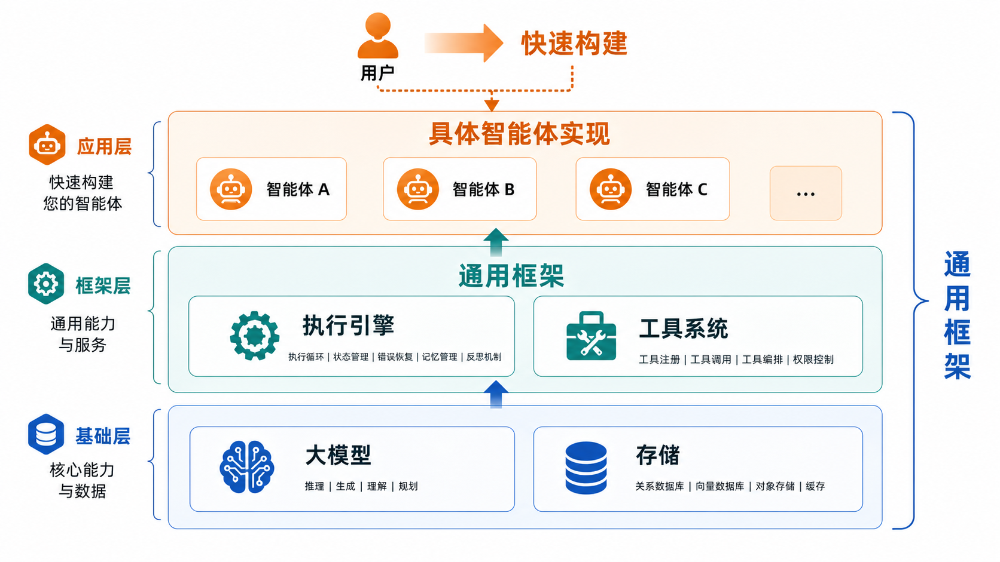

## 知识点讲解



### 1. 核心概念

通用 Agent 框架的目标是：让开发者只需要关心"这个 Agent 做什么"，不需要重复写执行循环、记忆管理、工具调度、错误处理这些通用逻辑。

框架和"Agent 应用"的关系，类似 Django 和 Web 应用——框架提供通用基础设施，应用只写业务逻辑。

一个够用的通用框架至少要覆盖六块：

| 模块 | 职责 |
| --- | --- |
| 执行引擎（Runtime） | 驱动 observe → think → act 循环，管理终止条件 |
| 工具系统（Tool System） | 工具注册、Schema 管理、调用执行 |
| 记忆系统（Memory） | 短期上下文管理 + 长期记忆存取 |
| LLM 接口（LLM Adapter） | 屏蔽不同 LLM 的 API 差异 |
| 状态管理（State） | 任务状态机、持久化、恢复 |
| 可观测性（Observability） | 日志、追踪、指标 |

### 2. 技术细节

#### 2.1 设计原则

**接口稳定、实现可换**：工具、记忆、LLM 都通过抽象接口定义，具体实现可以替换。换个向量库不应该改 Agent 逻辑。

**约定优于配置**：默认行为合理，只在需要定制时才配置。执行循环有合理的默认 max_steps，工具有默认的超时，记忆有默认的 window 大小。

**组合优于继承**：各模块独立，通过依赖注入组合，不要深的继承链。

#### 2.2 现有框架 vs 自建框架

| <br> | LangChain / LlamaIndex | LangGraph | 自建框架 |
| --- | --- | --- | --- |
| 上手速度 | 快 | 中（需理解状态图编程） | 慢 |
| 定制灵活性 | 受限（抽象层多） | 高（图节点和边可灵活定义） | 完全自控 |
| 状态/循环/分支 | 弱（链式为主） | **强（原生支持）** | 看你怎么写 |
| 依赖风险 | 重 | 中 | 无 |
| 适用场景 | 快速原型、标准 RAG | **复杂工作流、多 Agent 编排（当下生产首选）** | 极致定制、性能敏感 |

我的经验：**简单链路用 LangChain 起步，一旦出现循环/条件分支/checkpoint 需求立刻切 LangGraph，再不够才自建**。LangGraph 是 LangChain 团队针对"有状态 Agent"专门做的运行时，2024 年之后基本是当下生产 Agent 的主推路径，自建核心更多用在性能/合规/极端定制场景。

## 代码示例

**框架核心骨架**

```python
from abc import ABC, abstractmethod
from dataclasses import dataclass, field
from typing import Any

# ─── 工具系统 ───────────────────────────────────

class BaseTool(ABC):
    name: str
    description: str
    input_schema: dict  # JSON Schema

    @abstractmethod
    def run(self, **kwargs) -> Any:
        # ...
        pass

class ToolRegistry:
    def __init__(self):
        self._tools: dict[str, BaseTool] = {}

    def register(self, tool: BaseTool):
        self._tools[tool.name] = tool

    def get_schemas(self) -> list[dict]:
        return [
            {
                "name": t.name,
                "description": t.description,
                "input_schema": t.input_schema,
            }
            for t in self._tools.values()
        ]

    def execute(self, name: str, args: dict) -> Any:
        tool = self._tools.get(name)
        if tool is None:
            raise ValueError(f"工具 {name} 未注册")
        return tool.run(**args)


# ─── LLM 接口层 ─────────────────────────────────

class BaseLLM(ABC):
    @abstractmethod
    def call(self, messages: list[dict], tools: list[dict] = None) -> dict:
        """
        返回：{"content": str, "tool_calls": [...], "stop_reason": str}
        屏蔽不同 LLM API 的差异
        """
        # ...
        pass


# ─── 记忆接口层 ─────────────────────────────────

class BaseMemory(ABC):
    @abstractmethod
    def add(self, role: str, content: str):
        pass

    @abstractmethod
    def get_context(self, query: str = "") -> list[dict]:
        pass


# ─── 执行引擎 ────────────────────────────────────

@dataclass
class AgentConfig:
    max_steps: int = 15
    max_tokens: int = 30_000
    system_prompt: str = "你是一个有用的 AI Agent。"

class AgentRuntime:
    def __init__(
        self,
        llm: BaseLLM,
        tools: ToolRegistry,
        memory: BaseMemory,
        config: AgentConfig = None,
    ):
        self.llm = llm
        self.tools = tools
        self.memory = memory
        self.cfg = config or AgentConfig()

    def run(self, goal: str) -> str:
        self.memory.add("user", goal)
        steps = 0
        total_tokens = 0

        while steps < self.cfg.max_steps and total_tokens < self.cfg.max_tokens:
            # 组装上下文
            messages = [
                {"role": "system", "content": self.cfg.system_prompt},
                *self.memory.get_context(query=goal),
            ]

            # LLM 推理
            response = self.llm.call(messages, tools=self.tools.get_schemas())
            total_tokens += response.get("tokens_used", 0)

            if response["stop_reason"] == "end_turn":
                return response["content"]

            # 执行工具调用
            if response.get("tool_calls"):
                for call in response["tool_calls"]:
                    result = self._safe_execute(call["name"], call["input"])
                    self.memory.add(
                        "tool_result",
                        f"[{call['name']}] → {result}"
                    )
            else:
                # 没有 tool_call 也没有 end_turn → 异常
                break

            steps += 1

        return "任务超出步数或 token 限制，未能完成"

    def _safe_execute(self, tool_name: str, args: dict) -> str:
        try:
            result = self.tools.execute(tool_name, args)
            return str(result)
        except Exception as e:
            return f"ERROR: {e}"
```

**框架的使用方式（业务层只写这些）**

```python
# 1. 实现具体工具
class WebSearchTool(BaseTool):
    name = "web_search"
    description = "搜索网络获取实时信息"
    input_schema = {
        "type": "object",
        "properties": {"query": {"type": "string"}},
        "required": ["query"],
    }

    def run(self, query: str) -> str:
        # 实际调用搜索 API
        return f"搜索结果：{query}..."

# 2. 组装框架
registry = ToolRegistry()
registry.register(WebSearchTool())

runtime = AgentRuntime(
    llm=MyLLMAdapter(),         # 实现 BaseLLM
    tools=registry,
    memory=SlidingWindowMemory(max_messages=20),  # 实现 BaseMemory
    config=AgentConfig(max_steps=10, system_prompt="你是一个研究助理。"),
)

# 3. 运行
result = runtime.run("分析 2024 年大模型市场的主要趋势")
```

## 面试怎么答

通用 Agent 框架的核心设计思路是"分离关注点"——把所有 Agent 都需要的逻辑（执行循环、工具调度、记忆管理、错误处理）抽成框架，业务层只写"这个 Agent 有哪些工具、做什么任务"。

六个核心模块：执行引擎（驱动 observe-think-act 循环）、工具系统（注册 + Schema + 执行）、记忆系统（短期上下文 + 长期检索）、LLM 接口层（屏蔽不同厂商 API 差异）、状态管理（任务状态机和持久化）、可观测性（日志 + 追踪）。

关于"用现有框架还是自建"我的判断分三档：简单链路用 LangChain / LlamaIndex 快速起步；一旦出现循环、条件分支、checkpoint、人工介入这类复杂工作流，**直接切 LangGraph**——它是 LangChain 团队针对有状态 Agent 专门做的运行时，2024 年之后基本是当下生产 Agent 的主推路径；只有性能极致敏感、合规要求强、或者业务逻辑跟框架抽象冲突太大的时候，才考虑自建核心，把 LangChain/LlamaIndex 降到工具层（只用 embedding、向量库接口）。LangChain 早期版本接口确实不稳定，但 v0.3 之后好很多，主要的"被坑"经验现在更多是在它的某些社区集成上，不是核心 API。

## 高频追问 & 加分点

- **Q1：框架如何支持多种 LLM？**  
    LLM 接口层的核心价值就在这——定义统一的 `BaseLLM` 接口，`call(messages, tools)` 返回统一格式，具体实现类处理不同厂商的 API 差异（OpenAI 的 tool_calls vs Anthropic 的 tool_use）。换 LLM 只需要换一个 Adapter 实现类，不改 Agent 逻辑。
- **Q2：框架如何保证可扩展性？**  
    插件化是关键——工具、记忆、LLM 都通过注册机制接入，不需要改框架代码。新增一个工具只需要实现 `BaseTool`、注册进 registry 就行。框架版本升级时，插件不需要改。
- **Q3：框架层的可观测性怎么做？**  
    在执行引擎里加 hook——每次 LLM 调用前后、工具执行前后都触发事件，把 span 数据发给 tracing 系统（OpenTelemetry）。业务层不需要写任何监控代码。关键指标：每步延迟、工具调用成功率、token 消耗、任务完成率。
- **Q4：如何支持 Human-in-the-Loop？**  
    在执行引擎里加"暂停点"机制——工具执行前检查是否需要人工确认（用工具的 `requires_approval` 字段标记）。需要确认时暂停循环，序列化状态，等待外部事件（用户确认）后恢复。这个机制在框架层实现，业务层只需要标记哪些工具需要确认。
- **Q5：框架如何处理多租户（多用户隔离）？**  
    每个用户的执行实例独立——独立的 runtime、独立的 memory 命名空间、独立的工具调用 quota。状态持久化时用 user_id + task_id 做复合 key。资源层面，记忆存储和工具调用用 tenant_id 做过滤，物理隔离或逻辑隔离视安全要求而定。
