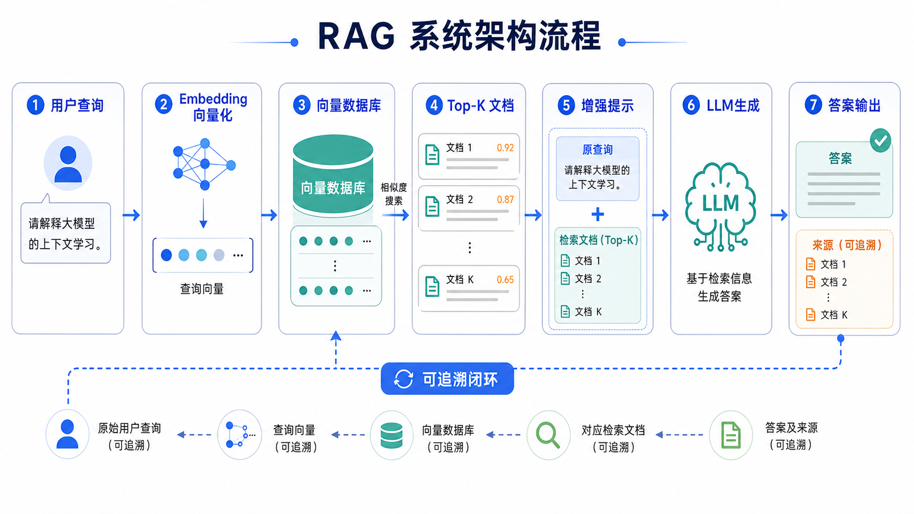

## 知识点讲解



### 1. 核心概念

RAG 做的事情，说白了就是给 LLM 配了一个"现查现用"的外部记忆。

LLM 本质上是个"训练截止日期前的百科全书"——它学的知识在训练结束那天就冻住了，问它最新的事、问它私有内部文档，它要么不知道要么瞎编。RAG 就是用来解这两个问题的：在 LLM 生成答案之前，先从外部知识库把相关内容检索出来，拼进 prompt，让模型"基于证据"回答。

核心流程四步：

```latex
用户查询 → 检索相关文档 → 文档塞进 prompt → LLM 生成答案
```

这种"检索优先"的设计带来三个实际好处：

- **实时性**：知识库随时更新，不用重训模型
- **可追溯**：每个答案都能对应到具体文档来源
- **可控性**：想控制模型说什么，控制检索内容就够了

### 2. 技术细节

#### 2.1 RAG 系统的两个阶段

一个完整的 RAG 系统分离线和在线两段：

**离线阶段（一次性构建）**：

| 步骤 | 做什么 |
| --- | --- |
| 文档收集 | PDF、网页、数据库等各种来源 |
| 分块（Chunking） | 把长文档切成合适大小的片段 |
| 向量化（Embedding） | 每个分块转成稠密向量 |
| 存入向量库 | 建索引，支持快速近邻搜索 |

**在线阶段（每次查询）**：

| 步骤 | 做什么 |
| --- | --- |
| 查询向量化 | 用相同的 Embedding 模型处理用户问题 |
| 相似度检索 | 向量库里找 Top-K 最相似的分块 |
| 可选 Rerank | 用 Cross-Encoder 重新打分，提精确率 |
| 拼 prompt | 检索结果 + 用户问题 → 送给 LLM |
| LLM 生成 | 基于上下文产出答案 |

#### 2.2 检索机制：密集 vs 稀疏

RAG 的检索器有两大流派：

| 检索方式 | 原理 | 适合场景 |
| --- | --- | --- |
| 密集检索（Dense） | Embedding 相似度，捕捉语义 | 语义理解、同义表达 |
| 稀疏检索（Sparse，BM25） | 关键词匹配 | 精确词汇、专有名词 |
| 混合检索 | 两者结合，RRF 融合排名 | 大多数生产场景 |

实战里混合检索效果普遍优于单一方式，这块在召回率优化那题会展开讲。

### 3. 对比与拓展

**RAG vs 长上下文模型**

有人会问：现在 Claude 200K、Gemini 1M，直接把所有文档塞进去不就完了？理论上可行，但成本随 token 线性涨，推理也慢，无关内容还会干扰注意力。RAG 的价值在于精准定位相关内容、减少噪声，而不只是扩大窗口。两者其实可以组合：先 RAG 检索，再把检索结果放进长上下文模型做复杂推理。

**普通 RAG vs Agentic RAG**

普通 RAG 的检索是被动的——用户问什么就检索什么，一次性。Agentic RAG 让 Agent 自己决定：要不要检索、检索什么、检索几次、结果够不够用。对复杂多跳问题，这种主动规划效果明显更好。

## 代码示例

下面是 RAG 两个阶段的核心控制流骨架，重点看数据流向。

**离线阶段：构建知识库**

```python
def build_knowledge_base(documents, embedding_model, vector_store):
    all_chunks = []
    for doc in documents:
        # 分块：按段落 > 句子 > 字符优先级递归切割
        chunks = recursive_split(
            doc.content,
            chunk_size=800,
            chunk_overlap=100,
            separators=["\n\n", "\n", "。", ""]
        )
        for chunk in chunks:
            chunk.metadata.update({
                "source": doc.source,
                "doc_id": doc.id,
                "created_at": doc.created_at,
            })
        all_chunks.extend(chunks)

    # 批量 Embedding，减少 API 调用次数
    embeddings = embedding_model.encode_batch(
        [c.content for c in all_chunks],
        batch_size=64
    )

    # 存入向量库并建 HNSW 索引
    vector_store.upsert(
        ids=[c.id for c in all_chunks],
        vectors=embeddings,
        payloads=[c.metadata for c in all_chunks],
    )
```

**在线阶段：检索 + 生成**

```python
def rag_query(query, embedding_model, vector_store, reranker, llm,
              top_k=50, final_k=5):
    # 1. 查询向量化
    query_vec = embedding_model.encode(query)

    # 2. 粗检索：宽召回，k 开大一些
    candidates = vector_store.search(query_vec, k=top_k)

    # 3. Rerank：从 50 个里精选 5 个
    reranked = reranker.rank(query, candidates)[:final_k]

    # 4. 拼 prompt，带来源标注
    context = "\n\n".join([
        f"[来源: {doc.metadata['source']}]\n{doc.content}"
        for doc in reranked
    ])
    prompt = build_rag_prompt(query, context)

    # 5. 生成，同时返回来源供溯源
    answer = llm.generate(prompt)
    return answer, [doc.metadata["source"] for doc in reranked]
```

**混合检索：向量 + BM25 + RRF 融合**

```python
def hybrid_search(query, vector_store, bm25_index, embedding_model, k=20):
    query_vec = embedding_model.encode(query)

    # 两路并行检索
    dense_hits = vector_store.search(query_vec, k=k)
    sparse_hits = bm25_index.search(query, k=k)

    # Reciprocal Rank Fusion 融合
    scores = {}
    for rank, hit in enumerate(dense_hits):
        scores[hit.id] = scores.get(hit.id, 0) + 1 / (60 + rank)
    for rank, hit in enumerate(sparse_hits):
        scores[hit.id] = scores.get(hit.id, 0) + 1 / (60 + rank)

    merged = sorted(scores.items(), key=lambda x: x[1], reverse=True)
    return [get_doc(doc_id) for doc_id, _ in merged[:k]]
```

## 面试怎么答

RAG 就是"检索增强生成"——在 LLM 生成答案之前，先从外部知识库把相关内容检索出来，塞进 prompt，让模型基于证据回答。它解决的核心问题有两个：LLM 训练知识过时，以及无法访问私有内部数据。

系统分两个阶段：离线阶段把文档切块、向量化、存进向量库；在线阶段把用户问题也向量化，检索出 Top-K 相关分块，可选加一个 Rerank 步骤提精确率，最后拼进 prompt 给 LLM 生成。

检索器这块，纯向量（密集检索）适合语义理解，BM25（稀疏）适合精确关键词，生产里一般混合用，两路都跑然后 RRF 融合，效果比单一方式普遍要好。

和长上下文模型比，RAG 的价值不只是扩大窗口，而是精准过滤噪声，成本也低得多。两者不对立，可以组合：RAG 先检索，长上下文模型再做深度推理。

## 高频追问 & 加分点

- **Q1：RAG 能完全替代微调吗？**  
    两个东西解决不同问题。微调是让模型学习某种风格、格式或领域通用能力，写进参数里；RAG 是注入最新的、私有的具体事实。最优解通常是"微调给格式和语言风格，RAG 给具体知识"——加分信号：能说出"预训练 + 微调 + RAG 三层结构"。
- **Q2：RAG 检索错了怎么办？**  
    检索错了是 RAG 最严重的风险。检索结果不对，LLM 会基于错误信息生成，比没检索还糟。防线有几道：Rerank 过滤、相似度阈值兜底、prompt 明确要求"文档里没有就说不知道"、加答案验证模块。加分点：主动提出"retrieval failure 检测"而不只是说优化检索本身。
- **Q3：Embedding 模型用通用的还是领域定制的？**  
    优先通用模型（text-embedding-3-small、BGE 系列），快速上线；领域 gap 大的情况——医学、法律、代码——可以考虑在领域数据上微调 Embedding，提升专业术语和同义词的召回。知道用 MTEB 榜单来选基础模型是加分项。
- **Q4：RAG 的延迟主要在哪里，怎么优化？**  
    主要三块：Embedding 推理（可并行 batch）、向量检索（HNSW 一般 &lt;10ms，基本不是瓶颈）、Rerank 推理（Cross-Encoder 较慢，可以异步或降候选数量 k）。总延迟里 LLM 生成往往才是大头。加分：提 streaming 输出让用户感知延迟更低。
- **Q5：知识库更新怎么处理？**  
    增量更新（新文档进来直接 upsert）比较容易，向量库支持在线增删；但换了 Embedding 模型就得全库重建，这是个隐藏大成本。生产里要锁定 Embedding 模型版本，不然更新模型等于全量重建，直接影响线上服务。
