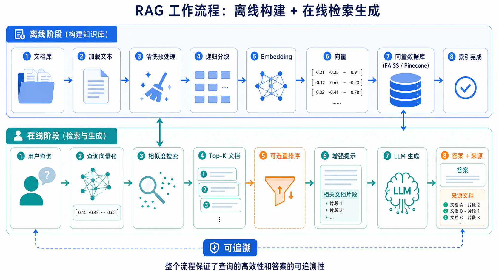

## 知识点讲解



### 1. 核心概念

RAG 的工作流程分两段：**离线构建**和**在线查询**，两段解耦是它能快速响应的核心原因。

离线构建是一次性的重活——把知识库整理成可检索的形式，该切块切块、该向量化向量化、建好索引存起来。这段耗时可以接受，因为它不在用户等待的路径上。

在线查询是每次用户发问时跑的：把问题向量化、去库里搜、取回来、可选重排、拼 prompt、喂给 LLM。整个链路要控制在秒级内，每一步的延迟都要计。

### 2. 技术细节

#### 2.1 离线构建的七步

```latex
原始文档 → 清洗 → 分块 → 元数据附加 → Embedding → 存向量库 → 建索引
```

每一步的关键决策：

| 步骤 | 关键决策 | 踩坑风险 |
| --- | --- | --- |
| 清洗 | 去重、去噪、编码统一 | 源文档质量差会污染整个库 |
| 分块 | chunk_size 和 overlap | 太小丢语义，太大带噪声 |
| Embedding | 模型选择、维度 | 换模型 = 全库重建 |
| 向量库 | HNSW/IVF 索引类型 | 数据量决定索引策略 |

#### 2.2 在线查询的八步

```latex
用户查询 → 预处理 → 查询 Embedding → 向量检索（粗） → Rerank（精）
        → 上下文拼接 → prompt 构建 → LLM 生成 → 后处理
```

关键参数配置：

| 参数 | 典型值 | 影响 |
| --- | --- | --- |
| chunk_size | 512–1024 token | 检索粒度 |
| chunk_overlap | 50–150 token | 跨边界语义连贯性 |
| 粗检索 Top-K | 20–50 | 召回宽度 |
| Rerank 后 K | 3–5 | 最终送入 LLM 的量 |
| 相似度阈值 | 0.5–0.7 | 过滤无关文档 |

#### 2.3 Rerank 为什么要单独一步

向量检索基于 Embedding 相似度，本质上是个近似操作。表面语义相似但语境不对的文档会被拉进来，直接影响最终答案质量。

Rerank 用的是 Cross-Encoder——把 `(query, document)` 对拼在一起送进模型，逐对打相关性分。精度远高于 Bi-encoder（向量检索），但计算量也大得多（O(k×d)），所以只在缩小的候选集上跑，不是全量跑。

### 3. 对比与拓展

**静态 Top-K vs 动态 Top-K**

固定 K 值简单，但不适应不同复杂度的查询。动态策略：简单问题（K=3），复杂多跳问题（K=10）。更激进的做法是 Agentic RAG——让 Agent 自己判断检索结果够不够用，够了就生成，不够就再检索一轮。

## 代码示例

三段骨架，分别对应离线构建、在线检索、以及 Rerank 集成。

**离线阶段：分块 + Embedding + 存库**

```python
def offline_index_pipeline(raw_docs, splitter, embedder, vector_db):
    chunks = []
    for doc in raw_docs:
        # 递归分块，优先按段落边界切
        doc_chunks = splitter.split(
            doc.text,
            chunk_size=800,
            overlap=100,
            separators=["\n\n", "\n", "。", ""]
        )
        for c in doc_chunks:
            c.metadata = {
                "source": doc.source,
                "doc_id": doc.id,
                "chunk_index": doc_chunks.index(c),
            }
        chunks.extend(doc_chunks)

    # 批量 Embedding，减少 API round-trip
    texts = [c.text for c in chunks]
    embeddings = embedder.encode_batch(texts, batch_size=64)

    # upsert 到向量库，支持增量更新
    vector_db.upsert(
        ids=[c.id for c in chunks],
        vectors=embeddings,
        payloads=[c.metadata for c in chunks],
    )
    return len(chunks)
```

**在线阶段：查询 → 粗检索 → Rerank → 生成**

```python
def online_rag_pipeline(query, embedder, vector_db, reranker, llm,
                        coarse_k=50, final_k=5):
    # 1. 查询向量化（和离线 Embedding 模型必须一致）
    q_vec = embedder.encode(query)

    # 2. 粗检索：开大 k，保证召回
    candidates = vector_db.search(q_vec, k=coarse_k)

    # 3. Rerank：Cross-Encoder 打分，挑最相关的
    reranked = reranker.rank(query, candidates, top_n=final_k)

    # 4. 构建带来源标注的 context
    context_parts = []
    for i, doc in enumerate(reranked):
        context_parts.append(f"[{i+1}] 来源：{doc.metadata['source']}\n{doc.text}")
    context = "\n\n".join(context_parts)

    # 5. 生成
    prompt = (
        f"请仅基于以下文档内容回答问题，回答时引用文档编号。\n\n"
        f"{context}\n\n问题：{query}"
    )
    answer = llm.generate(prompt)
    sources = [d.metadata["source"] for d in reranked]
    return answer, sources
```

**增量更新：新文档入库**

```python
def incremental_update(new_doc, splitter, embedder, vector_db):
    # 删除同 doc_id 的旧 chunks（如有）
    vector_db.delete(filter={"doc_id": new_doc.id})

    # 重新分块 + Embedding + 入库
    chunks = splitter.split(new_doc.text, chunk_size=800, overlap=100)
    for c in chunks:
        c.metadata = {"source": new_doc.source, "doc_id": new_doc.id}

    embeddings = embedder.encode_batch([c.text for c in chunks])
    vector_db.upsert(
        ids=[c.id for c in chunks],
        vectors=embeddings,
        payloads=[c.metadata for c in chunks],
    )
```

## 面试怎么答

RAG 工作流分离线和在线两段。离线阶段把文档切块、向量化、建好索引存进向量库，这是一次性的重活，不在用户等待路径上。在线阶段每次查询都跑：用户问题向量化 → 向量库粗检索（一般 k=2050）→ 可选 Rerank 精排 → 取 Top-35 → 拼 prompt → LLM 生成。

为什么要 Rerank 单独一步？向量检索本质是近似操作，表面语义相似但实际不相关的文档会混进来。Rerank 用 Cross-Encoder 逐对打分，精度高得多，但只在缩小的候选集上跑，不会太贵。

关键参数：chunk_size 我习惯 512800，overlap 1015%；粗检索 k 开 2050，Rerank 后留 35 送给 LLM。这些数值没有绝对对错，要结合文档类型和下游任务做实验。

两个常被忽视的工程细节：离线和在线必须用同一个 Embedding 模型版本，换模型就得全库重建；增量更新时要先按 doc_id 删掉旧 chunks 再入库，不然同一文档会有重复分块影响检索。

## 高频追问 & 加分点

- **Q1：离线索引多久需要更新一次？**  
    看数据变化频率。新闻、实时数据——每小时甚至实时增量；公司政策、产品文档——每天到每周跑一次增量更新就够。加分点：区分增量更新（upsert 新 chunks）和全量重建（换 Embedding 模型时不得不做），说清楚触发条件。
- **Q2：向量检索之后为什么不直接用相似度分数排序送 LLM？**  
    因为 Bi-encoder（向量检索）的分数只反映语义接近度，不反映真实的问答相关性。同一个向量空间里，和查询语义相近的文档未必能回答这个问题。Cross-Encoder 接受完整的 (query, doc) 对，能建模它们之间更细粒度的语义关系。加分：知道 Bi-encoder 和 Cross-Encoder 的精度-速度 tradeoff。
- **Q3：如何处理超出 LLM 上下文窗口的检索结果？**  
    三种方案：严格限制 final_k（最简单）、Map-Reduce 分批摘要（把每个文档先摘要，再汇总）、分层检索（第一轮粗选，第二轮精选）。通常先试限制 k，不够再上 Map-Reduce。
- **Q4：RAG 后处理阶段能做什么？**  
    常见几件事：提取并验证来源引用（答案里说的文档编号是否真的支持这句话）、置信度打分（让 LLM 自评"文档支持度"，低置信度答案加警告）、格式化输出（Markdown 表格、列表等）。**加分：提出"答案忠实度检测"，用另一个 LLM 校验答案有没有超出文档范围**。
- **Q5：Rerank 步骤一定要吗？**  
    小规模、延迟要求极高的场景可以省掉，但一般强烈建议加。BGE Reranker 本地部署，50 个候选重排大概 50ms，而精确率提升往往有 20~40%。这个 ROI 在绝大多数场景都划算。
