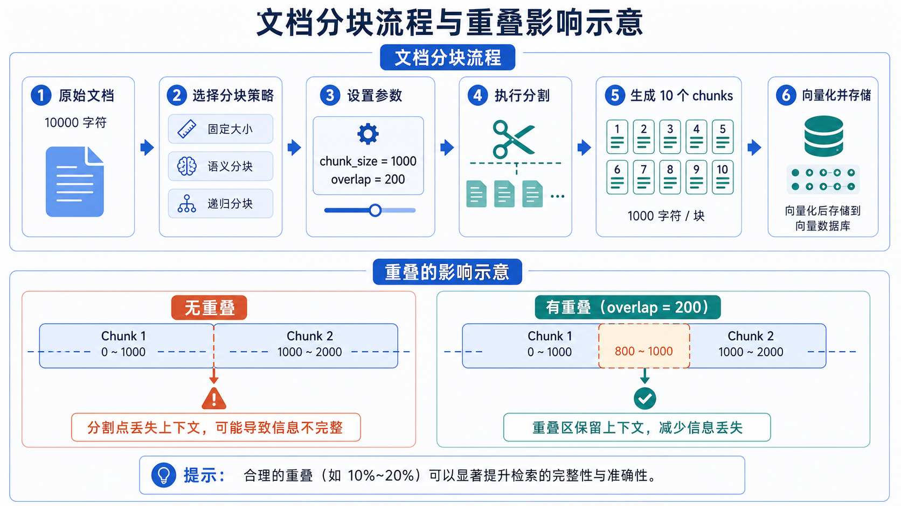

## 知识点讲解



### 1. 核心概念

文档分块（Chunking）是把长文档切成小片段，让向量检索能精准找到相关部分而不是整篇文档。

为什么不直接对整篇文档做 embedding？两个原因：第一，embedding 模型有 token 上限（大多数是 512 token），放进去的内容超出就会截断；第二，即使放进去了，整篇文档的向量表示是"所有主题的平均"，检索一个具体问题时会非常不精准——相当于用一个大杂烩回答一个具体问题。

分块把这个问题拆开：每个 chunk 只覆盖一个语义焦点，检索时精准命中，注入 LLM 的上下文就干净了。

分块质量直接决定 RAG 的检索质量，也是最容易被低估的环节。

### 2. 技术细节

#### 2.1 四种主流分块方法

**① 固定大小分块（Fixed-size Chunking）**

按固定 token 数切割，可加重叠（overlap）防止边界信息丢失。简单粗暴，适合格式均匀的文本（日志、新闻正文）。

缺点：完全不考虑语义边界，可能一句话被切成两半。

**② 递归分块（Recursive Splitting）**

按优先级依次尝试分割符：段落 → 句子 → 词 → 字符。每次分割超出 chunk_size 才用下一级分割符，尽可能保留语义完整性。LangChain 的 `RecursiveCharacterTextSplitter` 就是这个思路，实践中最常用。

**③ 语义分块（Semantic Chunking）**

对相邻句子计算 embedding 相似度，在相似度骤降的位置分割。优点是边界最准确，缺点是要为每个句子生成 embedding，成本高。适合知识库质量要求很高的场景。

**④ 结构化分块（Structure-aware Chunking）**

利用文档本身的结构（Markdown 的 `##` 标题、HTML 的 `<section>`、PDF 的目录）来分割，保留文档层次。适合结构良好的技术文档。

#### 2.2 Chunk Size 的选择

| 场景 | 推荐 chunk_size | 理由 |
| --- | --- | --- |
| 通用知识库 | 512-1024 token | 平衡精度和上下文 |
| 代码文件 | 512-768 token | 保持函数完整 |
| 法律/合同 | 1024-2048 token | 条款不能断 |
| 对话记录 | 256-512 token | 每轮对话是自然单元 |

**Overlap 设 chunk_size 的 10-20%** 通常够用——太小了边界信息丢，太大了冗余检索增加。

#### 2.3 父子分块（Parent-Child Chunking）

一个进阶模式：小块用于精确检索，大块用于生成上下文。检索时用小块（精准），生成时把小块对应的父块注入 LLM（完整上下文）。

```latex
父块（1024 token）
  ├── 子块 A（256 token） ← 检索用
  ├── 子块 B（256 token） ← 检索用
  └── 子块 C（256 token） ← 检索用
```

检索命中子块 B → 返回父块给 LLM。精准找到、完整使用。

## 代码示例

**递归分块（最常用）**

```python
from langchain.text_splitter import RecursiveCharacterTextSplitter

# 中文文档优先按段落、句子分割
splitter = RecursiveCharacterTextSplitter(
    chunk_size=800,
    chunk_overlap=100,
    separators=["\n\n", "\n", "。", "；", "，", " ", ""],
    length_function=len,   # 按字符数；token 敏感场景换 tiktoken
)

with open("document.txt", "r") as f:
    text = f.read()

chunks = splitter.split_text(text)
print(f"总共切出 {len(chunks)} 个 chunk，首个长度 {len(chunks[0])} 字符")
```

**语义分块（质量最高）**

```python
import numpy as np
from sentence_transformers import SentenceTransformer

model = SentenceTransformer("BAAI/bge-small-zh-v1.5")

def semantic_chunk(text: str, threshold: float = 0.5, max_chunk_tokens: int = 800) -> list[str]:
    """在语义跳变处分割文本"""
    sentences = [s.strip() for s in text.split("。") if s.strip()]
    if len(sentences) <= 1:
        return [text]

    embeddings = model.encode(sentences, normalize_embeddings=True)

    # 相邻句子的余弦相似度（归一化后等于内积）
    similarities = [
        float(embeddings[i] @ embeddings[i + 1])
        for i in range(len(embeddings) - 1)
    ]

    chunks, current = [], sentences[0]
    for i, sim in enumerate(similarities):
        next_sent = sentences[i + 1]
        if sim < threshold or len(current) + len(next_sent) > max_chunk_tokens:
            # 语义跳变或块太大 → 分割
            chunks.append(current + "。")
            current = next_sent
        else:
            current += "。" + next_sent
    chunks.append(current + "。")
    return chunks
```

**父子分块（检索精准 + 上下文完整）**

```python
from dataclasses import dataclass

@dataclass
class ParentChildChunk:
    parent_id: str
    child_id: str
    parent_text: str
    child_text: str
    child_start: int   # 子块在父块中的起始位置

def build_parent_child_chunks(
    text: str,
    parent_size: int = 1024,
    child_size: int = 256,
    overlap: int = 32,
) -> list[ParentChildChunk]:
    """把文档切成父块，再把每个父块切成子块"""
    # 先切父块（大块）
    parent_splitter = RecursiveCharacterTextSplitter(
        chunk_size=parent_size, chunk_overlap=0,
    )
    parents = parent_splitter.split_text(text)

    results = []
    for p_idx, parent in enumerate(parents):
        # 再切子块（小块，用于检索）
        child_splitter = RecursiveCharacterTextSplitter(
            chunk_size=child_size, chunk_overlap=overlap,
        )
        children = child_splitter.split_text(parent)
        for c_idx, child in enumerate(children):
            results.append(ParentChildChunk(
                parent_id=f"parent_{p_idx}",
                child_id=f"parent_{p_idx}_child_{c_idx}",
                parent_text=parent,
                child_text=child,
                child_start=parent.find(child),
            ))
    return results

# 存储：只为子块建向量索引，父块内容存元数据
# 检索：命中子块 → 取 parent_text 注入 LLM
```

## 面试怎么答

文档分块解决一个问题：embedding 模型和 LLM 的上下文窗口都有上限，整篇文档放进去放不下；放进去了向量表示也是"所有主题的平均"，检索精度很差。分块之后每个 chunk 覆盖一个语义焦点，检索更精准，注入 LLM 的上下文更干净。

四种方法：固定大小（简单，容易切断语义）；递归分块（按段落→句子→词依次分割，保留语义边界，实践中最常用）；语义分块（计算相邻句子相似度，在跳变处分割，质量最高但成本也最高）；结构化分块（利用文档自带的标题/章节结构）。

进阶一点的玩法是父子分块：小块用于精确检索，命中后返回对应的大块给 LLM 用——精准找到、完整使用，兼顾检索精度和生成质量。chunk_size 没有通用最优值，768-1024 是个不错的起点，具体要看文档类型、embedding 模型和下游评估结果。

## 高频追问 & 加分点

- **Q1：chunk_size 和 chunk_overlap 怎么调？**  
    没有通用答案，取决于三个因素：文档类型（代码/法律/通用）、embedding 模型的 token 上限、下游检索评估结果。调参方法：先用 768-1024 作为起点，在测试集上跑 Recall@K，调大或调小看指标变化。overlap 一般设 chunk_size 的 10-20%。
- **Q2：overlap 太大会有什么问题？**  
    检索时同一段内容被多个 chunk 命中，top-K 结果会有大量重复，实际召回的独立信息变少。解决方法：检索后做去重（MMR 算法或按 parent_id 过滤），或者直接减小 overlap。
- **Q3：代码文件怎么分块？**  
    代码有特殊结构，按函数/类分块最合理。可以用 AST 解析（Python 的 `ast` 模块）提取函数定义，每个函数作为一个 chunk。保持函数完整比强制按行数切更重要——切断函数会让检索和 LLM 理解都变差。
- **Q4：分块之后如何追踪来源？**  
    每个 chunk 存元数据：来源文档路径、页码、原文偏移量、分块时间。向量检索返回 chunk 时带上这些元数据，生成阶段可以在回答里附上"来源：XXX 文档第 XX 页"。这是生产里做引用溯源的基础。
- **Q5：分块策略需要定期更新吗？**  
    知识库文档更新时，受影响的文档需要重新分块 + 重建向量。增量更新比全量重建效率高：只处理变化的文档，用文档 hash 判断是否需要重建。分块策略本身（参数、方法）可以保持稳定，只有下游评估指标明显下降时才考虑调整。
