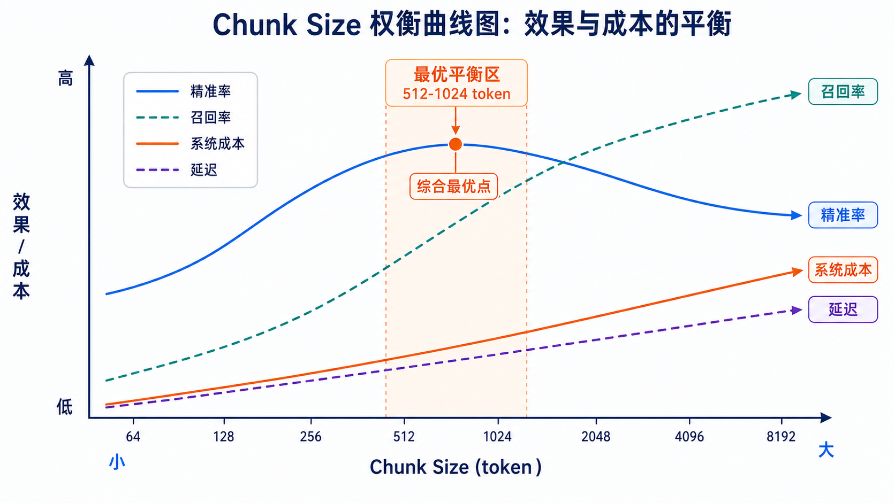

## 知识点讲解



### 1. 核心概念

Chunk Size 选择的本质是在两个方向上找平衡：

**块太小** → 语义碎片化，单块信息不完整，检索时需要更多块才能覆盖一个完整概念，top-K 里塞进来的信息密度低

**块太大** → 向量表示是"多个主题的平均"，检索精度下降；注入 LLM 的 token 更多，成本升、质量不一定升

没有一个"正确答案"，但有几个因素可以帮你缩小范围。

### 2. 技术细节

#### 2.1 影响 Chunk Size 的五个因素

**① 文档类型**

不同文档的信息密度和结构差异很大：

| 文档类型 | 推荐 chunk_size | 理由 |
| --- | --- | --- |
| 代码文件 | 512-768 token | 函数/方法是自然单元，不能断 |
| 技术文档 / 知识库 | 768-1024 token | 一个概念通常在一段内 |
| 新闻 / 博客 | 512-768 token | 段落短，保持完整即可 |
| 法律 / 合同 | 1024-2048 token | 条款相互关联，需要上下文 |
| 对话记录 | 256-512 token | 每轮是自然边界 |

**② LLM 上下文窗口 + Top-K**

最简单的算法：

```
max_chunk_size = (context_window - system_prompt - answer_reserve) / top_k
```

比如 context_window = 8192，system_prompt = 800，answer_reserve = 500，top_k = 5：

```
max_chunk_size = (8192 - 800 - 500) / 5 ≈ 1378 token
```

所以 chunk_size 设 1024-1200 是合理的，不会超限。

**③ 查询类型**

- 事实性问题（"XXX 是什么"）→ 小块，精准定位即可
- 综合性问题（"分析 XXX 的利弊"）→ 大块，需要更多上下文

**④ Embedding 模型的上限**

大多数 embedding 模型有 512 token 上限（如 all-MiniLM），超出的内容被截断——chunk_size 超过模型上限等于白设。用 OpenAI text-embedding-3 系列上限是 8191 token，这个就不是瓶颈了。

**⑤ 评估指标反馈**

这是最终裁判。上面的因素帮你定范围，实际最优值要靠在评估集上跑指标来确定。

#### 2.2 Overlap 的设置

Overlap 解决边界信息丢失问题。一句话被切断，两个 chunk 各有一半——overlap 让两边都包含完整的这句话。

经验值：**overlap = chunk_size 的 10-20%**。设太大（>30%）则检索时大量重复，top-K 里独立信息密度下降。

#### 2.3 动态 Chunk Size

不同文档类型混在同一个知识库时，统一设置一个 chunk_size 往往不够好。更好的做法是按文档类型分别设置，或者先做语义分块（自然边界），再做 token 上限裁剪。

## 代码示例

**按文档类型动态设置 chunk_size**

```python
import tiktoken
from langchain.text_splitter import RecursiveCharacterTextSplitter
from enum import Enum

class DocType(Enum):
    CODE     = "code"
    DOCUMENT = "document"
    LEGAL    = "legal"
    DIALOG   = "dialog"

CHUNK_CONFIG = {
    DocType.CODE:     {"chunk_size": 600,  "chunk_overlap": 60},
    DocType.DOCUMENT: {"chunk_size": 900,  "chunk_overlap": 100},
    DocType.LEGAL:    {"chunk_size": 1500, "chunk_overlap": 200},
    DocType.DIALOG:   {"chunk_size": 400,  "chunk_overlap": 40},
}

def get_splitter(doc_type: DocType) -> RecursiveCharacterTextSplitter:
    cfg = CHUNK_CONFIG[doc_type]
    encoding = tiktoken.encoding_for_model("gpt-4o")

    return RecursiveCharacterTextSplitter(
        chunk_size=cfg["chunk_size"],
        chunk_overlap=cfg["chunk_overlap"],
        length_function=lambda t: len(encoding.encode(t)),  # 按 token 计
        separators=["\n\n", "\n", "。", "；", " ", ""],
    )

# 使用
text = open("contract.txt").read()
chunks = get_splitter(DocType.LEGAL).split_text(text)
```

**根据 context window 计算最优 chunk_size**

```python
def calc_max_chunk_size(
    context_window: int = 8192,
    system_prompt_tokens: int = 800,
    answer_reserve: int = 500,
    top_k: int = 5,
    safety_margin: float = 0.85,   # 留 15% 余量
) -> int:
    available = context_window - system_prompt_tokens - answer_reserve
    max_size = int(available / top_k * safety_margin)
    # 取常见整百档，方便参数管理
    return min(max_size // 100 * 100, 2048)

# 示例：GPT-4o 128K 窗口，top-5 检索
max_size = calc_max_chunk_size(context_window=128000, top_k=5)
print(f"推荐 chunk_size ≤ {max_size} token")  # → 推荐 chunk_size ≤ 2048 token
```

**A/B 测试选最优 chunk_size**

```python
def evaluate_chunk_size(
    documents: list[str],
    qa_pairs: list[dict],  # [{"query": "...", "expected_doc_id": "..."}]
    chunk_sizes: list[int],
    embed_fn,
    search_fn,
    top_k: int = 5,
) -> dict[int, dict]:
    results = {}

    for size in chunk_sizes:
        splitter = RecursiveCharacterTextSplitter(
            chunk_size=size, chunk_overlap=size // 10
        )

        # 分块 + 向量化
        chunks = []
        for doc_id, text in enumerate(documents):
            for i, chunk_text in enumerate(splitter.split_text(text)):
                chunks.append({
                    "id": f"{doc_id}_{i}",
                    "doc_id": doc_id,
                    "text": chunk_text,
                    "embedding": embed_fn(chunk_text),
                })

        # 在评估集上跑检索
        hits = 0
        for qa in qa_pairs:
            query_emb = embed_fn(qa["query"])
            top_results = search_fn(query_emb, chunks, top_k=top_k)
            top_doc_ids = {r["doc_id"] for r in top_results}
            if qa["expected_doc_id"] in top_doc_ids:
                hits += 1

        recall = hits / len(qa_pairs)
        avg_chunk_tokens = sum(len(c["text"]) // 4 for c in chunks) / len(chunks)
        results[size] = {"recall_at_k": recall, "avg_tokens": avg_chunk_tokens, "n_chunks": len(chunks)}
        print(f"chunk_size={size}: Recall@{top_k}={recall:.3f}, avg_tokens={avg_chunk_tokens:.0f}")

    return results
```

## 面试怎么答

Chunk Size 没有通用最优值，但选择它有一个框架：先用文档类型确定范围（代码 512-768、普通文档 768-1024、法律文件 1024-2048）；再用 context_window 和 top_k 算出上限（available_tokens / top_k 就是单块上限）；最后在评估集上跑 A/B 测试确认。

两端的坑：太小了语义碎片化，单块不包含完整概念，检索时需要大量 top-K 才能覆盖，信息密度低；太大了向量是多个主题的平均，精准度下降，而且 chunk 数量少了，recall 也未必好。实践里 768-1024 token 是大多数场景的合理起点。

另外 overlap 不要忘了，设 chunk_size 的 10-20%，防止边界信息被切断。混合文档类型的知识库最好按类型分别设置，不要一刀切。

## 高频追问 & 加分点

- **Q1：怎么判断当前 chunk_size 是不是太小了？**  
    看 top-K 检索结果里的重复率。如果 5 个返回结果里有 3 个内容几乎一样（来自同一段落的相邻小块），说明粒度太细，信息密度低，应该调大。
- **Q2：chunk_size 和 Recall@K 的关系是什么？**  
    不是线性的。在某个最优点附近，召回率最高；太小了单块缺上下文、召回率下降；太大了单块语义模糊、精准度下降。这个最优点因数据集而异，只能实测。
- **Q3：embedding 模型 token 上限怎么处理？**  
    chunk_size 不能超过 embedding 模型的 token 上限（如 all-MiniLM 是 512），否则超出部分被截断，向量表示的是部分内容。如果用 OpenAI text-embedding-3 这类上限大的模型，这个限制就不那么严了。总之建议 chunk_size ≤ embedding 模型上限的 80%，留点余量。
- **Q4：上线后能动态调整 chunk_size 吗？**  
    调整 chunk_size 意味着需要重新分块 + 重建向量索引，成本较高。建议上线前多花时间在离线评估上找到合理参数。如果必须调，增量更新（只处理变化的文档）比全量重建经济。
- **Q5：多语言知识库 chunk_size 怎么设？**  
    中文和英文的 token 密度不同——中文每个字符约 0.5-1 token，英文每个单词约 1-2 token。如果按字符数设 chunk_size，中英文实际 token 数差异会很大。建议统一用 token 计数器（如 tiktoken）作为 length_function，保证不同语言的 chunk token 数一致。
