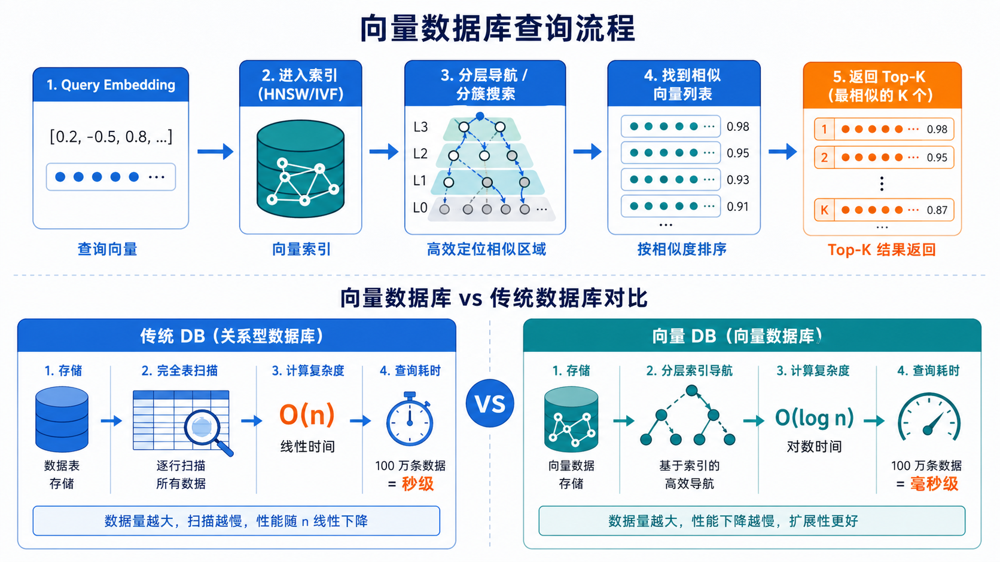

## 知识点讲解



### 1. 核心概念

向量数据库（Vector Database）是专门用来存储和检索高维向量的数据库。它要解决一个传统数据库做不好的问题：**在数百万乃至数十亿个高维向量里，快速找到和查询向量最相似的 K 个**。

传统关系型数据库能做精确匹配（WHERE id = 42），但算向量相似度要遍历全表——O(n) 复杂度，百万条数据就跑不动了。向量数据库通过专门的索引结构（HNSW、IVF 等），把检索降到接近 O(log n)，毫秒级返回结果。

RAG 系统里，向量数据库扮演"语义知识库"的角色：文档分块 embedding 后存进去，查询时用问题的 embedding 做相似度搜索，拿回最相关的几个 chunk 注入 LLM。

### 2. 技术细节

#### 2.1 核心索引算法

**HNSW（Hierarchical Navigable Small World）**：目前最主流。把向量组织成分层图，每层是"小世界网络"（每个节点和少数几个邻居相连，但任意两点间路径短），搜索时从高层快速定位、逐层精化。精度高、速度快，大多数向量数据库默认用这个。

**IVF（Inverted File Index）**：先把向量聚类，搜索时只在最近的几个簇里找。适合超大规模（十亿级）且对精度要求不苛刻的场景。

**PQ（Product Quantization）**：向量压缩方案，把原始向量量化成更短的编码，用内存换精度。通常和 IVF 组合（IVF+PQ），在内存受限时用。

#### 2.2 向量数据库 vs 内存向量库

| <br> | 向量数据库（Milvus / Qdrant / Pinecone） | 内存向量库（Faiss / Annoy） |
| --- | --- | --- |
| 持久化 | 有 | 无（进程退出数据丢） |
| 元数据过滤 | 原生支持 | 需要自己实现 |
| 分布式扩展 | 支持 | 通常单机 |
| 运维复杂度 | 较高（需要部署维护） | 低（直接 pip install） |
| 适合场景 | 生产环境，大规模 | 快速原型，小规模 |

#### 2.3 元数据过滤

向量相似度搜索配合元数据过滤，才能在实际场景里用起来。比如：查和"季度报告"最相关的文档，同时只看 2024 年的、属于"财务"部门的——这就需要向量搜索 + `year=2024 AND department=finance` 的元数据过滤同时生效。

不同向量库的实现策略不同：先过滤再搜（召回率低）、先搜再过滤（精度低）、混合执行（主流做法）。

## 代码示例

**Faiss（内存向量库，快速原型）**

```python
import faiss
import numpy as np

dim = 1536   # embedding 维度

# 构建 HNSW 索引
index = faiss.IndexHNSWFlat(dim, 32)   # 32 是图的连接数，越大精度越高但内存越多
index.hnsw.efConstruction = 200        # 构建时的搜索宽度
index.hnsw.efSearch = 64               # 查询时的搜索宽度

# 添加向量
vectors = np.random.random((100_000, dim)).astype("float32")
faiss.normalize_L2(vectors)            # L2 归一化后内积 == 余弦相似度
index.add(vectors)

# 查询
query = np.random.random((1, dim)).astype("float32")
faiss.normalize_L2(query)
distances, indices = index.search(query, k=5)
print("最相似的 5 个 id:", indices[0])
print("相似度分数:", distances[0])

# 持久化
faiss.write_index(index, "my_index.faiss")
index = faiss.read_index("my_index.faiss")
```

**Qdrant（生产级向量数据库，支持元数据过滤）**

```python
from qdrant_client import QdrantClient
from qdrant_client.models import (
    Distance, VectorParams, PointStruct, Filter, FieldCondition, MatchValue
)

client = QdrantClient(host="localhost", port=6333)

# 创建集合（collection）
client.create_collection(
    collection_name="docs",
    vectors_config=VectorParams(size=1536, distance=Distance.COSINE),
)

# 批量插入（带元数据）
points = [
    PointStruct(
        id=i,
        vector=embedding.tolist(),
        payload={
            "text": chunk_text,
            "source": "Q3_report.pdf",
            "page": 3,
            "department": "finance",
            "year": 2024,
        },
    )
    for i, (chunk_text, embedding) in enumerate(zip(chunks, embeddings))
]
client.upsert(collection_name="docs", points=points)

# 带元数据过滤的向量检索
results = client.search(
    collection_name="docs",
    query_vector=query_embedding.tolist(),
    query_filter=Filter(
        must=[
            FieldCondition(key="year", match=MatchValue(value=2024)),
            FieldCondition(key="department", match=MatchValue(value="finance")),
        ]
    ),
    limit=5,
    with_payload=True,
)

for r in results:
    print(f"score={r.score:.4f} | {r.payload['text'][:80]}")
```

**ChromaDB（轻量级，适合开发和小规模生产）**

```python
import chromadb
from chromadb.utils import embedding_functions

# 使用内置 embedding 函数
openai_ef = embedding_functions.OpenAIEmbeddingFunction(
    api_key="sk-...", model_name="text-embedding-3-small"
)

client = chromadb.PersistentClient(path="./chroma_db")
collection = client.get_or_create_collection(
    name="my_docs",
    embedding_function=openai_ef,  # 自动 embed
    metadata={"hnsw:space": "cosine"},
)

# 添加文档（自动生成 embedding）
collection.add(
    documents=["机器学习是...", "深度学习是...", "自然语言处理..."],
    ids=["doc0", "doc1", "doc2"],
    metadatas=[{"source": "ml.txt"}, {"source": "dl.txt"}, {"source": "nlp.txt"}],
)

# 查询
results = collection.query(
    query_texts=["什么是神经网络"],
    n_results=2,
    where={"source": "dl.txt"},  # 元数据过滤
)
print(results["documents"])
```

## 面试怎么答

向量数据库是专门用来存储和检索高维向量的数据库，核心能力是：在大规模向量集合里快速找到最相似的 K 个（ANN 搜索），而不是遍历全表。传统数据库做相似度搜索是 O(n) 复杂度，百万数据就很慢了；向量数据库靠 HNSW、IVF 这类索引降到接近 O(log n)，毫秒级返回。

技术上最关键的是索引算法：HNSW 是分层图结构，精度和速度的平衡最好，主流向量库默认用这个；IVF 是先聚类再搜索，适合超大规模数据；两者也可以组合，再加 PQ 量化压缩内存。

选型上：快速原型或小数据（&lt;100 万）用 Faiss/ChromaDB，轻量；生产环境需要持久化、元数据过滤、分布式的，用 Qdrant 或 Milvus（自托管）或 Pinecone（云托管）。Qdrant 目前我比较喜欢，Rust 写的，性能好、运维也不复杂。

## 高频追问 & 加分点

- **Q1：ANN 搜索的精度够吗？**  
    对大多数 RAG 场景够。ANN 的 recall 通常在 95-99%（相比精确搜索），极少数情况会漏掉一个相关文档，但这对生成质量影响不大。真正需要 100% 精确的场景（如合规审计）才考虑精确搜索（Flat Index），代价是速度慢很多。
- **Q2：向量数据库怎么处理更新和删除？**  
    HNSW 天然不支持删除（只能标记软删除），重建索引才能真正释放空间。Qdrant 和 Milvus 支持软删除 + 定期 compact。高频更新的场景，有些团队用双写（新索引边建边服务旧索引），切换时原子替换。
- **Q3：混合检索（Hybrid Search）怎么做？**  
    向量检索（语义相关）+ BM25 关键词检索（精确匹配）各跑一次，结果用 Reciprocal Rank Fusion（RRF）合并排序。两路各自的 top-K 按 1/(k + rank) 计分，合并取最高的 K 个。Qdrant 和 Weaviate 都原生支持这个。
- **Q4：多租户场景怎么隔离向量数据？**  
    三种方案：①不同租户用不同 collection（物理隔离，最安全但资源开销大）；②同一 collection，用 tenant_id 元数据过滤（逻辑隔离，需要每次查询都加过滤条件）；③namespace 方案（Pinecone 原生支持，介于物理和逻辑隔离之间）。
- **Q5：向量数据库的容量上限是多少？**  
    单机 Qdrant/Milvus 跑个千万到亿级没问题；真要上十亿级，就需要分片（sharding）部署。内存是瓶颈——HNSW 索引大约每个向量占 dim × 4 bytes + 图结构开销，1536 维、1000 万条向量大约需要 60-100GB 内存。内存不够就用 IVF+PQ 压缩，或者用磁盘索引（DiskANN）。
