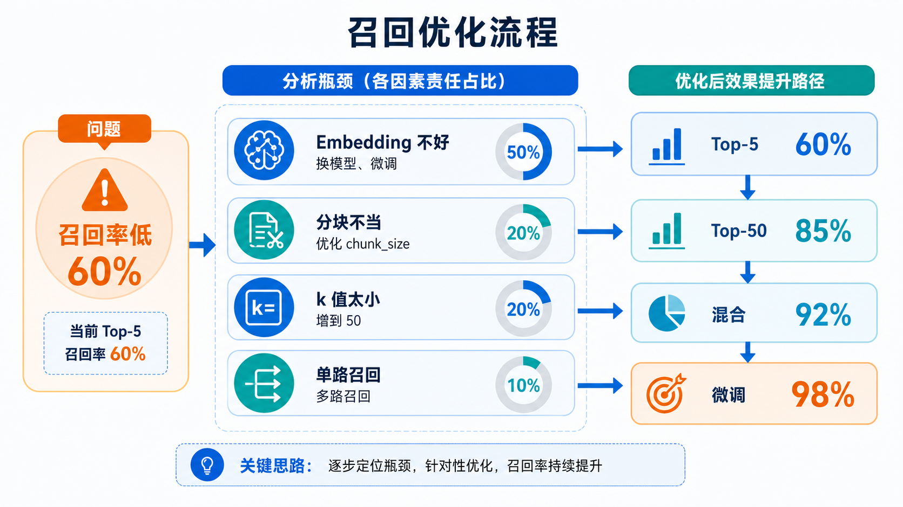

## 知识点讲解



### 1. 核心概念

召回率（Recall）在 RAG 里的定义：所有应该被找到的相关文档里，系统实际找到了多少。召回率低意味着 LLM 在生成时缺少关键信息，这是比精确率低更严重的问题——你找不到的东西，再好的模型也没法回答。

**召回率 vs 精确率**：两个指标天然有张力。召回率高意味着"网撒得宽"，但宽网会捞起更多不相关的；精确率高意味着"选的准"，但选得太严可能漏掉真正有用的。召回率是基础，先保证"能找到"，再用 Reranker 做精排。

召回率丢失的常见原因：

| 原因 | 表现 |
| --- | --- |
| Embedding 模型语义理解弱 | 语义相关但用词不同的内容找不到 |
| 分块太细 | 一个完整概念被分割，单块匹配分低 |
| top-K 太小 | 相关文档排在第 6、7 位，但 top-5 截断了 |
| 只用向量搜索 | 精确关键词场景（专有名词、代码）向量搜索效果差 |
| ANN 索引本身的精度损失 | 近似搜索有概率错过真正最近的邻居 |

### 2. 技术细节

#### 2.1 召回率优化的五条路

按投入产出排序：

**① 增大 top-K**：成本最低，直接从 top-5 调到 top-20 或 top-50。召回率通常能提升 20-40%，代价是后续 Reranker 要处理更多候选。

**② 混合检索（Hybrid Search）**：向量搜索 + BM25/关键词搜索两路并行，结果用 RRF 融合。向量搜索捕捉语义相关，BM25 捕捉精确关键词匹配，两者互补。这是目前最稳的召回率提升方案。

**③ 查询改写和扩展**：用 LLM 生成多个角度的查询变体，分别检索再合并去重。"神经网络"可能在文档里叫"人工神经元""深度网络"——一次查询不一定能覆盖所有表述方式。

**④ 多表示 Embedding（Multi-vector）**：同一文档生成多个向量（原文 + 摘要 + 关键词），任何一个命中都能召回该文档。覆盖面更宽，存储成本也更高。

**⑤ 领域微调 Embedding 模型**：当通用模型对领域词汇理解不好时（医疗、法律、金融），微调让模型理解领域语义，召回质量的提升是根本性的，但成本最高。

#### 2.2 RRF（Reciprocal Rank Fusion）合并策略

两路检索各自返回排好序的结果，用 RRF 合并：

```
score(doc) = Σ 1 / (k + rank_in_each_list)
```

其中 k 通常取 60，rank 是文档在某一路结果中的排名。文档在两路里都排前面，合并分就高；只在一路里出现，分数打折。最后按合并分排序取 top-N。

## 代码示例

**混合检索 + RRF 融合**

```python
from rank_bm25 import BM25Okapi
import numpy as np
from typing import Any

class HybridRetriever:
    def __init__(self, corpus: list[dict], embed_fn, vector_search_fn, k_rrf: int = 60):
        """
        corpus: [{"id": ..., "text": ...}, ...]
        embed_fn: text -> embedding
        vector_search_fn: (embedding, top_k) -> [{"id": ..., "score": ...}]
        """
        self.corpus = {doc["id"]: doc for doc in corpus}
        self.embed = embed_fn
        self.vector_search = vector_search_fn
        self.k_rrf = k_rrf

        # 构建 BM25 索引
        tokenized = [doc["text"].split() for doc in corpus]
        self.bm25 = BM25Okapi(tokenized)
        self.corpus_ids = [doc["id"] for doc in corpus]

    def search(self, query: str, top_k: int = 5, candidate_k: int = 50) -> list[dict]:
        """混合检索：向量 + BM25，RRF 融合"""
        # 向量检索
        query_emb = self.embed(query)
        vector_results = self.vector_search(query_emb, candidate_k)
        vector_ranking = {r["id"]: rank for rank, r in enumerate(vector_results)}

        # BM25 检索
        bm25_scores = self.bm25.get_scores(query.split())
        bm25_top_indices = np.argsort(bm25_scores)[::-1][:candidate_k]
        bm25_ranking = {self.corpus_ids[i]: rank for rank, i in enumerate(bm25_top_indices)}

        # RRF 融合
        all_ids = set(vector_ranking) | set(bm25_ranking)
        rrf_scores = {}
        for doc_id in all_ids:
            v_rank = vector_ranking.get(doc_id, candidate_k)  # 未出现的用最差排名
            b_rank = bm25_ranking.get(doc_id, candidate_k)
            rrf_scores[doc_id] = 1 / (self.k_rrf + v_rank) + 1 / (self.k_rrf + b_rank)

        # 按 RRF 分排序
        sorted_ids = sorted(rrf_scores, key=rrf_scores.get, reverse=True)
        return [self.corpus[doc_id] for doc_id in sorted_ids[:top_k] if doc_id in self.corpus]
```

**查询改写（多角度扩展）**

```python
def expand_query(query: str, llm, n_variants: int = 3) -> list[str]:
    """用 LLM 生成多个查询变体，覆盖不同表述"""
    prompt = f"""为以下问题生成 {n_variants} 个不同角度的变体查询，用不同的表述方式覆盖原问题的语义。
只输出变体，每行一个，不要编号。

原问题：{query}"""
    variants_text = llm.call(prompt)
    variants = [v.strip() for v in variants_text.strip().split("\n") if v.strip()]
    return [query] + variants[:n_variants]  # 原问题 + 变体

def multi_query_retrieve(query: str, retriever, llm, top_k: int = 5) -> list[dict]:
    """多查询检索，合并去重"""
    queries = expand_query(query, llm, n_variants=3)
    seen_ids = set()
    results = []

    for q in queries:
        for doc in retriever.search(q, top_k=top_k):
            if doc["id"] not in seen_ids:
                seen_ids.add(doc["id"])
                results.append(doc)

    # 按出现频率排序（多个查询都命中的文档更相关）
    from collections import Counter
    id_counts = Counter(
        doc["id"]
        for q in queries
        for doc in retriever.search(q, top_k=top_k)
    )
    results.sort(key=lambda d: id_counts[d["id"]], reverse=True)
    return results[:top_k * 2]  # 返回更多候选，后面 Reranker 精选
```

**父子分块检索（检索精准 + 返回上下文完整）**

```python
class ParentChildRetriever:
    def __init__(self, parent_store: dict, child_index, embed_fn):
        """
        parent_store: {parent_id: parent_text}
        child_index: 子块的向量索引（只检索小块）
        """
        self.parents = parent_store
        self.child_index = child_index
        self.embed = embed_fn

    def retrieve(self, query: str, top_k: int = 5) -> list[dict]:
        query_emb = self.embed(query)

        # 检索子块（精准）
        child_results = self.child_index.search(query_emb, top_k=top_k * 3)

        # 去重：同一父块只保留一次（取最高分的子块）
        parent_hits: dict[str, float] = {}
        for child in child_results:
            pid = child["parent_id"]
            if pid not in parent_hits or child["score"] > parent_hits[pid]:
                parent_hits[pid] = child["score"]

        # 返回父块（上下文完整）
        sorted_pids = sorted(parent_hits, key=parent_hits.get, reverse=True)
        return [
            {"id": pid, "text": self.parents[pid], "score": parent_hits[pid]}
            for pid in sorted_pids[:top_k]
        ]
```

## 面试怎么答

召回率优化的本质是"让检索网撒得更准更宽"。几条路按性价比排：最快的是直接调大 top-K，代价低、召回率立竿见影；其次是混合检索，向量搜索捕捉语义、BM25 捕捉精确关键词，结果用 RRF 融合，两者互补效果明显；查询改写让 LLM 生成多个查询变体，覆盖不同表述方式；更根本的是换更好的 embedding 模型，特别是领域专用的。

父子分块是个实用的进阶方案：小块用于精确检索（定位到正确段落），命中后返回对应的大块给 LLM（保留完整上下文）——精准找到、完整使用，兼顾了召回精度和生成质量。

召回率和精确率存在张力：网撒宽了召回率高但噪声也多。所以完整的链路是先用多路召回保证召回率，再用 Reranker 做精排保证精确率，两步分开处理。

## 高频追问 & 加分点

- **Q1：召回率和精确率怎么平衡？**  
    标准答案是"粗检索 + Reranker 精排"：粗检索 top-50 保证召回，Reranker 从 50 个里选 top-5 保证精确。召回和精确不在同一步解决，分开才都能做好。
- **Q2：向量 ANN 搜索本身会丢失召回，怎么办？**  
    调高 HNSW 的 `ef_search` 参数，让搜索范围更宽；或者用精确搜索（Flat Index）。但代价是速度变慢。生产里的平衡点：把 Recall@K 相对精确搜索维持在 98% 以上，低于这个再调参数。
- **Q3：查询改写会不会跑偏？**  
    会。LLM 生成的变体可能意思偏移，带来不相关的结果。缓解方法：在 prompt 里明确要求"不改变核心意图，只换表述方式"；变体生成数量控制在 2-3 个；变体检索的结果占比不要超过原查询结果。
- **Q4：混合检索的 RRF k 参数怎么设？**  
    k=60 是文献推荐的通用值，在大多数场景里效果稳定。k 越大，高排名位置的权重差异越小（趋向均匀分布）；k 越小，第一名的权重远高于后面。可以在评估集上调，但 60 是个好的起点，没必要过度优化这个参数。
- **Q5：多路召回的结果去重怎么做？**  
    用文档 ID 去重最直接。如果没有唯一 ID，可以用文本哈希（sha256 of text[:200]）作为去重 key。父子分块场景下，用 parent_id 去重（同一个父块的多个子块命中时，只保留分数最高的那个，返回父块）。
